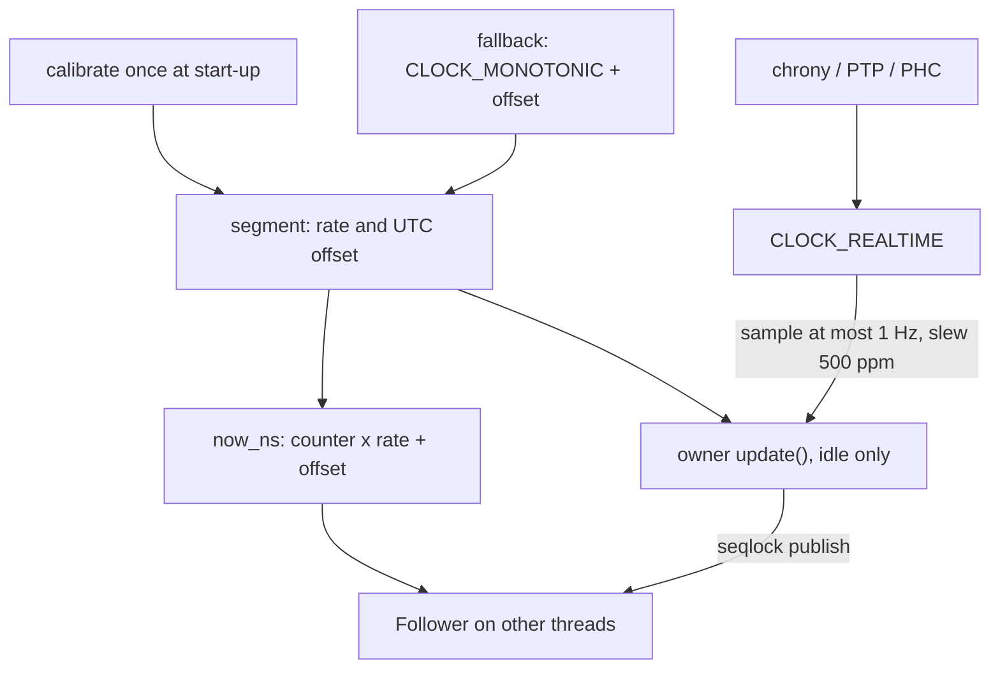

# UTC and Time Sync

`now_ns` is UTC by default. This page says how `update` keeps it on UTC,
how close it stays, and how to set up the host's time sync, which it
follows. It can be no closer to UTC than the host's own clock.

## How `update` keeps UTC

- **One owner**, the thread holding the `Clock`, calls `update`. Once a
  second it samples the wall clock (the tightest of up to 8 brackets — each
  bracket is an ordered read, a `CLOCK_REALTIME` read, an ordered read, and
  its width bounds the error) and re-anchors the clock to follow it.
- **Run the owner on a thread that never idles.** On c7i an update costs
  more than on Graviton and the cause is **untraced**: the measurement
  harness busy-waits between updates (`clock/bench/src/discipline.rs`), so
  no update in those runs ran on a core back from idle. On Graviton the
  slowest is the start update.
- **Rate cap:** ±500 ppm, NTP's and Linux's own limit.
- **The owner never goes back:** a clock behind the wall clock runs
  faster until it catches up; one ahead runs slower. It only slews, so its
  own reads never go back.
- **Bad samples:** a sample taken across an interrupt (too wide a bracket)
  is rejected, and the clock keeps its rate.
- **Followers:** the owner publishes each update through a seqlock (a
  lock-free publish; readers never wait). A follower's read costs what the
  owner's does and sees one consistent published set at a time — but it
  **can go back by about 1 ns at an update**, and by more while the clock
  slews at the cap and the thread loses milliseconds between its check and
  its read. Take durations with `since_ns` / `elapsed_ns` (they stop at
  zero), not by subtracting two raw stamps.
- **The fallback** is kept the same way: `CLOCK_MONOTONIC` plus a
  disciplined offset, never the raw `CLOCK_REALTIME`.

Calibrate once; the hot read never waits on discipline:



The hot read is one counter instruction and one multiply. Discipline
touches the segment between reads, never the read itself.

### Measured

Residuals track chrony's own frequency changes, not an ergon-clock error.
Updates cost more on c7i than on Graviton and the cause is untraced; the
harness busy-waits between updates, so this is not an idle-exit effect.
The clock is never closer to UTC than the host's own bound from chrony. One copy of
every figure, with maxima:
[`clock/BENCHMARKS.md`](https://github.com/mimran1980/ergon/blob/main/clock/BENCHMARKS.md#disciplined-residual-to-clock_realtime-ns).

## How the host keeps the wall clock

`calibrate` reports it, as far as the process can see
(`report.time_sync`), and warns at start-up when it is not synchronised or
not settled ([warnings](overview.md#start-up-warnings)):

| verdict | meaning |
|---|---|
| `PtpGrade` | chronyd locked to a PTP hardware clock, or phc2sys with the kernel synchronised |
| `NtpDisciplined` | chronyd or ntpd to an NTP server, or systemd-timesyncd; with its error bound where known |
| `Unsynchronised` | nothing keeps it; no error bound |
| `Unknown` | not Linux, or the answer cannot be read (daemon in another namespace, `/proc` with `hidepid`) |

`advanced::TimeSyncPolicy::RequirePtp` fails calibration unless PTP-grade;
`Off` skips the probe. `cargo run -p ergon-clock --example timesync` prints
this host's verdict; `report.recheck_findings()` re-runs it from an
idle-timer callback.

## Set up time sync

- **AWS:** chrony on the Amazon Time Sync Service. Not systemd-timesyncd:
  it keeps no error bound, and its slews after boot ran 820.252 ppm over a
  1 s window, falling to 533.462 ppm over 120 s (`CLOCK_MONOTONIC` vs
  `CLOCK_MONOTONIC_RAW`; run `aws-20261016-084001`, node b).

  ```text
  server 169.254.169.123 prefer iburst minpoll 4 maxpoll 4
  makestep 0.0001 3
  ```

  For PTP-grade time: an instance type with a PTP hardware clock (EC2
  `PhcSupport`), the ENA PTP clock enabled (in-tree ENA from Linux 6.17:
  devlink `enable_phc`; Amazon's driver: `phc_enable=1`), then:

  ```text
  refclock PHC /dev/ptp_ena poll 0 delay 0.000010 prefer
  server 169.254.169.123 iburst minpoll 4 maxpoll 4
  makestep 0.0001 3
  ```

  The service smears leap seconds: remove any `leapseclist` or `leapsectz`
  line.
- **Azure:** chrony on the Hyper-V PTP clock:
  `refclock PHC /dev/ptp_hyperv poll 3 dpoll -2 offset 0`.
- **x86 and Graviton** set up the same way.

## Since-boot clocks

A `Domain::Monotonic` clock, such as the
[DPDK transport's](../md-dpdk/overview.md), converts its stamps to and from
wall-clock time with `advanced::WallOffset::measure(&clock)`: `CLOCK_REALTIME`
less the clock, with its error bound. It drifts with the hardware's rate:
remeasure it from an idle-timer callback.
