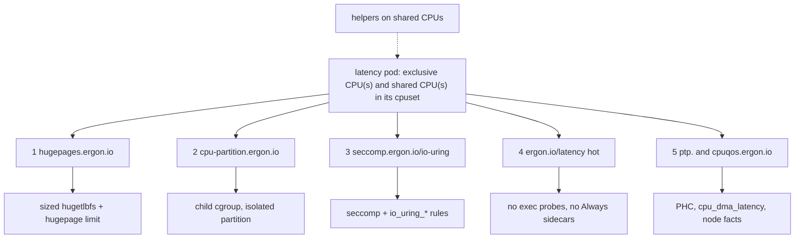

# Latency Pods

Five things a normal Kubernetes pod cannot do, and what to use instead.
They live in `k8s/nri-latency-pods` (node setup and the admission policy) and
`k8s/nri-shared-cpus` (the NRI plugin). This page is the contract.

**In short:** five opt-in grants: a sized hugetlbfs for Aeron's directory,
an isolated cpuset partition, an io_uring seccomp profile, an admission
policy against exec probes and sidecars, and device grants (the NIC's PHC).
Each is a mechanism; none has a measured latency effect. `SCHED_FIFO` is
built in the shared-cpus plugin and off by default
([evidence: mixed](hft.md#sched_fifo)).

Status: the grants ship in the public image
`ghcr.io/mimran1980/ergon-shared-cpus:0.1.2`. Install it with the chart
`oci://ghcr.io/mimran1980/charts/ergon-shared-cpus` version `0.1.2`
([Shared CPUs](shared-cpus.md#use-the-public-chart)). On EKS AL2023 a pod
labelled `ergon.io/latency: hot` needs `kubeletConfigDir`, which lets the
plugin read nodeadm's kubelet drop-in; the EKS install line is on that page. This page's admission
YAML and node units are not an image. The chart writes `seccomp.ioUring`
and `ptp` as `"off"`.
`k8s/nri-shared-cpus/examples/try` installs that chart and shows three
things on kind: the shared-CPU grant on an unlabelled pod, the plugin
refusing a hot pod (a kind node has no `isolcpus`), and this page's
admission policy denying an exec probe. Not yet run on kind. It does not
exercise hugepages, the cpuset partition, io_uring seccomp, or the PHC. The
five-grant kind e2e (`test/e2e.sh`) builds the plugin from source. On EKS the plugin's install is verified
([Shared CPUs](shared-cpus.md#limits-and-what-is-not-verified)); the grants' latency modes have not run there. No latency figure is measured.

## The five

Every grant is opt-in by pod annotation. A grant that cannot be given is
refused: the kubelet shows the text in the pod's events as
`CreateContainerError`, and the text names the fix. A pod author names
kinds and modes only; values come from the plugin config or the node's
facts.

| # | extension | mechanism | pod opt-in | env the app sees |
|---|---|---|---|---|
| 1 | sized hugetlbfs for `AERON_DIR` | NRI `AddMount` `type: hugetlbfs` with `pagesize=2M,size=N`, plus `AddLinuxHugepageLimit`; N is the container's `hugepages-2Mi` limit | `hugepages.ergon.io/<ctr>: "2M"` and a `hugepages-2Mi` resource (requests = limits) | `ERGON_HUGEPAGES_DIR`, `ERGON_HUGEPAGE_SIZE`, `AERON_FILE_PAGE_SIZE=2097152`, `AERON_TERM_BUFFER_SPARSE_FILE=false` |
| 2 | `cpuset.cpus.partition=isolated` on the exclusive CPUs | a `createRuntime` hook makes a threaded **child** cgroup holding only those CPUs, unions them into the ancestors' `cpuset.cpus.exclusive`, then writes `cpuset.cpus.partition=isolated`, and reads every write back. Takes a process, then single threads (see below) | `cpu-partition.ergon.io/<ctr>: "isolated"` | `ERGON_ISOLATED_CGROUP`, `ERGON_ISOLATED_CPUS`, `ERGON_SHARED_CPUS` |
| 3 | io_uring seccomp profile | (a) NRI `SetLinuxSeccompPolicy`: the request's profile plus the `io_uring_*` allow rules; (b) fallback, pod field `seccompProfile: Localhost` | `seccomp.ergon.io/<ctr>: "io-uring"` (or the Localhost fallback) | `ERGON_SECCOMP` |
| 4 | no exec probes, no always-restart sidecars | `ValidatingAdmissionPolicy` (CEL, GA 1.30) | pod label `ergon.io/latency: "hot"` | — |
| 5 | device grants | NRI `AddDevice`, plus a read-only bind of the node facts file | `ptp.ergon.io/<ctr>: "auto"` (the NIC PHC); `cpuqos.ergon.io/<ctr>` (`/dev/cpu_dma_latency`, x86 only) | `ERGON_PTP_DEVICE`, `ERGON_NODE_FACTS`, `ERGON_CPU_DMA_LATENCY` |

Ride-along: `rlimits.ergon.io/<ctr>` grants `MEMLOCK`, `NOFILE` and
`RTPRIO` (a limit value only — see below). The values are ceilings the
pod may ask for, set in the plugin config.

Also `numa.ergon.io/<ctr>`: `"0"`, `"0,1"` or `""` binds the container's
memory to those NUMA nodes (`cpuset.mems` and `MPOL_BIND`). `""` means the
data NIC's node, which needs that node recorded; on a one-node machine the
only node is the answer. A request the node cannot answer is refused and
says why — an unread topology, a node the machine does not have, or `""`
with several nodes and no NIC node. A binding is never dropped in silence.

The five grants on one pod. Everything stays inside the pod's own cpuset:
exclusive CPUs from the kubelet's static CPU manager, shared CPUs from
`ergon.io/shared-millicpus`. Helpers go on the shared CPUs; SQPOLL takes an
exclusive CPU of the pod's own ([SMT sibling](hft.md#smt-sibling)). On the
shared CPU it measured p99 10 ms once that CPU was busy
([SQPOLL placement](shared-cpus.md#sqpoll-placement)).

### 1. The app owns `AERON_DIR`

The plugin mounts a **sized** hugetlbfs at `/dev/hugepages` and exports
`ERGON_HUGEPAGES_DIR`, `ERGON_HUGEPAGE_SIZE`, `AERON_FILE_PAGE_SIZE=2097152`
and `AERON_TERM_BUFFER_SPARSE_FILE=false`. It does **not** set
`AERON_DIR`. The app creates `$ERGON_HUGEPAGES_DIR/aeron` and points
`AERON_DIR` there.

Why: an unsized hugetlbfs is what an emptyDir `medium: HugePages` gives
you, and Aeron refuses it. A 4 KiB `AERON_DIR` takes a page fault on each
first touch of a page. Latency effect not measured here.

### 2. Isolated partition

`cpuset.cpus.partition=isolated` makes the kernel treat the set as
isolated: no load balancing into it
([cgroup-v2](https://docs.kernel.org/admin-guide/cgroup-v2.html)). The
grant is applied to a **child** cgroup so the pod's own cgroup keeps its
shared CPUs. Latency effect not measured here.

**The child is threaded**, and a threaded child is a legal partition root
(`k8s/nri-shared-cpus/internal/cpuset/partition.go`). So:

| app shape | how the exclusive CPUs are used |
|---|---|
| one process whose threads all belong on the exclusive CPUs | write the pid to `$ERGON_ISOLATED_CGROUP/cgroup.procs`, then pin each thread to `ERGON_ISOLATED_CPUS` |
| hot threads in a multi-threaded process | write the pid to `$ERGON_ISOLATED_CGROUP/cgroup.procs` first, then move each helper thread back to the container cgroup through its `cgroup.threads`. The kernel confines the hot threads to the exclusive CPUs and the helpers to the shared ones (kernel lane: `test/cgroup/kernel_test.go`, `TestOneThreadCanLiveInThePartition`) |

These writes need a writable cgroup mount. containerd mounts
`/sys/fs/cgroup` read-only in an unprivileged container, so there the
`cgroup.procs` write fails and the move has to come from the node. The EKS
lab does that (`md-dpdk/benches/cloud/aws/eks-nri.sh`,
`partition_move_script`): the pod publishes its pid and waits; a privileged
node agent moves it only if exactly one task of that container's cgroup has
that pid. The kind e2e lane also moves from the node.

A program that does not make these moves itself, such as Aeron's C media
driver, keeps the boot line's isolation and `sched_setaffinity`: see the
[worked example](shared-cpus.md#worked-example-an-aeron-media-driver).

`cpuset.cpus.exclusive` is a **replace**, not a union, so every directory
the new partition shares with an already-running pod has to be updated
with the union of both reservations. The hook does that under a lock and
reads every write back; a write that does not stick fails the create.

### 3. io_uring

`RuntimeDefault` blocks io_uring (containerd issue 9320). Aeron's C media
driver does **not** use io_uring; the grant is for applications that do,
such as ergon-io's `uring-sqpoll` backend. It is a clone
of the pod's own seccomp profile with the `io_uring_*` calls allowed —
never `Unconfined`, which the plugin refuses.

### 4. Admission

An exec probe starts a process inside the container on any CPU of its
cpuset, the loop's exclusive CPU included
(`k8s/nri-shared-cpus/README.md`, Limits). A container with
`restartPolicy: Always` is an injected sidecar: it shares the pod's CPU
budget and can run on the hot core.

The policy refuses both on pods labelled `ergon.io/latency: "hot"`. It
also requires a `priorityClassName` (eviction and preemption stop a hot
pod mid-trade), the `ergon.io/shared-millicpus` resource, and the
`required-plugins.noderesource.dev` annotation naming the plugin.

`httpGet`, `tcpSocket` and `grpc` readiness probes are fine: they run
from outside the container.

### 5. Devices

The NIC's PHC (`/dev/ptp*`) for clock work, and on x86
`/dev/cpu_dma_latency` so a pod can cap C-states. The cap's measured effect
is mixed ([C-states](hft.md#c-states)), and a spinning core never idles, so
treat the grant as access, not a latency win. On arm64 the plugin ignores
the `cpuqos` annotation (`k8s/nri-latency-pods/README.md`, item 5).

## Real-time scheduling: built, default off

`SCHED_FIFO` is **not** part of the five grants. It is in
`k8s/nri-shared-cpus`, off unless a node turns it on:

| path | what it does | default |
|---|---|---|
| `ergon-cpus --fifo <prio>` | the exec wrapper takes `SCHED_FIFO` on the thread before it execs the command | off (no flag) |
| `sched-fifo.ergon.io/<container>: "thread"` | the NRI plugin grants `RLIMIT_RTPRIO` and `ERGON_SCHED_FIFO`; the app or `prelock` takes the policy on the hot thread only | `schedFifo: "off"` — the node refuses the annotation |

Why it is off: its one committed A/B is mixed, and under it the loop's
`nohz_full` CPU took timer interrupts again ([SCHED_FIFO](hft.md#sched_fifo)). RT throttling
(`kernel.sched_rt_runtime_us`, 950,000 of 1,000,000 µs by default,
[sched-rt-group](https://docs.kernel.org/scheduler/sched-rt-group.html)) can
take the CPU away. `ergon-tune` T7 warns on a real-time policy.

## Deliberately not built

| item | why |
|---|---|
| SR-IOV VF per pod | Nitro guests have one ENA per ENI; there are no in-guest VFs |
| a netns-sysctl writer pretending the knobs are per-netns | `busy_poll`/`busy_read` are global; `gro_flush_timeout` and `napi_defer_hard_irqs` are per-netdev sysfs; `rmem_max` is not writable in a non-init netns. The node sets them (`node-checks.md`) |
| an IRQ DaemonSet that pins the latency pod's NIC IRQs to the **shared** CPUs | IRQs on a CPU that also runs other work are not measured here; IRQs on a core of their own are ([interrupt placement](hft.md#interrupt-placement)). The kept-CPU default stays |

`RTPRIO` is granted as a **limit only** on the latency-pods path. That
plugin never changes a scheduler policy, and the e2e asserts PID 1 stays
`SCHED_OTHER` and `ERGON_SCHED_FIFO` is empty.

## Node setup

The full check list is `k8s/nri-latency-pods/node-checks.md`. The short version:

| setting | value |
|---|---|
| Kubernetes | >= 1.33 (the labs ran 1.36) |
| kubelet | `cpuManagerPolicy: static`; `reservedSystemCPUs` = the IRQ CPU(s) plus the shared CPUs; x86 `full-pcpus-only` |
| `strict-cpu-reservation` | **off** (on, it empties the shared pool) |
| kernel | >= 6.7, cgroup v2 (`cpuset.cpus.exclusive` is what the partition writes, and it is 6.7; a vendor backport of that file also works — the plugin reads the file, not the version). Also `nohz_full`, `rcu_nocbs`, `isolcpus=managed_irq` on the exclusive CPUs, never the shared ones. 6.2 is enough for the shared CPUs only |
| `transparent_hugepage` | `never` |
| fair server | `runtime` 0 on each isolated CPU at every boot, kernel 6.12+ ([shared CPUs](shared-cpus.md#quiet-isolated-cpus)). Not with the `SCHED_FIFO` opt-in: nothing real-time may run there |
| `net.core.rmem_max` / `wmem_max` | at least Aeron's `AERON_SOCKET_SO_RCVBUF` / `SNDBUF` when raised ([hft](hft.md#settings)) |
| `net.core.busy_poll` / `busy_read` | unset (global; not measured here). ergon-io busy-polls per socket |
| containerd | >= 2.2, NRI on, the default validator on |

**Why not AKS:** it has no supported way to change containerd (so an NRI
plugin cannot be installed) and no `reservedSystemCPUs` list. Everything
here needs one of those. The target is EKS on AL2023.

## The two labels

They are different on purpose.

| label | where | what reads it |
|---|---|---|
| pod `ergon.io/latency: "hot"` | every latency pod | the **validating** policy (extension 4) |
| namespace `ergon.io/latency: "true"` | the latency namespace | the **mutating** policy (it reads `namespaceObject`) |

## Related

- [Shared CPUs for Helper Threads](shared-cpus.md) — the plugin that grants the shared housekeeping CPUs
- [Kubernetes](kubernetes.md) — deployment
- [Kubernetes HFT tuning](hft.md) — every setting and its evidence
