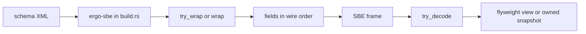

# Introduction

ergon is a set of Rust crates you can use on their own. `ergo-sbe` generates
[Simple Binary Encoding](https://www.fixtrading.org/standards/sbe/) codecs.
`ergo-aeron-cluster` is an experimental Aeron Cluster client. `ergon-tune`
reads a host and names the settings that will wreck a tail latency. The
Kubernetes pieces give a pod exclusive CPUs and a latency-pod policy. You do
not need a cluster to generate a codec, and you do not need the other crates
to use one of them.

0.x alpha: any release may break the API, with no deprecation period. Pin
exact versions and read the changelog before upgrading. Exit criteria:
[Road to 1.0](project/road-to-1.0.md).

## Light path

This page is the light path. It is enough to see what the software is, which
crate to open, and where to go next. The route below stops at an overview.
The [detail chapters](#detail-chapters) stay separate and are linked by name;
they are not folded into this page.

1. **Write one message.** [Depend on the generator](sbe/getting-started/depend.md),
   then [encode and decode](sbe/getting-started/encode-decode.md). The
   [feature tour](sbe/feature-tour.md) is the worked overview. The sketch
   further down this page is the same API.
2. **Open a cluster client, only if you need one.** Read the
   [client overview](cluster/overview.md) and stop there until you are
   building a session. The client is experimental.
3. **Check a latency host.** [Host checks](tune/overview.md) name what is
   wrong. The call changes nothing.
4. **Kubernetes, only if you deploy there.** Three separate chapters, not
   one merged guide: [shared CPUs](deploy/shared-cpus.md),
   [latency pods](deploy/latency-pods.md), and the
   [Kubernetes quickstart](samples/k8s-quickstart.md).



A message written out of tail order is a compile error. Checked constructors
return `Result`; the three constructor tiers are specified in one place,
[Trust boundary](sbe/core-concepts/trust-boundary.md). Size the buffer with
the generated length API before you write; the rule table is
[Buffer sizing](sbe/core-concepts/buffer-sizing.md).

## Crates

| Crate | What it does | When to use it |
|---|---|---|
| `ergo-sbe` | Generates Rust SBE codecs from schema XML. Wire layout matches official SBE for the [published profile](https://github.com/mimran1980/ergon/blob/main/docs/SBE_COMPATIBILITY.md). Generated codecs embed `sbe_rt`, so the generator is not on the hot path. | You have an SBE schema and want encode and decode in Rust. `ergo_sbe::generate(source, config)?.write_to_out_dir()?` in `build.rs`, then `include!` or `ergo_sbe::sbe_mod!(name)` ([Depend](sbe/getting-started/depend.md)). |
| `ergon-tune` | Reads the host and names what will wreck a tail latency, and the fix. | At start-up on a latency host. It changes nothing ([Host checks](tune/overview.md)). |
| `ergo-aeron-cluster` | An Aeron Cluster client. | You need a cluster client. Experimental, not a production substitute ([overview](cluster/overview.md)). |

| Piece | What it does | When to use it |
|---|---|---|
| `k8s/nri-shared-cpus` | Gives a pod its exclusive CPUs and the node's shared housekeeping CPUs, and starts every thread on the shared ones so the busy-spin loop keeps its core. | A pod that spins on exclusive CPUs. Chart `oci://ghcr.io/mimran1980/charts/ergon-shared-cpus` version `0.1.3`, image `ghcr.io/mimran1980/ergon-shared-cpus:0.1.3`. Prepare the node first ([chapter](deploy/shared-cpus.md)). |
| `k8s/nri-latency-pods` | Node tuning and the hot-pod admission policy: no exec probes, no always-restart sidecars. The grants live in the shared-cpus image. | After the chart. Apply the admission YAML, then label hot pods `ergon.io/latency: hot` ([chapter](deploy/latency-pods.md)). |

Start with `ergo-sbe`. Add another row only for a need you have.

## Flyweight or an owned snapshot

| You have | Use | Cost |
|---|---|---|
| A few fields, and the work finishes while the frame is borrowed | The flyweight decoder (`price()`, and so on) | No whole-message copy |
| A value that must outlive the buffer | The owned `*Domain` snapshot from `with_domain_objects` | Allocates. Tooling and logs, not a hot path |

The full comparison, including `*FixedFields` and the `*Source` trait, is
[Flyweight vs whole struct](sbe/core-concepts/flyweight-vs-struct.md).
Mapping a wire field to an application type (`with_conversion` or
`with_domain_type`) is a different switch:
[with_conversion vs with_domain_type](sbe/configuration/conversion-vs-domain.md).

## Detail chapters

Read these when the light path is not enough. Each topic is written in full
on the page named here.

| Topic | Chapter |
|---|---|
| Constructor tiers, acting block length, and group tails | [Trust boundary](sbe/core-concepts/trust-boundary.md) |
| `compute_length_with_header` and `*EncodedLength` | [Buffer sizing](sbe/core-concepts/buffer-sizing.md) |
| Borrowed view versus owned snapshot | [Flyweight vs whole struct](sbe/core-concepts/flyweight-vs-struct.md) |
| `with_conversion` versus `with_domain_type` | [with_conversion vs with_domain_type](sbe/configuration/conversion-vs-domain.md) |
| Wire order as named stages | [Wire order](sbe/core-concepts/wire-order-stages.md) |
| Cluster session, egress, chained decode, compatibility | [SessionBuilder](cluster/session-builder.md), [egress](cluster/egress-listeners.md), [chained decoding](cluster/chained-decoding.md), [compatibility](cluster/compatibility.md) |
| Node tuning, clocks, shared CPUs, latency pods | [HFT tuning](deploy/hft.md), [clocks](deploy/clocks.md), [shared CPUs](deploy/shared-cpus.md), [latency pods](deploy/latency-pods.md). These stay separate chapters. |

## Use the animations

The diagrams in the detail chapters show work and ownership step by step.
Use **Next** to inspect one transition, **Back** to compare it with the
previous state, or **Play** for the whole sequence, or drag the timeline
directly to a step. With focus inside a diagram, arrow keys step and Space
plays or pauses. Reduced-motion preferences turn movement off; the controls
still work. Each diagram has captions and an accompanying text explanation,
so its lesson also works without animation or JavaScript. Schematic widths
and illustrative byte counts are labelled; movement is not a timing
measurement.

## A first encode

```toml
[build-dependencies]
ergo-sbe = "0.1"

[dependencies]
ergo-sbe = "0.1"   # only for sbe_mod! / include_sbe!
```

```rust,no_run
{{#include ../examples/heartbeat-encode.rs:staged_chaining}}
```

*(From `book/examples/heartbeat-encode.rs`, compiled against the feature-tour codec.)*

**[Set up →](sbe/getting-started/depend.md)** ·
**[Feature tour →](sbe/feature-tour.md)** ·
**[Coming from sbe-tool →](sbe/getting-started/from-sbe-tool.md)**

Nested groups use scoped closures, so you do not hand encoder ownership back
with `.parent()`:

```rust,no_run
{{#include ../../samples/sbe-feature-tour/src/lib.rs:encode_sample_car}}
```
*(Compiled and run in CI.)*

It is not a line-for-line port of sbe-tool. The generated API is meant to be
easier under Rust's borrow checker, safer at untrusted boundaries, and still
official-SBE on the wire for the shapes under test. Wire parity is tested by
the dual-encode suite (`sbe_tool_wire_parity_test`,
`sbe_tool_multi_schema_wire_parity_test`). The benchmarks also assert byte
parity before timing: [Benchmarks](sbe/benchmarks.md). Encode and decode of
the generated codecs do not allocate on the hot path
([allocation_count_test](https://github.com/mimran1980/ergon/blob/main/sbe/tests/allocation_count_test.rs)).

Hosts and Kubernetes: [Deployment](deploy/overview.md). Which clock to read:
[Clocks](deploy/clocks.md).

Rust 1.99+. Clone setup and checks:
[repository README](https://github.com/mimran1980/ergon/blob/main/README.md).
