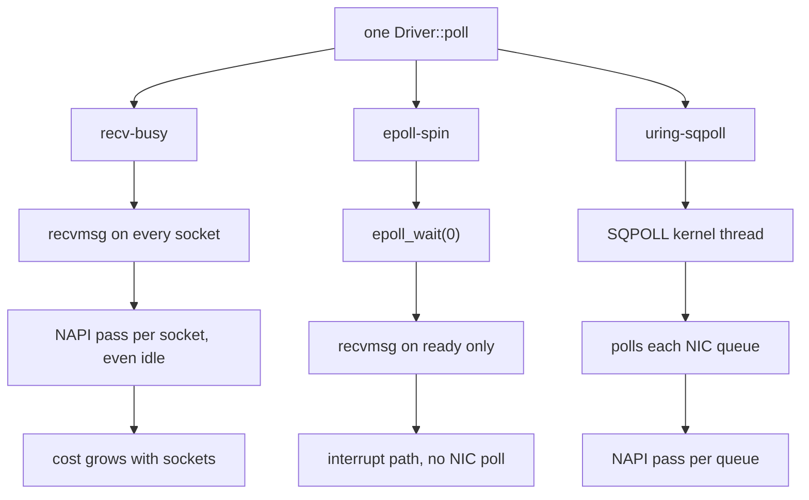

# Backends and Configuration

A backend is the kernel interface the `Driver` waits and reads with. It is
configuration, so one binary can run with each. Which to pick:
[Choosing a backend](overview.md#choosing-a-backend).

| backend | how it waits | polls the NIC | extra core |
|---|---|---|---|
| `epoll-spin` | `epoll_wait(0)` every poll, then one `recvmsg` per ready socket: [mio's mechanism](#mio-measured-not-a-backend) | no (interrupts); with `busy_poll_us`, once per socket after each receive | no |
| `recv-busy` | non-blocking `recvmsg` on every socket every poll, with `SO_BUSY_POLL` (with `per_queue`: one read per NIC queue, then the sockets epoll reports ready) | yes, one pass per socket (or queue) per poll | no |
| `uring-sqpoll` | an `SQPOLL` kernel thread submits, completes and polls the NIC | yes, on the kernel thread | yes |
| `fstack-spin` | no kernel: one [F-Stack](#fstack-spin-tcp-on-f-stack) pass every poll, then its kqueue | yes, F-Stack's DPDK queue | no (a NIC of its own) |

- **None sleeps in the kernel.** The first three are the kernel backends
  the busy-spin benchmarks measured. `fstack-spin` and `smoltcp-spin` ran
  on AWS; the ranking uses the cells whose echo was pinned
  ([transport comparison](../transports/comparison.md#ergon-io-kernel-smoltcp-and-f-stack)).
- **Among `epoll-spin`, `recv-busy` and `uring-sqpoll`, UDP (`UdpConn`) runs on `epoll-spin` only.** The other two refuse a UDP
  driver at `Driver::new` (`Error::Unsupported`); framed TCP and the TLS
  endpoints run on all three ([UDP](udp.md)). `smoltcp-spin` also carries UDP.

- **`epoll-spin` is [mio's mechanism](#mio-measured-not-a-backend), and so tokio's.**
  `epoll_wait(0)` never blocks, but never polls the NIC either.
- **Plain `recv-busy` reads every socket on every poll**, so each socket
  adds a little to every poll. `per_queue` reads one socket per NIC
  queue instead: see [cost per poll](#cost-per-poll).
- **`uring-sqpoll` costs a spinning kernel thread per ring.** Rings in one
  process can share one; other processes cannot. Its kernel thread polls each
  NIC queue, not each socket ([cost per poll](#cost-per-poll)).

## Configuration strings

`backend[,key=value...]`, parsed and checked by `Config::parse`:

```rust,ignore
{{#include ../../../io/tests/backend_config.rs:config_strings}}
```
*(From `io/tests/backend_config.rs`; `cargo test -p ergon-io` runs it on
every platform.)*

| key | default | meaning |
|---|---|---|
| `loop_cpu` | unset | the loop's CPU, for the host checks; unset: the CPU the calling thread is pinned to (ergon-io never pins it) |
| `sqpoll_cpu` | unset | the SQPOLL kernel thread's CPU; unset: the first helper CPU ([placement](kubernetes.md#why-a-pod-has-no-housekeeping-cpus)). A core of its own or the loop's SMT sibling: [what the sibling costs](#uring-sqpoll-on-the-loops-smt-sibling-x86) |
| `sqpoll_idle_ms` | 600,000 | idle time before the SQPOLL thread sleeps; NIC polling does not count as work, so keep it long |
| `ring_entries` | 256 | `io_uring` submission queue size |
| `per_queue` | `false` | `recv-busy` only: one busy-polled read per NIC queue, then the sockets epoll reports ready |
| `connect_cpu` | unset | the `connect_background` helper thread's CPU; unset: the housekeeping CPUs |
| `connect_timeout_ms` | 10,000 | the longest connection set-up |
| `rcvbuf` | 4 MiB | `SO_RCVBUF` for every socket; needs `net.core.rmem_max` at least as large (warned at start-up); 0: the kernel's autotuning |
| `rx_timestamps` | `true` | kernel software, and where supported NIC hardware, receive timestamps in `RxMeta` |
| `rx_read_timestamp` | `false` | ergon-io's own receive time in `RxMeta::rx_read_ns`: one `CLOCK_REALTIME` read (vDSO) per read with data, right after the read returns (`io_uring`: when the completion is reaped; frames the upgrade read with the 101: when the driver takes them); off, no clock read and the field is 0 |
| `quickack_check` | `warn` | `off`, `warn` or `require` |
| `keepalive_idle_s` | 10 | TCP keepalive: idle seconds before the first probe; 0: off |
| `keepalive_interval_s`, `keepalive_count` | 5, 3 | seconds between probes, probes before the drop |
| `tcp_user_timeout_ms` | 25,000 | `TCP_USER_TIMEOUT`; 0: the kernel default |
| `tcp_rto_min_us` | 0 (kernel: 200 ms) | `TCP_RTO_MIN_US`, Linux 6.15+: the retransmission timeout's floor; 2,000 to 200,000 µs in whole kernel ticks; refused, typed, at `Driver::new` ([Kubernetes](kubernetes.md#tcp-timers-and-tcp_info)) |
| `tcp_delack_max_us` | 0 (kernel: 200 ms) | `TCP_DELACK_MAX_US`, Linux 6.15+: the longest delayed ACK; same range and checks |
| `tcp_info_interval_ms` | 0 (off) | passive `TCP_INFO` per connection (`Driver::tcp_info`); at most one `getsockopt` per poll, from the 250 µs deadline check |
| `epoll_events` | 64 | the most ready sockets one `epoll_wait` reports (`epoll-spin`; `recv-busy` with `per_queue`); the rest are reported on the next poll; 1 to 65,536 |
| `datagram_burst` | 16 | UDP: the most datagrams one poll reads from one ready socket; 1 to 1,024 ([UDP](udp.md)) |
| `busy_poll_us` | 0 (off) | `epoll-spin` only: `SO_BUSY_POLL` on every socket, 0 to `i32::MAX` µs; above 0, the read that empties a socket polls the NIC once ([busy polling on `epoll-spin`](#busy-polling-on-epoll-spin)); other backends refuse it |

An unknown key, a bad value or a setting the backend cannot use is an error
(`Config::validate`), never ignored. `recv-busy` sets `SO_BUSY_POLL` to 1 µs
(one NAPI pass per empty read) and `uring-sqpoll` a 1 µs NAPI busy-poll
timeout; `epoll-spin` sockets get `busy_poll_us` (0 by default), so a
`net.core.busy_read` default never leaks in.

### Busy polling on `epoll-spin`

`busy_poll_us` gives `epoll-spin` what mio gets from the same socket option,
for a comparison where only the library differs.

| what | with `busy_poll_us` above 0 |
|---|---|
| socket | `SO_BUSY_POLL` set to the value (TCP, framed TCP, WebSocket, HTTP, UDP); never `SO_PREFER_BUSY_POLL` |
| TCP read | a socket read with data is read once more at the start of the next poll, after the replies went out; finding the queue empty, that read makes one NAPI pass, then `EAGAIN` (mio reads to `WouldBlock`: the same pass) |
| UDP read | a ready socket is read once; its `datagram_burst` runs at the start of the next poll and ends on the empty read |
| value | the reads are non-blocking: any value above 0 makes exactly one pass; the value only bounds a blocking read |
| `epoll_wait(0)` | never busy-polls: the kernel returns before `ep_busy_loop` on a zero timeout, so `net.core.busy_poll`, `EPIOCSPARAMS` and `SO_PREFER_BUSY_POLL` change nothing |
| host | `CONFIG_NET_RX_BUSY_POLL`; a NIC with NAPI ids (none on loopback or a plain veth, where the option does nothing); no sysctl and no capability (`SO_BUSY_POLL` needs no `CAP_NET_ADMIN`) |

It polls the NIC once per receive, not while idle: the loop still waits
for the interrupt. To poll the NIC every poll, use `recv-busy`.

## The one-core backends

`recv-busy`, `recv-busy,per_queue` and `epoll-spin` run on the loop's CPU
alone: no `SQPOLL` kernel thread. `uring-sqpoll` is the only backend that
needs another CPU; it is not in this section. The interrupt backend
(`epoll-spin`) was measured with the NIC's interrupts on a core of their
own; on the loop's CPU its p99 rose from 4 sockets ([fair run](https://github.com/mimran1980/ergon/blob/main/io/benches/BENCHMARK.md#interrupt-against-nic-polling-the-fair-run-graviton)).

```rust,ignore
{{#include ../../../io/tests/backend_config.rs:one_core_backends}}
```
*(From `io/tests/backend_config.rs`; `cargo test -p ergon-io` runs it on
every platform.)*

What one poll does:

| backend | one poll does | syscalls |
|---|---|---|
| `recv-busy` | `recvmsg` on **every** socket | one per socket per poll |
| `recv-busy,per_queue` | one read per **NIC queue**, then `epoll_wait(0)` on the ready sockets | one per queue plus the ready ones |
| `epoll-spin` | `epoll_wait(0)`, then `recvmsg` on the ready sockets | only the ready sockets |

Which one to take: [choosing a backend](overview.md#choosing-a-backend).

## `per_queue`: one read per NIC queue

Plain `recv-busy` calls `recvmsg` on every socket every poll. Each call runs
one NAPI busy-poll pass even when the socket is idle, so almost all of those
reads return nothing and much of the core sits in the kernel. A message then
waits for its socket's turn, half a poll on average and up to a whole one.

`per_queue` changes the scan. It reads **one socket per NIC queue** (that
read polls the queue), then calls `epoll_wait(0)` and reads only the sockets
that are ready. Its NIC polling stops growing at the queue count.

As struct fields, for when more than one setting changes:

```rust,ignore
{{#include ../../../io/tests/backend_config.rs:per_queue_struct}}
```

It is `recv-busy` and nothing else. On any other backend it is a parse
error, never ignored:

```rust,ignore
{{#include ../../../io/tests/backend_config.rs:per_queue_errors}}
```

On the lab command line:

```sh
# plain: one recvmsg per socket per poll
io_bench lab --variants recv-busy --cpus 2 \
  --server SENDER:9447 --conns 100 --duration 60 --out res/c100-recv-busy

# per_queue: one read per NIC queue, then the ready sockets
io_bench lab --variants recv-busy --per-queue --cpus 2 \
  --server SENDER:9447 --conns 100 --duration 60 --out res/c100-per-queue

$B/analyse --warmup-s 2 res/c100-*
```

Measured against plain `recv-busy` and `uring-sqpoll` at 1–256
connections: [polling backends](https://github.com/mimran1980/ergon/blob/main/io/benches/BENCHMARK.md#polling-backends-by-socket-count-x86).

## `uring-sqpoll` on the loop's SMT sibling (x86)

With SMT on, one physical core is two hyperthreads. The loop spins on one;
the SQPOLL kernel thread can spin on the other, so the pair costs one core,
the same as mio or `epoll-spin` with SMT off.

TCP round trip, 1 connection, 64 B, AWS `c7i.4xlarge` (Intel), the NIC
interrupts on a core of their own capped at C1, 3 reps. µs, p50 / p99,
range over reps:

| arm | cores | 10,000 msg/s | 50,000 | 200,000 |
|---|---|---|---|---|
| mio, SMT off | 1 | 40.0–41.4 / 47.1–48.7 | 44.5–45.2 / 55.0–56.6 | 70.3–71.6 / 94.3–97.6 |
| `epoll-spin`, SMT off | 1 | 39.7–40.9 / 47.5–48.5 | 44.2 / 51.7–55.0 | 70.0–71.5 / 96.3–102.5 |
| **`uring-sqpoll`, SQPOLL on the sibling** | 1 | **35.7–36.9 / 40.7–42.0** | **34.7–36.5 / 43.0–47.3** | **64.5–67.5 / 84.4–88.7** |
| `uring-sqpoll`, SQPOLL on another core, SMT off | 2 | 36.6–38.6 / 41.2–46.1 | 35.8–37.7 / 43.3–47.4 | 61.4–62.5 / 79.0–81.6 |

- **The sibling beats mio.** On the same hosts (mio with its sibling idle)
  `uring-sqpoll` is 2.3 / 7.3 / 5.0 µs lower at p50 and 5.4 / 8.5 / 15.4 at
  p99. SMT on and SMT off ran on two host pairs; mio measured on both puts
  the pairs 1.1–2.4 µs apart at 10–50k.
- **A core of its own is better only at high rates:** level at 10–50k,
  about 4–6 µs p50 and 8 µs p99 lower at 200,000 msg/s.
- **`epoll-spin` and mio are level.** Neither polls the NIC; both wait for
  the interrupt.
- **Tails are not ranked:** every arm had millisecond round trips (24 of 63
  points, to 8.7 ms), most with no recorded cause.

Every figure, the A/A controls and the fairness checks:
[SMT sibling cost](https://github.com/mimran1980/ergon/blob/main/io/benches/BENCHMARK.md#smt-sibling-cost).
In a pod: [x86 with SMT, `cpu: 2`](kubernetes.md#x86-with-smt-cpu-2-one-physical-core).

## `fstack-spin`: TCP on F-Stack

Kernel bypass: [F-Stack](https://github.com/F-Stack/f-stack) (FreeBSD's
TCP/IP stack on DPDK, Apache-2.0/BSD; ergon-io builds v2.0) owns a NIC of
its own, and the polling thread runs it. **Status:** Docker lab test (two
F-Stack processes over a veth pair), and AWS `c7i` / `c8g` runs. The
F-Stack TCP echo was pinned; kernel TCP and WebSocket echoes were on CPU 0
([ergon-io](../transports/comparison.md#ergon-io-kernel-smoltcp-and-f-stack)).

| | |
|---|---|
| a poll | one F-Stack pass (`ff_run_once`: NIC receive burst, the stack, timers, transmit), its kqueue (`epoll-spin`'s loop: level-triggered, zero timeout), one read per ready socket, the send pass, then a second pass so replies leave in the same poll |
| endpoints | `FrameConn<FstackTcp>`, `WsConn<FstackTcp>`, `HttpConn<FstackTcp>`, from `FrameDial::<FstackTcp>::on_stack`, `WsDial::<FstackTcp>::on_stack`, `HttpDial::<FstackTcp>::on_stack` (with `Driver::connect`, or `connect_blocking` then `Driver::add`). TCP over IPv4; no UDP |
| type safety | the socket type is the endpoint's parameter: dropping an endpoint closes it with `ff_close`, never `close(2)`; `Driver::new` refuses endpoints of the other stack |
| threads | F-Stack is single-threaded: `fstack::init` (called by `Driver::new` if not yet) binds it to the polling thread, once per process. F-Stack endpoints are not `Send`, so there is no `connect_background`; every `Driver` of the process runs on that thread |
| allocation | none once warm (tested on framed TCP and WebSocket over TLS); F-Stack's own buffers are DPDK's |

Configuration: `fstack-spin` and the `fstack_*` keys (`FstackConf`), from
which ergon-io writes F-Stack's config file (`fstack::initialised()` keeps
the text):

```text
fstack-spin,loop_cpu=3,fstack_addr=10.0.1.20,fstack_prefix_len=24,fstack_gateway=10.0.1.1,fstack_pci=0000:00:06.0
```

| key | |
|---|---|
| `fstack_addr`, `fstack_prefix_len` (24), `fstack_gateway` | the interface; required |
| `fstack_pci` or `fstack_vdev` | the port: a PCI address, or a DPDK virtual device (commas written `;`: `net_af_packet0;iface=eth1`) |
| `loop_cpu` | F-Stack's lcore; else the CPU the thread is pinned to. `helper_cpus` take the EAL's control threads |
| `fstack_no_huge`, `fstack_memory_mb` (1024), `fstack_file_prefix` | the EAL's memory and runtime files (one prefix per process on a host) |
| `fstack_hz` (100), `fstack_delayed_ack` (false), `fstack_sysctl=name=value` | FreeBSD's clock tick, delayed ACKs, any other FreeBSD sysctl |

Fixed: `pkt_tx_delay=0` and `idle_sleep=0` (no transmit hold, no sleep),
TSO and LRO off. FreeBSD's other settings are F-Stack's shipped ones.

ergon-io does not detect the address, the gateway or the port.
`FstackConf::check` refuses a config that omits `fstack_addr`,
`fstack_gateway`, or exactly one of `fstack_pci` and `fstack_vdev`.
The prefix defaults to 24. A peer on that subnet still needs
`fstack_gateway`: F-Stack's port has no on-link-only mode. The kernel
route lookup does not run for this backend, and it cannot fill these
fields in after DPDK has bound the NIC, because the kernel then has no
address on that device. Read the address, prefix, gateway and PCI from
the interface before the bind, and name the data NIC. On a host with a
management interface and a data interface, the management address must
stay with the kernel.

The shortest line for a real NIC is
`fstack-spin,fstack_addr=10.0.1.20,fstack_gateway=10.0.1.1,fstack_pci=0000:00:06.0`.
A veth test uses `fstack_vdev=net_af_packet0;iface=eth1` instead of
`fstack_pci`, and `fstack_no_huge=true` when there are no hugepages.

What the kernel backends have and F-Stack does not:

| kernel | `fstack-spin` |
|---|---|
| quick-ACK route check | off: `fstack_delayed_ack=false` acknowledges at once |
| `TCP_NODELAY` | set on every socket |
| `TCP_USER_TIMEOUT`, `tcp_rto_min_us`, `tcp_delack_max_us` | refused by `Config::validate`; `fstack_sysctl=net.inet.tcp.rexmit_min=…` sets the RTO floor (ms) for the stack. FreeBSD stores that value as `ms * fstack_hz / 1000` ticks and rejects 0 ticks, so an 8 ms floor needs `fstack_hz` of at least 125 (the latency arm uses 1000). The library default remains 100 |
| receive timestamps | none (`rx_read_timestamp` still works) |
| route, egress-device and NAPI checks | skipped: they describe kernel devices. The CPU checks still run |
| `TCP_INFO` | FreeBSD's: RTT, RTT variation, RTO, retransmits (`Driver::tcp_info`). FreeBSD keeps RTT in clock ticks (`fstack_hz`): below one tick it reads a fixed value |
| keepalive | the same keys (`SO_KEEPALIVE`, `TCP_KEEPIDLE` / `INTVL` / `CNT`) |
| DNS | the kernel's resolver (control path); or `Target::with_addr` |

Requirements:

| need | why |
|---|---|
| Linux, the `fstack` feature, `FSTACK_PREFIX` at build time | build.rs links F-Stack and its DPDK, both static, from the prefix [`build-fstack.sh`](https://github.com/mimran1980/ergon/blob/main/io/benches/fstack/build-fstack.sh) builds (x86_64; arm64 is in progress). Without `FSTACK_PREFIX` the feature compiles and `fstack::init` returns `Error::Unsupported` |
| `-C link-arg=-Wl,-z,nostart-stop-gc` in the binary's `RUSTFLAGS` | lld otherwise drops FreeBSD's linker sets and `ff_init` crashes; a dependency cannot pass it on |
| a NIC of its own (on AWS a second ENI) bound to `vfio-pci` or `igb_uio` | DPDK takes the device from the kernel |
| hugepages | DPDK's memory (`fstack_no_huge` is for tests) |
| privileges | `igb_uio`: `CAP_SYS_ADMIN` (physical addresses) and `CAP_DAC_OVERRIDE` (`/dev/uioN`, sysfs, hugepages); `vfio-pci`: the `/dev/vfio` group and `CAP_IPC_LOCK` |

The EAL exits the process (`rte_exit`) on most start-up failures instead of
returning; its own lines say why.

Kubernetes: the pod gets the NIC from a device plugin (an SR-IOV virtual
function, or an ENA ENI bound to DPDK as [ergon-md-dpdk](../md-dpdk/overview.md)'s plugin hands one out),
`hugepages-2Mi` (or `-1Gi`) as a resource, the capabilities above, and
whole CPUs (Guaranteed QoS, static CPU manager): `loop_cpu` inside the
pod's cpuset, with a second CPU for the EAL's control threads
(`helper_cpus`). Nothing node-level (interrupts, moderation) applies: the
NIC raises none.

## `smoltcp-spin`: TCP and UDP on smoltcp over DPDK

Kernel bypass with a TCP/IP stack in the process:
[smoltcp](https://github.com/smoltcp-rs/smoltcp) 0.14.0 (0BSD) over one
DPDK port, driven by the polling thread. Pure Rust, so it runs on Graviton
as on x86. **Status:** Docker lab test (a DPDK `net_af_packet` port against
the kernel's stack across a veth pair, arm64), and the same AWS runs. The
UDP echo was pinned; its TCP and WebSocket echoes were on the housekeeping CPU.

| | |
|---|---|
| a poll | one stack pass (one RX burst of up to 32 frames, smoltcp's ingress and egress, one TX burst), the ready sockets (level-triggered), one read each, the send pass, then smoltcp's egress so replies leave in the same poll |
| endpoints | `FrameConn<SmolTcp>`, `WsConn<SmolTcp>`, `HttpConn<SmolTcp>` from the dials' `on_stack` (`FrameDial::<SmolTcp>::on_stack`); UDP as `UdpConn<SmolUdp>` from `Stack::udp_connect` / `udp_bind`. IPv4 only |
| type safety | as `fstack-spin`: the socket type is the endpoint's parameter, dropping an endpoint closes it on the stack, `Driver::new` refuses endpoints of another stack |
| threads | `smoltcp_dpdk::Stack::init` starts DPDK (once per process), the port and the stack on the polling thread; every `smoltcp-spin` driver on that thread shares it. Endpoints are not `Send`: no `connect_background` |
| copies | receive: NIC to mbuf (DMA), smoltcp's socket buffer, the endpoint's buffer; send: the reverse. One more copy each way than the kernel's path |
| allocation | none once warm (tested: 5,000 framed round trips, 0 allocations); closed sockets are kept with their buffers for the next connect |

Start the stack, then the driver:

```rust,ignore
use ergon_io::smoltcp_dpdk::{SmolTcp, Stack, StackConfig};
use ergon_io::{Config, Driver, FrameConn, FrameDial, FrameOptions, Target};

let stack = Stack::init(&StackConfig::parse(
    "port=0000:00:06.0,ip=10.0.1.20/24,gw=10.0.1.1,eal=-a 0000:00:06.0",
)?)?;
let mut driver: Driver<FrameConn<SmolTcp>> = Driver::new(Config::parse("smoltcp-spin")?)?;
let target = Target::new("venue", 9000, "/").with_addr(venue_addr);
let id = driver.connect(FrameDial::<SmolTcp>::on_stack(target, FrameOptions::default())?)?;
```

`StackConfig` keys (`key=value,...`, `eal=` last, taking the rest):

| key | |
|---|---|
| `port` | the DPDK device name (`0000:00:06.0`, `net_af_packet0`) or port index |
| `ip` (`a.b.c.d/len`), `gw`, `gw_mac` | the address, required (prefix defaults to 24); the gateway, optional when the peer is on that prefix; its MAC, optional, and only with `gw` |
| `mtu` (1500, up to 9001 on ENA), `rx_desc`, `tx_desc` (1024), `mbufs` (8191) | the port |
| `max_sockets` (64), `tcp_rx_buf`, `tcp_tx_buf` (256 KiB), `udp_buf` (256 KiB), `udp_packets` (256) | the sockets |
| `rto_min_us` (10 000), `cc` (`reno`, `none`), `timestamps` (true) | TCP |
| `tx_csum_offload` (true) | IPv4, TCP and UDP transmit checksums on the NIC when it has all three (ENA does); received checksums are checked in software |
| `eal` | EAL arguments; the stack adds `--lcores=0@(<the thread's CPUs>)`, `--no-telemetry`, and `--in-memory` (`--no-shconf` with `--no-huge`) unless given |

`ip` is the only field the parser requires. `StackConfig::parse("ip=10.0.1.20")`
is a /24 with no gateway: on-link peers are reached by ARP. Set `gw` when
the peer is on another subnet. `gw_mac` skips ARP for that gateway and is
refused without `gw`. `port` defaults to `0`, the first DPDK port. These
values are not detected. On a real NIC pass `eal=-a <pci>` last so DPDK
allowlists that device, and name the data NIC before it is bound, as for
`fstack-spin`. The shortest real-NIC line is
`port=0000:00:06.0,ip=10.0.1.20/24,eal=-a 0000:00:06.0`.

TCP, against smoltcp's defaults:

| setting | `smoltcp-spin` | smoltcp |
|---|---|---|
| Nagle | off | on |
| delayed ACK | off; `tcp_delack_max_us` sets one | 10 ms |
| RTO floor | `rto_min_us`, 10 ms | 1 s, a constant |
| timestamps (RFC 7323) | on | off |
| window scaling | from `tcp_rx_buf` (256 KiB: shift 3) | the same |
| SACK | offered; SACK blocks sent for out-of-order data | the same |
| congestion control | Reno | Reno |
| keepalive, user timeout | `keepalive_idle_s` (one interval, no probe count), `tcp_user_timeout_ms` | off |

The RTO floor: smoltcp's is a constant 1 s, so the stack runs smoltcp's
clock `1 s / rto_min_us` times faster than real time (100× at 10 ms), and
every smoltcp timer scales with it: the first RTO before an RTT sample is
`rto_min_us`, the RTO cap is 600 ms, TIME-WAIT 100 ms, an ARP entry 600 ms
(the stack sends an ARP request for the gateway and on-link peers every
200 ms, or feeds smoltcp the pinned gateway MAC, so no entry lapses).
Keepalive, user timeout and delayed ACK are set in real time.

Under loss (`tc netem` on the veth, the vdev test
`a_lossy_link_recovers_within_the_rto_floor`), a lost segment costs one
floor, and a lost retransmission doubles it: the worst round trip stays a
few floors (tens of ms at 10 ms), where smoltcp's own 1 s floor stalls a
lost last segment for a second or more.

What smoltcp does not do, against Linux's or FreeBSD's TCP:

| | |
|---|---|
| SACK | received SACK blocks are ignored: fast retransmit (3 duplicate ACKs) resends one segment, a timeout goes back to the first unacknowledged byte |
| loss recovery | no RACK, TLP, F-RTO or PRR: a lost last segment waits for the RTO |
| first RTO | the floor, before any RTT sample: a peer further than `rto_min_us` sees a spurious SYN and first-segment retransmission (raise `rto_min_us` for such peers) |
| peer delayed ACKs | a floor below a peer's delayed-ACK timer (Linux 40 ms) can resend a lone segment the peer holds its ACK for; a reply carries the ACK sooner |
| other | no ECN, pacing, TSO or LRO; IPv4 fragments dropped; no listening sockets; no `TCP_INFO` (`Stack::tcp_stats`: state, retransmits counted as they leave, queues) |
| user timeout | smoltcp aborts a connection that hears nothing for `tcp_user_timeout_ms`, idle or not: `Config::validate` requires keepalive on and shorter |

Also: `rx_sw_ns` is the receive time of the RX burst that brought the
frames (`CLOCK_REALTIME`); `quickack_check` is off (`require` refused);
`tcp_rto_min_us` is refused (the floor is the stack's).

Requirements: Linux x86_64 or aarch64; the `smoltcp-dpdk` feature;
libdpdk >= 23.11 through pkg-config (Ubuntu 24.04's `libdpdk-dev`);
a port DPDK can take (an ENA ENI bound to `vfio-pci`, as for
[ergon-md-dpdk](../md-dpdk/overview.md)), hugepages, and the `vfio`
privileges. It cannot be linked beside `fstack` with `FSTACK_PREFIX` (two
DPDKs).

Kubernetes: as for `fstack-spin`: the port from a device plugin,
`hugepages-2Mi` as a resource, `CAP_IPC_LOCK`, whole CPUs (Guaranteed QoS,
static CPU manager), the polling thread pinned to one before
`Stack::init`. Housekeeping (closed sockets, ARP refreshes, the PMD's
timers) runs on the polling thread once a millisecond, a few µs each.

## Kernel

| backend | needs |
|---|---|
| `epoll-spin`, `recv-busy` | any supported kernel |
| `uring-sqpoll` | Linux 6.9+ (NAPI registration) and the `uring` feature |
| `fstack-spin` | what DPDK 24.11 runs on, the `fstack` feature and F-Stack linked ([above](#fstack-spin-tcp-on-f-stack)) |

An older kernel gives `Error::Unsupported` from `Driver::new`.

## Host settings

The loop is only as quiet as its core. What mattered on AWS and Azure, for
x86 and Graviton: [Deployment: AWS and Azure hosts](../deploy/hosts.md).
ergon-io's own checks ([ergon-tune](../tune/overview.md)) report what is
missing at start-up.

## Cost per poll

One poll is 1 ÷ the loop's polls per second. Measured poll times:
[polling backends](https://github.com/mimran1980/ergon/blob/main/io/benches/BENCHMARK.md#polling-backends-by-socket-count-x86).

One poll per backend. Where the NIC's NAPI pass runs is what separates
them:



`recv-busy,per_queue` sits between the first two: one busy-polled read
per NIC queue (so one NAPI pass per queue), then `epoll_wait(0)` and
only the ready sockets. Its NIC polling stops at the queue count.

- **Plain `recv-busy` grows with sockets:** each non-blocking `recvmsg` runs
  one NIC busy-poll pass even on an idle socket, so most reads return
  nothing and the core sits in the kernel.
- **What it costs in latency:** a message waits for its socket's turn, half
  a poll on average and up to a whole poll.
- **`per_queue`** reads one socket per NIC queue (which polls that queue),
  then only the ready sockets. Its NIC polling stops growing at the queue
  count.
- **`epoll-spin`** does not read idle sockets; it waits for the NIC
  interrupt instead. Against the polling backends:
  [fair run](https://github.com/mimran1980/ergon/blob/main/io/benches/BENCHMARK.md#interrupt-against-nic-polling-the-fair-run-graviton).
- **A send pass visits only the connections with bytes queued** (the
  driver's send set), so idle connections add nothing to it. The passes
  measured below predate the send set: each also checked every connection
  for queued sends, which grew the pass with idle sockets (not re-measured
  since).
- Where each polling backend stops winning:
  [choosing a backend](overview.md#choosing-a-backend).

Graviton fair run, market data, `irqcore`. Pass = 1 ÷ the loop's passes per
second (a mean), two rounds. The longest pass is not attributed to a cause.

| backend | pass, 1 socket | pass, 256 sockets | longest pass, 256 sockets |
|---|---|---|---|
| `epoll-spin` | 342–343 ns | 601–617 ns | 612–690 µs |
| `uring-sqpoll` (the loop's thread) | 27 ns | 368 ns | 231–246 µs |
| `recv-busy,per_queue` | 933–934 ns | 5.56–5.58 µs | 804–897 µs |
| `recv-busy` | 574–588 ns | 149.3–149.4 µs | 1,910–2,187 µs |

Data: [`loop-counters.md`](https://github.com/mimran1980/ergon/blob/main/io/benches/results/flags-aws-20261019T175248Z/loop-counters.md).

## Find the crossover on your own host

The crossover depends on the NIC, queue count, interrupt path and traffic.
Compare two hosts using the same message stream and your target socket
count; run each backend separately.


- Compare the backends' sender → decoded p50, p99 and max within the same
  session, and repeat in reversed order: the two clocks drift.
- On AWS, set the NIC on the node before each run (node-level):
  `ethtool -C <nic> adaptive-rx off rx-usecs 0`, with the NIC's interrupts
  on a core of their own, as in the
  [fair run](https://github.com/mimran1980/ergon/blob/main/io/benches/BENCHMARK.md#interrupt-against-nic-polling-the-fair-run-graviton).
  Otherwise the interrupt backends wait for moderation.
- HTTP with a pool: [HTTP with many connections](http-client.md#many-connections).
- Everything about the method: [`io/benches/BENCHMARK.md`](https://github.com/mimran1980/ergon/blob/main/io/benches/BENCHMARK.md).

## mio: measured, not a backend

**On Linux `epoll-spin` is mio's mechanism.** mio's `Poll::poll` with a zero
timeout is `epoll_wait(timeout = 0)`, and the loop then reads the sockets it
reports ready. tokio's I/O driver is mio (it passes a timeout and blocks
when it has no work). `epoll-spin` makes the same two calls every poll. The
differences:

| | mio | `epoll-spin` |
|---|---|---|
| wait | `epoll_wait(0)` | `epoll_wait(0)` |
| readiness | edge-triggered: read until `WouldBlock` | level-triggered: one `recvmsg` per ready socket |
| reads per message | 2 (the data, then the empty read) | 1 |
| on top | nothing | TLS 1.3 records, WebSocket, HTTP, queued sends, background connect, receive timestamps, host checks, and the other backends behind the same API |

**Measured level.** Graviton fair run `flags-aws-20261019T175248Z`
(`c8g.2xlarge` / `c8g.xlarge`, moderation off, NIC interrupts on a core of
their own). mio arm: ergon-stack's `mio_bench`, mio 1.2.4, rustls's buffered
`ClientConnection`, `Poll::poll(0)` in a spin loop. µs, p50 / p99 / max,
ranges over 2 rounds:

| | mio | `epoll-spin` |
|---|---|---|
| WebSocket N = 1 | 39.1–39.3 / 47.0–48.4 / 108–133 | 38.9–39.2 / 47.0–47.4 / 131–145 |
| WebSocket N = 16 | 39.7–40.1 / 49.9–51.5 / 156–168 | 39.6–40.0 / 50.0–51.6 / 158–193 |
| WebSocket N = 64 | 39.9–40.1 / 52.3–53.1 / 178–425 | 40.2–40.4 / 51.9–53.9 / 143–146 |
| HTTP pool of 1 | 41.1 / 50.8–51.4 / 127–225 | 40.2–40.4 / 50.2–51.2 / 136–158 |
| HTTP pool of 20 | 42.3–42.9 / 53.0–55.0 / 157–1,478 | 42.3–42.9 / 52.8–54.9 / 137–285 |

Every row, the polling backends beside them, and the work counts:
[fair run](https://github.com/mimran1980/ergon/blob/main/io/benches/BENCHMARK.md#interrupt-against-nic-polling-the-fair-run-graviton).
mio makes 2.0× the `recvmsg` calls (WebSocket N = 1: 1.20 M against 0.60 M,
[`loop-counters.md`](https://github.com/mimran1980/ergon/blob/main/io/benches/results/flags-aws-20261019T175248Z/loop-counters.md)).

**Gated.** [`io/benches/parity/mio_parity.rs`](https://github.com/mimran1980/ergon/blob/main/io/benches/parity/mio_parity.rs)
runs in CI on Linux x86_64 and aarch64 (`just io-parity`, release):

- **Structure**, exact counts from the `Driver`'s counters: one
  `epoll_wait` per poll; 20,000 idle polls return in milliseconds, so the
  timeout is 0 (at 1 ms, the shortest that blocks, they would take 20 s);
  one `recvmsg` per echo and none to `EAGAIN`, at 1 and 16 sockets. The
  mio loop makes exactly two reads per echo.
- **Latency**, two-sided: a loopback TLS 1.3 WebSocket round trip, 64 B
  at 10,000/s, through the `Driver` and through a minimal mio loop doing
  the same work (ergon-io's TLS record layer and WebSocket framing, the
  same echo peer on its own CPU, `TCP_NODELAY`, 4 MiB `SO_RCVBUF`, 64
  events per wait, each echo checked byte for byte). 7 pairs at 1 and 16
  sockets; in each pair the two loops take turns round trip by round trip.
  It fails if either side's p50 is ahead by more than 5 % in 6 of 7
  pairs: an `epoll-spin` win that large is a suspected defect too.

The tolerance comes from 10 runs, 140 pairs, in Docker on Apple silicon
(arm64 and amd64; [`summary.md`](https://github.com/mimran1980/ergon/blob/main/io/benches/results/mio-parity-docker-20261024T154626Z/summary.md)):
p50 5.3–15.3 µs, mio slower by +2.1 to +3.1 % at the median (its read to
`WouldBlock` is timed), every run passed. With 10 % added to either loop's
round trips every test failed, 7 of 7 pairs.

Why it is not a backend:

1. **It would duplicate `epoll-spin`:** the same two syscalls, plus one
   empty read per message.
2. **Its one edge was not mio's.** Its mean pass at 256 sockets was 359 ns
   against `epoll-spin`'s 601–617 ns because the `Driver` then checked every
   connection for queued sends on each pass and `mio_bench` does not. That
   cost was the `Driver`'s, paid by every backend, not epoll's; the send set
   has removed it (not re-measured: [cost per poll](#cost-per-poll)).
3. **Off Linux it would lose what ergon-io is for.** macOS and Windows have
   no `SO_BUSY_POLL`, `io_uring`, `TCP_QUICKACK`, `SO_TIMESTAMPING` or
   netlink route checks. Latency verdicts come from Linux only.
4. **Its fair-run maxima have no cause yet:**

   | max | where | what the data rules out |
   |---|---|---|
   | 1,478 µs | HTTP pool of 20, `irqcore`, round 2 | a stall of either loop; a TCP retransmit on either host |
   | 640.75 µs | WebSocket N = 16, `irqlocal`, round 2 | a stall of either loop |
   | 425 µs | WebSocket N = 64, `irqcore`, round 2 | a stall of either loop. It falls at 60.0 s, the run's final instant |
   | 36,059–40,180 µs sender lateness | market data, 1 connection, every placement, 0.07 % of batches | no latency sample saw it, so the `md-mio-c1` latency figures stand |

   Data: the last section of `loop-counters.md` (above); the sender
   lateness is in
   [`fair.md`](https://github.com/mimran1980/ergon/blob/main/io/benches/results/flags-aws-20261019T175248Z/fair.md).
5. **The market-data arm was confounded.** The default `SO_RCVBUF` gave
   receive-window pressure (`TCPWantZeroWindowAdv` up to 2,862 per point)
   that no ergon-io arm showed. So mio is not ranked on market data. Data:
   `loop-counters.md`, "mio receive-window pressure".

**Revisit if** someone needs the `Driver` on macOS or Windows for its own
sake, not for latency.
