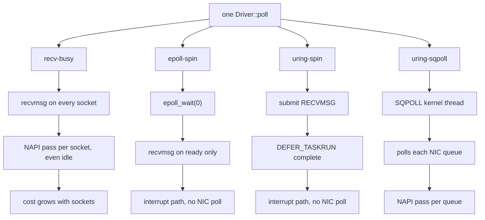

# Backends and Configuration

A backend is the kernel interface the `Driver` waits and reads with. It is
configuration, so one binary can run with each. Which to pick:
[Choosing a backend](overview.md#choosing-a-backend).

| backend | how it waits | polls the NIC | sleeps in the kernel | extra core |
|---|---|---|---|---|
| `epoll-spin` | `epoll_wait(0)` every poll, then `recvmsg` on ready sockets | no (interrupts) | never | no |
| `recv-busy` | non-blocking `recvmsg` on every socket every poll, with `SO_BUSY_POLL` (with `per_queue`: one read per NIC queue, then the sockets epoll reports ready) | yes, one pass per socket (or queue) per poll | never | no |
| `uring-spin` | `IORING_OP_RECVMSG` with `DEFER_TASKRUN`; enters the kernel only when it flags work | no (interrupts) | never | no |
| `uring-sqpoll` | an `SQPOLL` kernel thread submits, completes and polls the NIC | yes, on the kernel thread | never (the application's thread) | yes |
| `epoll-busy` | `epoll_pwait2(wait_us)` with epoll busy polling for `busy_poll_us` | yes, inside the wait | up to `wait_us` | no |
| `uring-napi` | `io_uring_enter(GETEVENTS, 1, wait_us)` with NAPI busy polling | yes, inside the wait | up to `wait_us`, and on every idle poll | no |

- **`epoll_wait(0)` never blocks, but never polls the NIC either.** mio,
  and so tokio, is this path too.
- **Plain `recv-busy` reads every socket on every poll**, so each socket
  adds a little to every poll. `per_queue` reads one socket per NIC
  queue instead: see [cost per poll](#cost-per-poll).
- **`uring-sqpoll` costs a spinning kernel thread per ring.** Rings in one
  process can share one; other processes cannot. Its kernel thread polls
  each NIC queue once per pass, so it has no per-socket scan.

## Configuration strings

`backend[,key=value...]`, parsed and checked by `Config::parse`:

```rust,ignore
{{#include ../../../io/tests/backend_config.rs:config_strings}}
```
*(From `io/tests/backend_config.rs`; `cargo test -p ergon-io` runs it on
every platform.)*

| key | default | meaning |
|---|---|---|
| `loop_cpu` | unset | the loop's CPU, for the host checks; unset: the CPU the calling thread is pinned to (ergon-io never pins it) |
| `sqpoll_cpu` | unset | the SQPOLL kernel thread's CPU; unset: the first housekeeping CPU. Put it on the loop's SMT sibling or another CPU the pod already has — never a second isolated full core just for SQPOLL |
| `sqpoll_idle_ms` | 600,000 | idle time before the SQPOLL thread sleeps; NIC polling does not count as work, so keep it long |
| `ring_entries` | 256 | `io_uring` submission queue size |
| `busy_poll_us` | 1 (`recv-busy`, `uring-sqpoll`), 50 (`epoll-busy`, `uring-napi`) | NIC busy polling in µs: how long `epoll-busy` and `uring-napi` poll before sleeping; `recv-busy` and `uring-sqpoll` need it non-zero |
| `wait_us` | 0, or 100 (`epoll-busy`, `uring-napi`) | the longest `epoll-busy` and `uring-napi` wait in the kernel |
| `per_queue` | `false` | `recv-busy` only: one busy-polled read per NIC queue, then the sockets epoll reports ready |
| `prefer_busy_poll` | `false` | the kernel leaves the NIC queue to the polling loop (with `recv-busy`, `SO_PREFER_BUSY_POLL`: needs `CAP_NET_ADMIN`); NIC-polling backends only |
| `busy_poll_budget` | 0 (kernel: 8) | packets per busy-poll pass; `recv-busy` and `epoll-busy` only; raising it needs `CAP_NET_ADMIN` |
| `connect_cpu` | unset | the `connect_background` helper thread's CPU; unset: the housekeeping CPUs |
| `connect_timeout_ms` | 10,000 | the longest connection set-up |
| `rcvbuf` | 4 MiB | `SO_RCVBUF` for every socket; needs `net.core.rmem_max` at least as large (warned at start-up); 0: the kernel's autotuning |
| `rx_timestamps` | `true` | kernel software, and where supported NIC hardware, receive timestamps in `RxMeta` |
| `quickack_check` | `warn` | `off`, `warn` or `require` |
| `keepalive_idle_s` | 10 | TCP keepalive: idle seconds before the first probe; 0: off |
| `keepalive_interval_s`, `keepalive_count` | 5, 3 | seconds between probes, probes before the drop |
| `tcp_user_timeout_ms` | 25,000 | `TCP_USER_TIMEOUT`; 0: the kernel default |

An unknown key, a bad value or a setting the backend cannot use is an error
(`Config::validate`), never ignored.

## The four one-core backends

`recv-busy`, `recv-busy,per_queue`, `epoll-spin` and `uring-spin` each cost
**one core**. No second core, no SMT sibling, no `SQPOLL` kernel thread.
`uring-sqpoll` is the only backend that needs another CPU; it is not in this
section.

```rust,ignore
{{#include ../../../io/tests/backend_config.rs:one_core_backends}}
```
*(From `io/tests/backend_config.rs`; `cargo test -p ergon-io` runs it on
every platform.)*

What one poll does:

| backend | one poll does | syscalls |
|---|---|---|
| `recv-busy` | `recvmsg` on **every** socket | one per socket per poll |
| `recv-busy,per_queue` | one read per **NIC queue**, then `epoll_wait(0)` on the ready sockets | one per queue plus the ready ones |
| `epoll-spin` | `epoll_wait(0)`, then `recvmsg` on the ready sockets | only the ready sockets |
| `uring-spin` | `IORING_OP_RECVMSG` with `DEFER_TASKRUN` | few |

Latency and cost tables live in
[`io/benches/BENCHMARK.md`](https://github.com/mimran1980/ergon/blob/main/io/benches/BENCHMARK.md).
`epoll-spin` and `uring-spin` are not fairly ranked against the polling
backends there yet: every AWS comparison left ENA's adaptive moderation on.
Do not pick against the polling backends on those numbers.

Which one to take, all at one core:

| sockets on the loop | pick |
|---|---|
| 1–4 | `recv-busy` |
| 5–16 | `recv-busy,per_queue=true` |
| 17–256 | `recv-busy,per_queue=true` |
| few sockets, and the core must stay out of the kernel | `uring-spin` |
| few sockets, and the interrupt path is acceptable | `epoll-spin` |

At one or two connections — a WebSocket feed or one HTTP pool — take
`recv-busy`.

## `per_queue`: one read per NIC queue

Plain `recv-busy` calls `recvmsg` on every socket every poll. Each call runs
one NAPI busy-poll pass even when the socket is idle, so almost all of those
reads return nothing and much of the core sits in the kernel. A message then
waits for its socket's turn, half a poll on average and up to a whole one.

`per_queue` changes the scan. It reads **one socket per NIC queue** (that
read polls the queue), then calls `epoll_wait(0)` and reads only the sockets
that are ready. The cost stops growing at the queue count.

As struct fields, for when more than one setting changes:

```rust,ignore
{{#include ../../../io/tests/backend_config.rs:per_queue_struct}}
```

It is `recv-busy` and nothing else. On any other backend it is a parse
error, never ignored:

```rust,ignore
{{#include ../../../io/tests/backend_config.rs:per_queue_errors}}
```

On the lab command line:

```sh
# plain: one recvmsg per socket per poll
io_bench lab --variants recv-busy --cpus 2 --busy-poll 1 --wait-us 0 \
  --server SENDER:9447 --conns 100 --duration 60 --out res/c100-recv-busy

# per_queue: one read per NIC queue, then the ready sockets
io_bench lab --variants recv-busy --per-queue --cpus 2 --busy-poll 1 --wait-us 0 \
  --server SENDER:9447 --conns 100 --duration 60 --out res/c100-per-queue

$B/analyse --warmup-s 2 res/c100-*
```

Measured against plain `recv-busy`: level at 1 and 10 connections, and
ahead at 100 on the whole path. Figures:
[`io/benches/BENCHMARK.md`](https://github.com/mimran1980/ergon/blob/main/io/benches/BENCHMARK.md#limits).

## Kernel

| backend | needs |
|---|---|
| `epoll-spin`, `recv-busy` | any supported kernel |
| `uring-spin` | Linux 6.1+ and the `uring` feature |
| `uring-sqpoll`, `uring-napi` | Linux 6.9+ (NAPI registration) and the `uring` feature |
| `epoll-busy` | Linux 6.9+ (`EPIOCSPARAMS`) |

An older kernel gives `Error::Unsupported` from `Driver::new`.

## Host settings

The loop is only as quiet as its core. What mattered on AWS and Azure, for
x86 and Graviton: [Deployment: AWS and Azure hosts](../deploy/hosts.md).
ergon-io's own checks ([ergon-tune](../tune/overview.md)) report what is
missing at start-up.

## Cost per poll

One poll is 1 ÷ the loop's polls per second. Tables:
[`io/benches/BENCHMARK.md`](https://github.com/mimran1980/ergon/blob/main/io/benches/BENCHMARK.md#aws-tokyo).

One poll per backend. Where the NIC's NAPI pass runs is what separates
them:



`recv-busy,per_queue` sits between the first two: one busy-polled read
per NIC queue (so one NAPI pass per queue), then `epoll_wait(0)` and
only the ready sockets. Its cost stops at the queue count.

- **Plain `recv-busy` grows with sockets:** each non-blocking `recvmsg` runs
  one NIC busy-poll pass even on an idle socket, so most reads return
  nothing and the core sits in the kernel.
- **What it costs in latency:** a message waits for its socket's turn, half
  a poll on average and up to a whole poll.
- **`per_queue`** reads one socket per NIC queue (which polls that queue),
  then only the ready sockets. Its poll stops growing at the queue count.
- **`epoll-spin` and `uring-spin`** do not scan idle sockets; they wait for
  the NIC interrupt instead. Their latency against the polling backends is
  not yet measured fairly.
- Where each polling backend stops winning:
  [choosing a backend](overview.md#choosing-a-backend).

## Find the crossover on your own host

The crossover depends on the NIC, its queue count, the interrupt path and
the traffic. Measure it with the lab tools in `io/benches`, on two hosts:
the many-connection market-data test the tables above come from, once per
backend, at your socket count (here 20).

```sh
cargo build --release --manifest-path io/benches/Cargo.toml --bin replay_server --bin io_bench --bin analyse
B=io/benches/target/release

# sender: one stream per connection; restart it before each run, copy cert-many.pem to the receiver
sudo $B/replay_server --listen 0.0.0.0:9447 --cert-out cert-many.pem --clients 20 --mode mixed --cpu 1 --duration 120 \
  --trickle-min-us 1000 --trickle-max-us 10000 --burst-every-us 2000 --burst-slots 10 --burst 10 --seed 42

# receiver, loop on isolated CPU 2
sudo $B/io_bench lab --variants recv-busy --cpus 2 --busy-poll 1 --wait-us 0 --server SENDER:9447 \
  --ca cert-many.pem --sni lab.local --conns 20 --capacity 8000000 --duration 60 --out res/c20-recv-busy
# then the same with --variants recv-busy --per-queue (out res/c20-per-queue),
# --variants epoll-spin (res/c20-epoll-spin), --variants uring-sqpoll --sqpoll-cpu 3 (res/c20-sqpoll)

$B/analyse --warmup-s 2 res/c20-*
```

- Compare the backends' sender → decoded p50, p99 and max within the same
  session, and repeat in reversed order: the two clocks drift.
- On AWS, give each family its own best NIC setting, as in production.
  Polling runs: `ethtool -C <nic> adaptive-rx off`. The `epoll-spin` run:
  `adaptive-rx off rx-usecs 0 tx-usecs 0`, with the NIC's interrupts on a
  core of their own ([ergon-tune N1](../tune/overview.md)). Otherwise the
  interrupt waits for moderation and `epoll-spin` looks slower than it is.
- HTTP with a pool: [HTTP with many connections](http-client.md#many-connections).
- Everything about the method: [`io/benches/BENCHMARK.md`](https://github.com/mimran1980/ergon/blob/main/io/benches/BENCHMARK.md).
