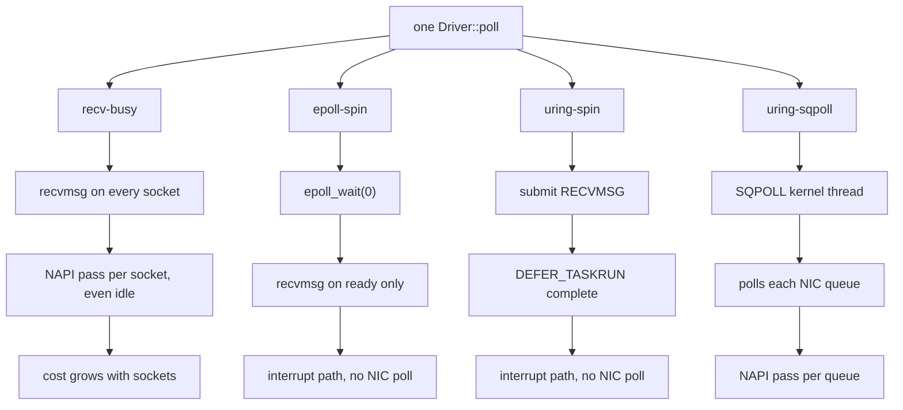

# Backends and Configuration

A backend is the kernel interface the `Driver` waits and reads with. It is
configuration, so one binary can run with each. Which to pick:
[Choosing a backend](overview.md#choosing-a-backend).

| backend | how it waits | polls the NIC | sleeps in the kernel | extra core |
|---|---|---|---|---|
| `epoll-spin` | `epoll_wait(0)` every poll, then `recvmsg` on ready sockets | no (interrupts) | never | no |
| `recv-busy` | non-blocking `recvmsg` on every socket every poll, with `SO_BUSY_POLL` (with `per_queue`: one read per NIC queue, then the sockets epoll reports ready) | yes, one pass per socket (or queue) per poll | never | no |
| `uring-spin` | `IORING_OP_RECVMSG` with `DEFER_TASKRUN`; enters the kernel only when it flags work | no (interrupts) | never | no |
| `uring-sqpoll` | an `SQPOLL` kernel thread submits, completes and polls the NIC | yes, on the kernel thread | never (the application's thread) | yes |
| `epoll-busy` | `epoll_pwait2(wait_us)` with epoll busy polling for `busy_poll_us` | yes, inside the wait | up to `wait_us` | no |
| `uring-napi` | `io_uring_enter(GETEVENTS, 1, wait_us)` with NAPI busy polling | yes, inside the wait | up to `wait_us`, and on every idle poll | no |

- **`epoll_wait(0)` never blocks, but never polls the NIC either.** mio,
  and so tokio, is this path too.
- **Plain `recv-busy` reads every socket on every poll**, so each socket
  adds a little to every poll. `per_queue` reads one socket per NIC
  queue instead: see [cost per poll](#cost-per-poll).
- **`uring-sqpoll` costs a spinning kernel thread per ring.** Rings in one
  process can share one; other processes cannot. Its kernel thread polls each
  NIC queue, not each socket; the loop's pass still grows ([cost per poll](#cost-per-poll)).

## Configuration strings

`backend[,key=value...]`, parsed and checked by `Config::parse`:

```rust,ignore
{{#include ../../../io/tests/backend_config.rs:config_strings}}
```
*(From `io/tests/backend_config.rs`; `cargo test -p ergon-io` runs it on
every platform.)*

| key | default | meaning |
|---|---|---|
| `loop_cpu` | unset | the loop's CPU, for the host checks; unset: the CPU the calling thread is pinned to (ergon-io never pins it) |
| `sqpoll_cpu` | unset | the SQPOLL kernel thread's CPU; unset: the first helper CPU ([placement](kubernetes.md#why-a-pod-has-no-housekeeping-cpus)). A core of its own or the loop's SMT sibling: [what the sibling costs](https://github.com/mimran1980/ergon/blob/main/io/benches/BENCHMARK.md#smt-sibling-cost) |
| `sqpoll_idle_ms` | 600,000 | idle time before the SQPOLL thread sleeps; NIC polling does not count as work, so keep it long |
| `ring_entries` | 256 | `io_uring` submission queue size |
| `busy_poll_us` | 1 (`recv-busy`, `uring-sqpoll`), 50 (`epoll-busy`, `uring-napi`) | NIC busy polling in µs: how long `epoll-busy` and `uring-napi` poll before sleeping; `recv-busy` and `uring-sqpoll` need it non-zero |
| `wait_us` | 0, or 100 (`epoll-busy`, `uring-napi`) | the longest `epoll-busy` and `uring-napi` wait in the kernel |
| `per_queue` | `false` | `recv-busy` only: one busy-polled read per NIC queue, then the sockets epoll reports ready |
| `prefer_busy_poll` | `false` | the kernel leaves the NIC queue to the polling loop (with `recv-busy`, `SO_PREFER_BUSY_POLL`: needs `CAP_NET_ADMIN`); NIC-polling backends only; effect not measured here |
| `busy_poll_budget` | 0 (kernel: 8) | packets per busy-poll pass; `recv-busy` and `epoll-busy` only; raising it needs `CAP_NET_ADMIN`; effect not measured here |
| `connect_cpu` | unset | the `connect_background` helper thread's CPU; unset: the housekeeping CPUs |
| `connect_timeout_ms` | 10,000 | the longest connection set-up |
| `rcvbuf` | 4 MiB | `SO_RCVBUF` for every socket; needs `net.core.rmem_max` at least as large (warned at start-up); 0: the kernel's autotuning |
| `rx_timestamps` | `true` | kernel software, and where supported NIC hardware, receive timestamps in `RxMeta` |
| `quickack_check` | `warn` | `off`, `warn` or `require` |
| `keepalive_idle_s` | 10 | TCP keepalive: idle seconds before the first probe; 0: off |
| `keepalive_interval_s`, `keepalive_count` | 5, 3 | seconds between probes, probes before the drop |
| `tcp_user_timeout_ms` | 25,000 | `TCP_USER_TIMEOUT`; 0: the kernel default |
| `tcp_rto_min_us` | 0 (kernel: 200 ms) | `TCP_RTO_MIN_US`, Linux 6.15+: the retransmission timeout's floor; 2,000 to 200,000 µs in whole kernel ticks; refused, typed, at `Driver::new` ([Kubernetes](kubernetes.md#tcp-timers-and-tcp_info)) |
| `tcp_delack_max_us` | 0 (kernel: 200 ms) | `TCP_DELACK_MAX_US`, Linux 6.15+: the longest delayed ACK; same range and checks |
| `tcp_info_interval_ms` | 0 (off) | passive `TCP_INFO` per connection (`Driver::tcp_info`); at most one `getsockopt` per poll, from the 250 µs deadline check |

An unknown key, a bad value or a setting the backend cannot use is an error
(`Config::validate`), never ignored.

## The four one-core backends

`recv-busy`, `recv-busy,per_queue`, `epoll-spin` and `uring-spin` run on
the loop's CPU alone: no `SQPOLL` kernel thread. `uring-sqpoll` is the only
backend that needs another CPU; it is not in this section. The interrupt
backends (`epoll-spin`, `uring-spin`) were measured with the NIC's
interrupts on a core of their own; on the loop's CPU their p99 rose from 4
sockets ([fair run](https://github.com/mimran1980/ergon/blob/main/io/benches/BENCHMARK.md#interrupt-against-nic-polling-the-fair-run-graviton)).

```rust,ignore
{{#include ../../../io/tests/backend_config.rs:one_core_backends}}
```
*(From `io/tests/backend_config.rs`; `cargo test -p ergon-io` runs it on
every platform.)*

What one poll does:

| backend | one poll does | syscalls |
|---|---|---|
| `recv-busy` | `recvmsg` on **every** socket | one per socket per poll |
| `recv-busy,per_queue` | one read per **NIC queue**, then `epoll_wait(0)` on the ready sockets | one per queue plus the ready ones |
| `epoll-spin` | `epoll_wait(0)`, then `recvmsg` on the ready sockets | only the ready sockets |
| `uring-spin` | `IORING_OP_RECVMSG` with `DEFER_TASKRUN` | few |

Which one to take: [choosing a backend](overview.md#choosing-a-backend).

## `per_queue`: one read per NIC queue

Plain `recv-busy` calls `recvmsg` on every socket every poll. Each call runs
one NAPI busy-poll pass even when the socket is idle, so almost all of those
reads return nothing and much of the core sits in the kernel. A message then
waits for its socket's turn, half a poll on average and up to a whole one.

`per_queue` changes the scan. It reads **one socket per NIC queue** (that
read polls the queue), then calls `epoll_wait(0)` and reads only the sockets
that are ready. Its NIC polling stops growing at the queue count.

As struct fields, for when more than one setting changes:

```rust,ignore
{{#include ../../../io/tests/backend_config.rs:per_queue_struct}}
```

It is `recv-busy` and nothing else. On any other backend it is a parse
error, never ignored:

```rust,ignore
{{#include ../../../io/tests/backend_config.rs:per_queue_errors}}
```

On the lab command line:

```sh
# plain: one recvmsg per socket per poll
io_bench lab --variants recv-busy --cpus 2 --busy-poll 1 --wait-us 0 \
  --server SENDER:9447 --conns 100 --duration 60 --out res/c100-recv-busy

# per_queue: one read per NIC queue, then the ready sockets
io_bench lab --variants recv-busy --per-queue --cpus 2 --busy-poll 1 --wait-us 0 \
  --server SENDER:9447 --conns 100 --duration 60 --out res/c100-per-queue

$B/analyse --warmup-s 2 res/c100-*
```

Measured against plain `recv-busy` and `uring-sqpoll` at 1–256
connections: [polling backends](https://github.com/mimran1980/ergon/blob/main/io/benches/BENCHMARK.md#polling-backends-by-socket-count-x86).

## Kernel

| backend | needs |
|---|---|
| `epoll-spin`, `recv-busy` | any supported kernel |
| `uring-spin` | Linux 6.1+ and the `uring` feature |
| `uring-sqpoll`, `uring-napi` | Linux 6.9+ (NAPI registration) and the `uring` feature |
| `epoll-busy` | Linux 6.9+ (`EPIOCSPARAMS`) |

An older kernel gives `Error::Unsupported` from `Driver::new`.

## Host settings

The loop is only as quiet as its core. What mattered on AWS and Azure, for
x86 and Graviton: [Deployment: AWS and Azure hosts](../deploy/hosts.md).
ergon-io's own checks ([ergon-tune](../tune/overview.md)) report what is
missing at start-up.

## Cost per poll

One poll is 1 ÷ the loop's polls per second. Measured poll times:
[polling backends](https://github.com/mimran1980/ergon/blob/main/io/benches/BENCHMARK.md#polling-backends-by-socket-count-x86).

One poll per backend. Where the NIC's NAPI pass runs is what separates
them:



`recv-busy,per_queue` sits between the first two: one busy-polled read
per NIC queue (so one NAPI pass per queue), then `epoll_wait(0)` and
only the ready sockets. Its NIC polling stops at the queue count.

- **Plain `recv-busy` grows with sockets:** each non-blocking `recvmsg` runs
  one NIC busy-poll pass even on an idle socket, so most reads return
  nothing and the core sits in the kernel.
- **What it costs in latency:** a message waits for its socket's turn, half
  a poll on average and up to a whole poll.
- **`per_queue`** reads one socket per NIC queue (which polls that queue),
  then only the ready sockets. Its NIC polling stops growing at the queue
  count.
- **`epoll-spin` and `uring-spin`** do not read idle sockets; they wait for
  the NIC interrupt instead. Against the polling backends:
  [fair run](https://github.com/mimran1980/ergon/blob/main/io/benches/BENCHMARK.md#interrupt-against-nic-polling-the-fair-run-graviton).
- **Every backend checks each connection for queued sends on every pass**,
  so the loop's pass grows with sockets even when they are idle.
- Where each polling backend stops winning:
  [choosing a backend](overview.md#choosing-a-backend).

Graviton fair run, market data, `irqcore`. Pass = 1 ÷ the loop's passes per
second (a mean), two rounds. The longest pass is not attributed to a cause.

| backend | pass, 1 socket | pass, 256 sockets | longest pass, 256 sockets |
|---|---|---|---|
| `epoll-spin` | 342–343 ns | 601–617 ns | 612–690 µs |
| `uring-spin` | 29 ns | 393–395 ns | 1,015–1,199 µs |
| `uring-sqpoll` (the loop's thread) | 27 ns | 368 ns | 231–246 µs |
| `recv-busy,per_queue` | 933–934 ns | 5.56–5.58 µs | 804–897 µs |
| `recv-busy` | 574–588 ns | 149.3–149.4 µs | 1,910–2,187 µs |

Data: [`loop-counters.md`](https://github.com/mimran1980/ergon/blob/main/io/benches/results/flags-aws-20261019T175248Z/loop-counters.md).

## Find the crossover on your own host

The crossover depends on the NIC, queue count, interrupt path and traffic.
Compare two hosts using the same message stream and your target socket
count; run each backend separately.


- Compare the backends' sender → decoded p50, p99 and max within the same
  session, and repeat in reversed order: the two clocks drift.
- On AWS, set the NIC on the node before each run (node-level):
  `ethtool -C <nic> adaptive-rx off rx-usecs 0`, with the NIC's interrupts
  on a core of their own, as in the
  [fair run](https://github.com/mimran1980/ergon/blob/main/io/benches/BENCHMARK.md#interrupt-against-nic-polling-the-fair-run-graviton).
  Otherwise the interrupt backends wait for moderation.
- HTTP with a pool: [HTTP with many connections](http-client.md#many-connections).
- Everything about the method: [`io/benches/BENCHMARK.md`](https://github.com/mimran1980/ergon/blob/main/io/benches/BENCHMARK.md).

## mio: measured, not a backend

mio was benchmarked beside ergon-io's backends. It is not one of them.

**What ran.** ergon-stack's `mio_bench`: mio 1.2.4, edge-triggered, reads
until `WouldBlock`, rustls's buffered `ClientConnection`, and `Poll::poll`
with a zero timeout in a spin loop. Graviton fair run
`flags-aws-20261019T175248Z`: `c8g.2xlarge` / `c8g.xlarge`, moderation off,
the NIC's interrupts on a core of their own (`irqcore`). µs, p50 / p99 /
max, ranges over 2 rounds, no A/A control.

| | mio | `epoll-spin` | `recv-busy` | `uring-sqpoll` |
|---|---|---|---|---|
| WebSocket N = 1 | 39.1–39.3 / 47.0–48.4 / 108–133 | 38.9–39.2 / 47.0–47.4 / 131–145 | 36.0–36.2 / 43.9–46.0 / 148–284 | 36.5–37.0 / 45.4–45.5 / 122–262 |
| WebSocket N = 64 | 39.9–40.1 / 52.3–53.1 / 178–425 | 40.2–40.4 / 51.9–53.9 / 143–146 | 78.1–78.3 / 118.7–119.5 / 197–265 ‡ | 40.0–40.1 / 53.7–54.8 / 110–131 |
| HTTP pool of 1 | 41.1 / 50.8–51.4 / 127–225 | 40.2–40.4 / 50.2–51.2 / 136–158 | 38.5–38.6 / 47.6–48.2 / 129–133 | 38.7–39.0 / 47.6–48.6 / 123–140 |
| HTTP pool of 20 | 42.3–42.9 / 53.0–55.0 / 157–1,478 | 42.3–42.9 / 52.8–54.9 / 137–285 | 56.5–57.2 / 68.9–70.2 / 164–308 | 42.9–43.1 / 53.5–54.4 / 139–248 |

‡ Could not hold 10,000/s. Every row and footnote:
[fair run](https://github.com/mimran1980/ergon/blob/main/io/benches/BENCHMARK.md#interrupt-against-nic-polling-the-fair-run-graviton).

Loop counters
([`loop-counters.md`](https://github.com/mimran1980/ergon/blob/main/io/benches/results/flags-aws-20261019T175248Z/loop-counters.md)):

- mio makes 2.0× the `recvmsg` calls: 1.20 M against `epoll-spin`'s 0.60 M
  on the WebSocket round trip at N = 1.
- Its mean pass at 256 sockets is 359 ns against `epoll-spin`'s 601–617 ns
  (longest mio pass not recorded).

Why it is not a backend:

1. **On Linux mio is epoll.** It is level with `epoll-spin` and behind the
   polling backends at 1 socket. The 2× `recvmsg` calls come from edge
   triggering.
2. **Its one edge is not mio's.** Its pass is cheaper at many sockets
   because the `Driver` checks every connection for queued sends on each
   pass and `mio_bench` does not. That cost is the `Driver`'s, paid by every
   backend ([cost per poll](#cost-per-poll)), not epoll's.
3. **Off Linux it would lose what ergon-io is for.** macOS and Windows have
   no `SO_BUSY_POLL`, `io_uring`, `TCP_QUICKACK`, `SO_TIMESTAMPING` or
   netlink route checks. Latency verdicts come from Linux only.
4. **Its maxima have no cause yet:**

   | max | where | what the data rules out |
   |---|---|---|
   | 1,478 µs | HTTP pool of 20, `irqcore`, round 2 | a stall of either loop; a TCP retransmit on either host |
   | 640.75 µs | WebSocket N = 16, `irqlocal`, round 2 | a stall of either loop |
   | 425 µs | WebSocket N = 64, `irqcore`, round 2 | a stall of either loop. It falls at 60.0 s, the run's final instant |
   | 36,059–40,180 µs sender lateness | market data, 1 connection, every placement, 0.07 % of batches | no latency sample saw it, so the `md-mio-c1` latency figures stand |

   Data: the last section of `loop-counters.md` (above); the sender
   lateness is in
   [`fair.md`](https://github.com/mimran1980/ergon/blob/main/io/benches/results/flags-aws-20261019T175248Z/fair.md).

5. **The market-data arm was confounded.** The default `SO_RCVBUF` gave
   receive-window pressure (`TCPWantZeroWindowAdv` up to 2,862 per point)
   that no ergon-io arm showed. So mio is not ranked on market data. Data:
   `loop-counters.md`, "mio receive-window pressure".

**Revisit if** someone needs the `Driver` on macOS or Windows for its own
sake, not for latency.
