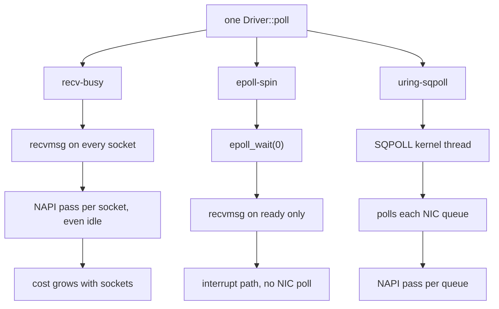

# Backends and Configuration

A backend is the kernel interface the `Driver` waits and reads with. It is
configuration, so one binary can run with each. Which to pick:
[Choosing a backend](overview.md#choosing-a-backend).

| backend | how it waits | polls the NIC | extra core |
|---|---|---|---|
| `epoll-spin` | `epoll_wait(0)` every poll, then one `recvmsg` per ready socket: [mio's mechanism](#mio-measured-not-a-backend) | no (interrupts) | no |
| `recv-busy` | non-blocking `recvmsg` on every socket every poll, with `SO_BUSY_POLL` (with `per_queue`: one read per NIC queue, then the sockets epoll reports ready) | yes, one pass per socket (or queue) per poll | no |
| `uring-sqpoll` | an `SQPOLL` kernel thread submits, completes and polls the NIC | yes, on the kernel thread | yes |

- **None sleeps in the kernel.** These are the three backends the
  benchmarks measured in a busy-spin loop.

- **`epoll-spin` is [mio's mechanism](#mio-measured-not-a-backend), and so tokio's.**
  `epoll_wait(0)` never blocks, but never polls the NIC either.
- **Plain `recv-busy` reads every socket on every poll**, so each socket
  adds a little to every poll. `per_queue` reads one socket per NIC
  queue instead: see [cost per poll](#cost-per-poll).
- **`uring-sqpoll` costs a spinning kernel thread per ring.** Rings in one
  process can share one; other processes cannot. Its kernel thread polls each
  NIC queue, not each socket ([cost per poll](#cost-per-poll)).

## Configuration strings

`backend[,key=value...]`, parsed and checked by `Config::parse`:

```rust,ignore
{{#include ../../../io/tests/backend_config.rs:config_strings}}
```
*(From `io/tests/backend_config.rs`; `cargo test -p ergon-io` runs it on
every platform.)*

| key | default | meaning |
|---|---|---|
| `loop_cpu` | unset | the loop's CPU, for the host checks; unset: the CPU the calling thread is pinned to (ergon-io never pins it) |
| `sqpoll_cpu` | unset | the SQPOLL kernel thread's CPU; unset: the first helper CPU ([placement](kubernetes.md#why-a-pod-has-no-housekeeping-cpus)). A core of its own or the loop's SMT sibling: [what the sibling costs](https://github.com/mimran1980/ergon/blob/main/io/benches/BENCHMARK.md#smt-sibling-cost) |
| `sqpoll_idle_ms` | 600,000 | idle time before the SQPOLL thread sleeps; NIC polling does not count as work, so keep it long |
| `ring_entries` | 256 | `io_uring` submission queue size |
| `per_queue` | `false` | `recv-busy` only: one busy-polled read per NIC queue, then the sockets epoll reports ready |
| `connect_cpu` | unset | the `connect_background` helper thread's CPU; unset: the housekeeping CPUs |
| `connect_timeout_ms` | 10,000 | the longest connection set-up |
| `rcvbuf` | 4 MiB | `SO_RCVBUF` for every socket; needs `net.core.rmem_max` at least as large (warned at start-up); 0: the kernel's autotuning |
| `rx_timestamps` | `true` | kernel software, and where supported NIC hardware, receive timestamps in `RxMeta` |
| `quickack_check` | `warn` | `off`, `warn` or `require` |
| `keepalive_idle_s` | 10 | TCP keepalive: idle seconds before the first probe; 0: off |
| `keepalive_interval_s`, `keepalive_count` | 5, 3 | seconds between probes, probes before the drop |
| `tcp_user_timeout_ms` | 25,000 | `TCP_USER_TIMEOUT`; 0: the kernel default |
| `tcp_rto_min_us` | 0 (kernel: 200 ms) | `TCP_RTO_MIN_US`, Linux 6.15+: the retransmission timeout's floor; 2,000 to 200,000 µs in whole kernel ticks; refused, typed, at `Driver::new` ([Kubernetes](kubernetes.md#tcp-timers-and-tcp_info)) |
| `tcp_delack_max_us` | 0 (kernel: 200 ms) | `TCP_DELACK_MAX_US`, Linux 6.15+: the longest delayed ACK; same range and checks |
| `tcp_info_interval_ms` | 0 (off) | passive `TCP_INFO` per connection (`Driver::tcp_info`); at most one `getsockopt` per poll, from the 250 µs deadline check |

An unknown key, a bad value or a setting the backend cannot use is an error
(`Config::validate`), never ignored. NIC busy polling has no key: `recv-busy`
sets `SO_BUSY_POLL` to 1 µs (one NAPI pass per empty read) and
`uring-sqpoll` a 1 µs NAPI busy-poll timeout; every other socket gets 0.

## The one-core backends

`recv-busy`, `recv-busy,per_queue` and `epoll-spin` run on the loop's CPU
alone: no `SQPOLL` kernel thread. `uring-sqpoll` is the only backend that
needs another CPU; it is not in this section. The interrupt backend
(`epoll-spin`) was measured with the NIC's interrupts on a core of their
own; on the loop's CPU its p99 rose from 4 sockets ([fair run](https://github.com/mimran1980/ergon/blob/main/io/benches/BENCHMARK.md#interrupt-against-nic-polling-the-fair-run-graviton)).

```rust,ignore
{{#include ../../../io/tests/backend_config.rs:one_core_backends}}
```
*(From `io/tests/backend_config.rs`; `cargo test -p ergon-io` runs it on
every platform.)*

What one poll does:

| backend | one poll does | syscalls |
|---|---|---|
| `recv-busy` | `recvmsg` on **every** socket | one per socket per poll |
| `recv-busy,per_queue` | one read per **NIC queue**, then `epoll_wait(0)` on the ready sockets | one per queue plus the ready ones |
| `epoll-spin` | `epoll_wait(0)`, then `recvmsg` on the ready sockets | only the ready sockets |

Which one to take: [choosing a backend](overview.md#choosing-a-backend).

## `per_queue`: one read per NIC queue

Plain `recv-busy` calls `recvmsg` on every socket every poll. Each call runs
one NAPI busy-poll pass even when the socket is idle, so almost all of those
reads return nothing and much of the core sits in the kernel. A message then
waits for its socket's turn, half a poll on average and up to a whole one.

`per_queue` changes the scan. It reads **one socket per NIC queue** (that
read polls the queue), then calls `epoll_wait(0)` and reads only the sockets
that are ready. Its NIC polling stops growing at the queue count.

As struct fields, for when more than one setting changes:

```rust,ignore
{{#include ../../../io/tests/backend_config.rs:per_queue_struct}}
```

It is `recv-busy` and nothing else. On any other backend it is a parse
error, never ignored:

```rust,ignore
{{#include ../../../io/tests/backend_config.rs:per_queue_errors}}
```

On the lab command line:

```sh
# plain: one recvmsg per socket per poll
io_bench lab --variants recv-busy --cpus 2 \
  --server SENDER:9447 --conns 100 --duration 60 --out res/c100-recv-busy

# per_queue: one read per NIC queue, then the ready sockets
io_bench lab --variants recv-busy --per-queue --cpus 2 \
  --server SENDER:9447 --conns 100 --duration 60 --out res/c100-per-queue

$B/analyse --warmup-s 2 res/c100-*
```

Measured against plain `recv-busy` and `uring-sqpoll` at 1–256
connections: [polling backends](https://github.com/mimran1980/ergon/blob/main/io/benches/BENCHMARK.md#polling-backends-by-socket-count-x86).

## Kernel

| backend | needs |
|---|---|
| `epoll-spin`, `recv-busy` | any supported kernel |
| `uring-sqpoll` | Linux 6.9+ (NAPI registration) and the `uring` feature |

An older kernel gives `Error::Unsupported` from `Driver::new`.

## Host settings

The loop is only as quiet as its core. What mattered on AWS and Azure, for
x86 and Graviton: [Deployment: AWS and Azure hosts](../deploy/hosts.md).
ergon-io's own checks ([ergon-tune](../tune/overview.md)) report what is
missing at start-up.

## Cost per poll

One poll is 1 ÷ the loop's polls per second. Measured poll times:
[polling backends](https://github.com/mimran1980/ergon/blob/main/io/benches/BENCHMARK.md#polling-backends-by-socket-count-x86).

One poll per backend. Where the NIC's NAPI pass runs is what separates
them:



`recv-busy,per_queue` sits between the first two: one busy-polled read
per NIC queue (so one NAPI pass per queue), then `epoll_wait(0)` and
only the ready sockets. Its NIC polling stops at the queue count.

- **Plain `recv-busy` grows with sockets:** each non-blocking `recvmsg` runs
  one NIC busy-poll pass even on an idle socket, so most reads return
  nothing and the core sits in the kernel.
- **What it costs in latency:** a message waits for its socket's turn, half
  a poll on average and up to a whole poll.
- **`per_queue`** reads one socket per NIC queue (which polls that queue),
  then only the ready sockets. Its NIC polling stops growing at the queue
  count.
- **`epoll-spin`** does not read idle sockets; it waits for the NIC
  interrupt instead. Against the polling backends:
  [fair run](https://github.com/mimran1980/ergon/blob/main/io/benches/BENCHMARK.md#interrupt-against-nic-polling-the-fair-run-graviton).
- **A send pass visits only the connections with bytes queued** (the
  driver's send set), so idle connections add nothing to it. The passes
  measured below predate the send set: each also checked every connection
  for queued sends, which grew the pass with idle sockets (not re-measured
  since).
- Where each polling backend stops winning:
  [choosing a backend](overview.md#choosing-a-backend).

Graviton fair run, market data, `irqcore`. Pass = 1 ÷ the loop's passes per
second (a mean), two rounds. The longest pass is not attributed to a cause.

| backend | pass, 1 socket | pass, 256 sockets | longest pass, 256 sockets |
|---|---|---|---|
| `epoll-spin` | 342–343 ns | 601–617 ns | 612–690 µs |
| `uring-sqpoll` (the loop's thread) | 27 ns | 368 ns | 231–246 µs |
| `recv-busy,per_queue` | 933–934 ns | 5.56–5.58 µs | 804–897 µs |
| `recv-busy` | 574–588 ns | 149.3–149.4 µs | 1,910–2,187 µs |

Data: [`loop-counters.md`](https://github.com/mimran1980/ergon/blob/main/io/benches/results/flags-aws-20261019T175248Z/loop-counters.md).

## Find the crossover on your own host

The crossover depends on the NIC, queue count, interrupt path and traffic.
Compare two hosts using the same message stream and your target socket
count; run each backend separately.


- Compare the backends' sender → decoded p50, p99 and max within the same
  session, and repeat in reversed order: the two clocks drift.
- On AWS, set the NIC on the node before each run (node-level):
  `ethtool -C <nic> adaptive-rx off rx-usecs 0`, with the NIC's interrupts
  on a core of their own, as in the
  [fair run](https://github.com/mimran1980/ergon/blob/main/io/benches/BENCHMARK.md#interrupt-against-nic-polling-the-fair-run-graviton).
  Otherwise the interrupt backends wait for moderation.
- HTTP with a pool: [HTTP with many connections](http-client.md#many-connections).
- Everything about the method: [`io/benches/BENCHMARK.md`](https://github.com/mimran1980/ergon/blob/main/io/benches/BENCHMARK.md).

## mio: measured, not a backend

**On Linux `epoll-spin` is mio's mechanism.** mio's `Poll::poll` with a zero
timeout is `epoll_wait(timeout = 0)`, and the loop then reads the sockets it
reports ready. tokio's I/O driver is mio (it passes a timeout and blocks
when it has no work). `epoll-spin` makes the same two calls every poll. The
differences:

| | mio | `epoll-spin` |
|---|---|---|
| wait | `epoll_wait(0)` | `epoll_wait(0)` |
| readiness | edge-triggered: read until `WouldBlock` | level-triggered: one `recvmsg` per ready socket |
| reads per message | 2 (the data, then the empty read) | 1 |
| on top | nothing | TLS 1.3 records, WebSocket, HTTP, queued sends, background connect, receive timestamps, host checks, and the other backends behind the same API |

**Measured level.** Graviton fair run `flags-aws-20261019T175248Z`
(`c8g.2xlarge` / `c8g.xlarge`, moderation off, NIC interrupts on a core of
their own). mio arm: ergon-stack's `mio_bench`, mio 1.2.4, rustls's buffered
`ClientConnection`, `Poll::poll(0)` in a spin loop. µs, p50 / p99 / max,
ranges over 2 rounds:

| | mio | `epoll-spin` |
|---|---|---|
| WebSocket N = 1 | 39.1–39.3 / 47.0–48.4 / 108–133 | 38.9–39.2 / 47.0–47.4 / 131–145 |
| WebSocket N = 16 | 39.7–40.1 / 49.9–51.5 / 156–168 | 39.6–40.0 / 50.0–51.6 / 158–193 |
| WebSocket N = 64 | 39.9–40.1 / 52.3–53.1 / 178–425 | 40.2–40.4 / 51.9–53.9 / 143–146 |
| HTTP pool of 1 | 41.1 / 50.8–51.4 / 127–225 | 40.2–40.4 / 50.2–51.2 / 136–158 |
| HTTP pool of 20 | 42.3–42.9 / 53.0–55.0 / 157–1,478 | 42.3–42.9 / 52.8–54.9 / 137–285 |

Every row, the polling backends beside them, and the work counts:
[fair run](https://github.com/mimran1980/ergon/blob/main/io/benches/BENCHMARK.md#interrupt-against-nic-polling-the-fair-run-graviton).
mio makes 2.0× the `recvmsg` calls (WebSocket N = 1: 1.20 M against 0.60 M,
[`loop-counters.md`](https://github.com/mimran1980/ergon/blob/main/io/benches/results/flags-aws-20261019T175248Z/loop-counters.md)).

**Gated.** [`io/benches/parity/mio_parity.rs`](https://github.com/mimran1980/ergon/blob/main/io/benches/parity/mio_parity.rs)
runs in CI on Linux x86_64 and aarch64 (`just io-parity`, release):

- **Structure**, exact counts from the `Driver`'s counters: one
  `epoll_wait` per poll; 20,000 idle polls return in milliseconds, so the
  timeout is 0 (at 1 ms, the shortest that blocks, they would take 20 s);
  one `recvmsg` per echo and none to `EAGAIN`, at 1 and 16 sockets. The
  mio loop makes exactly two reads per echo.
- **Latency**, two-sided: a loopback TLS 1.3 WebSocket round trip, 64 B
  at 10,000/s, through the `Driver` and through a minimal mio loop doing
  the same work (ergon-io's TLS record layer and WebSocket framing, the
  same echo peer on its own CPU, `TCP_NODELAY`, 4 MiB `SO_RCVBUF`, 64
  events per wait, each echo checked byte for byte). 7 pairs at 1 and 16
  sockets; in each pair the two loops take turns round trip by round trip.
  It fails if either side's p50 is ahead by more than 5 % in 6 of 7
  pairs: an `epoll-spin` win that large is a suspected defect too.

The tolerance comes from 10 runs, 140 pairs, in Docker on Apple silicon
(arm64 and amd64; [`summary.md`](https://github.com/mimran1980/ergon/blob/main/io/benches/results/mio-parity-docker-20261024T154626Z/summary.md)):
p50 5.3–15.3 µs, mio slower by +2.1 to +3.1 % at the median (its read to
`WouldBlock` is timed), every run passed. With 10 % added to either loop's
round trips every test failed, 7 of 7 pairs.

Why it is not a backend:

1. **It would duplicate `epoll-spin`:** the same two syscalls, plus one
   empty read per message.
2. **Its one edge was not mio's.** Its mean pass at 256 sockets was 359 ns
   against `epoll-spin`'s 601–617 ns because the `Driver` then checked every
   connection for queued sends on each pass and `mio_bench` does not. That
   cost was the `Driver`'s, paid by every backend, not epoll's; the send set
   has removed it (not re-measured: [cost per poll](#cost-per-poll)).
3. **Off Linux it would lose what ergon-io is for.** macOS and Windows have
   no `SO_BUSY_POLL`, `io_uring`, `TCP_QUICKACK`, `SO_TIMESTAMPING` or
   netlink route checks. Latency verdicts come from Linux only.
4. **Its fair-run maxima have no cause yet:**

   | max | where | what the data rules out |
   |---|---|---|
   | 1,478 µs | HTTP pool of 20, `irqcore`, round 2 | a stall of either loop; a TCP retransmit on either host |
   | 640.75 µs | WebSocket N = 16, `irqlocal`, round 2 | a stall of either loop |
   | 425 µs | WebSocket N = 64, `irqcore`, round 2 | a stall of either loop. It falls at 60.0 s, the run's final instant |
   | 36,059–40,180 µs sender lateness | market data, 1 connection, every placement, 0.07 % of batches | no latency sample saw it, so the `md-mio-c1` latency figures stand |

   Data: the last section of `loop-counters.md` (above); the sender
   lateness is in
   [`fair.md`](https://github.com/mimran1980/ergon/blob/main/io/benches/results/flags-aws-20261019T175248Z/fair.md).
5. **The market-data arm was confounded.** The default `SO_RCVBUF` gave
   receive-window pressure (`TCPWantZeroWindowAdv` up to 2,862 per point)
   that no ergon-io arm showed. So mio is not ranked on market data. Data:
   `loop-counters.md`, "mio receive-window pressure".

**Revisit if** someone needs the `Driver` on macOS or Windows for its own
sake, not for latency.
