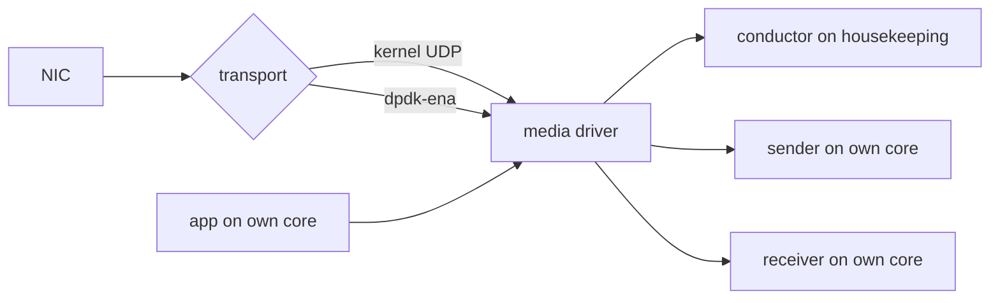

# Configuring the DPDK Transport

> Read the [notice](overview.md) first: this transport is a proof of concept,
> not recommended for production. For kernel bypass with Aeron, use Aeron
> Premium. Terms: [glossary](overview.md#glossary).

## Build

- **`dpdk` feature:** Linux x86-64 or aarch64, `libdpdk >= 23.11` found by
  pkg-config (`libdpdk-dev` on Ubuntu 24.04 or Debian 13; from source on
  Amazon Linux 2023). Without it the crate still builds everywhere, and
  selecting DPDK returns `DpdkError::FeatureDisabled`.
- **`static`:** links Aeron's C driver statically.
- **Graviton:** build for the core, or gcc turns every atomic add on the hot
  path into a library call: `CFLAGS=-mcpu=native` (as measured) or the core
  (`neoverse-v2` Graviton4, `neoverse-v3` Graviton5), and the same in
  `RUSTFLAGS=-Ctarget-cpu=`. rusteron builds Aeron's own C for the build
  host's CPU unless `RUSTERON_C_MARCH` names another.

```sh
cargo test -p ergon-md-dpdk -- --test-threads=1   # every platform, without the feature
just check-dpdk                                   # Linux with libdpdk
just verify-dpdk-docker --build --all             # the same in Docker (amd64)
just verify-dpdk-docker --arm64 --build --all     # and arm64
```

The tests run the C against DPDK-free fakes of the EAL and the NICs. Only the
cloud labs touch a real NIC.

## Run it

The bundled `media_driver` binary picks the transport from
`RUSTERON_MEDIA_DRIVER_TRANSPORT`:

```sh
RUSTERON_MEDIA_DRIVER_TRANSPORT=dpdk-ena cargo run -p ergon-md-dpdk --features dpdk --bin media_driver
```

| value | result |
|---|---|
| unset or `default` | Aeron's kernel socket transport, unchanged |
| `dpdk-ena` | the DPDK transport; any failure exits non-zero and never falls back to kernel UDP |
| anything else | exits non-zero |

The whole binary, which is also the shape of a driver embedded in your own
process:

```rust,ignore
{{#include ../../../md-dpdk/src/bin/media_driver.rs}}
```
*(`md-dpdk/src/bin/media_driver.rs`: built by `cargo test -p ergon-md-dpdk`
on every platform; `tests/media_driver_transport_selection.rs` runs it with
each value, checks it never falls back, and stops it with SIGTERM.)*

## Entry points

Each runs once, at start-up, and adds nothing to the send or receive path.
Each returns `Result<_, DpdkError>`, except `clock()`.

| call | returns | use it when |
|---|---|---|
| `driver::ConfiguredDriver::from_env(context)`, then `.start()` | an `EnvMediaDriver`: Aeron directory, agent pins, transport and host checks set as the binary sets them; call its `do_work()` and `idle()` in your loop | you run the driver in your own process, configured from the environment (the binary above) |
| `configure_media_transport_from_env(&context)` | `None` for the kernel transport, `Some(DpdkTransport)` for DPDK | you set up Aeron yourself and only want the transport |
| `DpdkTransport::install(&context, &config)` | a `DpdkTransport`, from a typed `DpdkTransportConfig` | you want no environment variables ([example](https://github.com/mimran1980/ergon/blob/main/md-dpdk/examples/embedded_dpdk.rs), built by `just check-dpdk`) |
| `pin_agents_to_configured_cpus(&context)` | nothing | your own driver on the kernel transport: Aeron's C driver reads `AERON_*_CPU_AFFINITY`, but only `aeronmd` applies it |
| `lock_memory_from_env()` | `true` if it locked memory | **Not recommended.** `RUSTERON_MEDIA_DRIVER_MLOCKALL=1`; measured no gain on AWS or Azure, and a worse idle max. A sized hugetlbfs already removes the page faults it targets |
| `DpdkTransport::clock()` | the `TransportClock` the transport reads: `Counter { hz, rate, eal_hz, measured_hz }` or `Monotonic { reason }` | you check whether the transport reads the CPU counter, at which rate, and if not, why |

**Keep the `DpdkTransport` alive until the driver has stopped.** The driver's
threads call into memory it owns, and rusteron's context cannot hold it for
you. Drop order: the driver, then its context, then the transport;
`EnvMediaDriver` drops them in that order for you.

## Environment

The names are rusteron's, so deployments written for rusteron's DPDK branch
work unchanged. Aeron itself is set with the usual `AERON_*` variables. The
EAL is DPDK's start-up layer: it maps the NICs and hugepages and starts
DPDK's own threads.

| variable | meaning |
|---|---|
| `RUSTERON_DPDK_FILE_PREFIX` | the EAL's file prefix (required) |
| `RUSTERON_DPDK_SENDER_PCI`, `_IPV4_CIDR`, `_GATEWAY` | the sender's NIC: PCI address, address with prefix, gateway (required) |
| `RUSTERON_DPDK_RECEIVER_*` | the same for the receiver's NIC (required) |
| `RUSTERON_DPDK_SENDER_MAC`, `_RECEIVER_MAC` | Azure: pick the NICs by MAC (every NIC of a VM shares one PCI function) |
| `RUSTERON_DPDK_RX_DESCRIPTORS` | receive ring size; unset: 4,096 on ENA, 256 on MANA |
| `RUSTERON_DPDK_TX_DESCRIPTORS` | transmit ring size, 512 by default; **set 256 on Azure**, or start fails |
| `RUSTERON_DPDK_MBUFS_PER_PORT` | packet buffers per NIC, 16,384 by default |
| `RUSTERON_DPDK_EAL_ARGS` | extra EAL options, such as `-l 0` to keep the EAL's main thread on housekeeping |
| `RUSTERON_DPDK_HOUSEKEEPING_CPU` | the CPU for the transport's housekeeping and local-I/O threads |
| `RUSTERON_MEDIA_DRIVER_HOST_CHECK` | `warn` (default), `off`, or `require`: refuse to start while any [host check](../tune/overview.md) warns |
| `RUSTERON_MEDIA_DRIVER_MLOCKALL` | `1`: lock memory before the driver starts (needs `CAP_IPC_LOCK`). **Not recommended** — see the entry-point table above |

Every other knob (rate caps, ARP, host-local channels, ENA device arguments)
is in [`md-dpdk/README.md`](https://github.com/mimran1980/ergon/blob/main/md-dpdk/README.md).

## Threads and cores

Aeron's driver has three agents (threads of work): the **conductor** sets up
channels and handles control; the **sender** and the **receiver** move the
data. The thread that runs the sender or receiver must busy-spin
(`AERON_*_IDLE_STRATEGY` `noop` or `spin`) on a CPU of its own: a thread
that sleeps leaves a NIC queue unread. The install refuses a layout that
breaks this.

| `AERON_THREADING_MODE` | network thread | its CPU |
|---|---|---|
| `DEDICATED` | sender and receiver, a NIC each | `AERON_SENDER_CPU_AFFINITY`, `AERON_RECEIVER_CPU_AFFINITY`, different CPUs |
| `SHARED_NETWORK` | one thread, both NICs | `AERON_SENDER_CPU_AFFINITY` |
| `SHARED` | one thread for everything | `AERON_CONDUCTOR_CPU_AFFINITY` |
| `INVOKER` | your thread, which runs the driver | `AERON_CONDUCTOR_CPU_AFFINITY` |

One physical core per role, skipping cores a two-minute spin test found
stalling ([hosts](../deploy/hosts.md#cpu-layout)):

| core | runs |
|---|---|
| housekeeping | interrupts, Aeron's conductor, the EAL's main thread, the transport's housekeeping and local-I/O threads |
| application | your busy-spinning loop |
| sender | the media driver's sender |
| receiver | the media driver's receiver |

- **The agents are pinned for you**, in every mode. Without the pins the
  sender and receiver once shared one core and the round trip was
  milliseconds.
- **`SHARED_NETWORK` saves a core but is not recommended** (Graviton): more
  than double the 1,344 B burst latency, with a worse max.
- **Start the driver on housekeeping** (`taskset -c 0 media_driver`), so the
  threads it does not pin stay off the busy cores.

Where the transport sits, and the same core placement on both hosts:



Same layout on host A and host B: housekeeping, app, sender, receiver.
Host-local channels still use kernel sockets, so the same host is IPC
or kernel UDP, never DPDK.

## Aeron settings

What the measurements used; each won a reproduced A/B unless marked. One
copy of every figure:
[`md-dpdk/BENCHMARKS.md`](https://github.com/mimran1980/ergon/blob/main/md-dpdk/BENCHMARKS.md).

| setting | what it does | measured |
|---|---|---|
| `AERON_RECEIVER_IO_VECTOR_CAPACITY=16` (the default under `dpdk-ena`) | the receiver takes up to 16 frames a cycle instead of 4; the DPDK path now drains whole bursts itself, so this mainly helps host-local sockets | before that drain, 16 frames a cycle removed NAKs under load where 4 lost frames |
| `AERON_DIR` on a *sized* 2 MiB hugetlbfs, `AERON_FILE_PAGE_SIZE=2097152`, `AERON_TERM_BUFFER_SPARSE_FILE=false` | the log buffers sit on hugepages (hugetlbfs is a filesystem of them), allocated up front: no page faults | an unsized hugetlbfs reports no free space, and Aeron refuses every log buffer |
| `AERON_CLIENT_PRE_TOUCH_MAPPED_MEMORY=true` on clients | clients fault their mappings in before the first message | not A/B'd |
| `AERON_MTU_LENGTH=1408` (at most `RUSTERON_DPDK_MAX_AERON_MTU`) | every frame fits one packet buffer | jumbo frames: **one** Graviton run improved 1,344 B bursts and raised the ceiling a little. A second run has **not** been done, so it is a candidate for bulk or bursty channels only, not a default |
| `AERON_RCV_INITIAL_WINDOW_LENGTH`, `AERON_SOCKET_SO_RCVBUF`, `_SNDBUF` all 2 MiB, `net.core.rmem_max`/`wmem_max` 16 MiB | the window fits the socket buffer | a 1 MiB window instead cut 32 B throughput hard |
| Azure: `AERON_CONDUCTOR_IDLE_STRATEGY_INIT_ARGS=100-10-1us-20us`, and per channel a receiver window (`rcv-wnd`) MANA's 256-entry ring can hold: 256 × the smallest datagram, 80 KiB for 288 B | status messages (the receiver's "send more") go out every 20 µs, and the sender never has more in flight than the ring holds | 80 KiB: no lossy rep anywhere, but a lower peak rate; 256 KiB: a higher loss-free 1,344 B rate. The fast park alone lost more than the default |
| transparent hugepages off | the kernel stops pausing busy threads to merge pages | Azure idle max falls hard |
| a ~1 kHz keep-alive on sparse, latency-critical streams | a lost frame is noticed within a millisecond | without it, a lost frame on a quiet stream waits for the 100 ms heartbeat: one round trip took 134 ms (not A/B'd) |

**AWS caps one UDP flow** at a few Gbit/s, x86 and Graviton, whatever the
transport. An Aeron channel is one flow, so spread a heavier stream over
several channels on different ports
([data](https://github.com/mimran1980/ergon/blob/main/md-dpdk/BENCHMARKS.md#aws-c7i4xlarge-round-7-p50--p999--max-median-across-reps)).

## Clocks and timestamps

- **Clock:** the transport times intervals in nanoseconds since boot. By
  default (`RUSTERON_DPDK_CLOCK=counter`) it reads the CPU counter inline at
  the rate DPDK gives it (`rte_get_tsc_hz()`), or at the rate it measures
  against `CLOCK_MONOTONIC_RAW` at start where DPDK's is more than 100 ppm
  off: no system call, no call into Rust. It falls back to
  `CLOCK_MONOTONIC` when the kernel's clock source is not the counter or a
  hypervisor's view of it, the TSC is not invariant (x86_64), or DPDK's rate
  is not `CNTFRQ_EL0` (aarch64).
  `RUSTERON_DPDK_CLOCK=monotonic` forces it. Counter type 80 and
  `DpdkTransport::clock()` say which, and why.
- **NIC receive timestamps:** `RUSTERON_DPDK_RX_HW_TIMESTAMP=1`. Only AWS ENA
  offers them (Gen7+ instances in a `precision-time` placement group, DPDK
  25.11+); Azure MANA does not. They mean something only while chrony keeps
  the host on the NIC's clock ([time sync](../clock/wall-clock.md)).
- **Media receive timestamps** (`media-rcv-ts-offset=reserved` on a
  subscription): no measurable cost on Graviton DPDK. One run: repeat it
  before making them a default.

## Best practices

- **Measure the kernel path beside DPDK in every run,** on the same pair, in
  random order. Never compare numbers from different pairs.
- **Count loss, not only latency:** NAKs, retransmits, NIC drops and short
  sends before and after each run. A flat-out rate that loses is a ceiling,
  not an operating point.
- **Fail closed.** A DPDK transport that cannot start exits; keep it that way,
  so a run can never measure kernel UDP by mistake.
- **Set `RUSTERON_MEDIA_DRIVER_HOST_CHECK=require`** once the host is tuned,
  so a reboot or NIC reset that undoes a setting stops the driver.

## Pitfalls

| symptom | cause | fix |
|---|---|---|
| crash in the driver's agents at shutdown | `DpdkTransport` dropped before the driver | drop the driver first |
| start fails on Azure | transmit ring above MANA's 256 | `RUSTERON_DPDK_TX_DESCRIPTORS=256` |
| start fails naming the ENA's BAR | the NIC's memory window (BAR) is not mapped write-combined (a CPU mode that batches writes to a device), so ENA's low-latency queue is off: sends about 100 times slower (Aeron Premium's DPDK notes, `md-dpdk/tests/dpdk_ena_llq.rs`) | `igb_uio` with `wc_activate=1`, or a write-combining `vfio-pci` with `RUSTERON_DPDK_VFIO_WC=1` |
| Aeron refuses every log buffer | hugetlbfs mounted without `size=` | mount it sized |
| window smaller than asked | `net.core.rmem_max` below 2 MiB | raise it to 16 MiB |
| a channel stops at a fixed rate of 1,344 B on AWS | one flow's Gbit/s cap | more channels, on different ports |
| millisecond spikes once a minute on Azure | a vCPU stalling | keep busy threads off the cores the spin test flags |
| no gain on localhost | host-local channels use kernel sockets | expected; use IPC |
