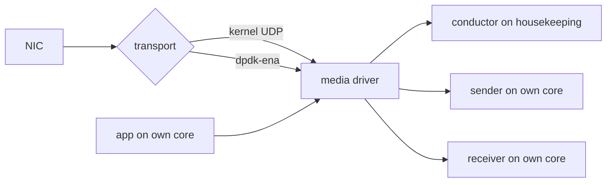

# Configuring the DPDK Transport

> Read the [notice](overview.md) first: this transport is a proof of concept,
> not recommended for production. For kernel bypass with Aeron, use Aeron
> Premium. Terms: [glossary](overview.md#glossary).

## Build

- **`dpdk` feature:** Linux x86-64 or aarch64, `libdpdk >= 23.11` found by
  pkg-config (`libdpdk-dev` on Ubuntu 24.04 or Debian 13; from source on
  Amazon Linux 2023). Without it the crate still builds everywhere, and
  selecting DPDK returns `DpdkError::FeatureDisabled`.
- **`static`:** links Aeron's C driver statically.
- **Graviton:** build for the core, or Ubuntu's and Debian's gcc turn every atomic add on the hot
  path into a library call (GCC's `-moutline-atomics`): `CFLAGS=-mcpu=native` (as measured) or the core
  (`neoverse-v2` Graviton4, `neoverse-v3` Graviton5), and the same in
  `RUSTFLAGS=-Ctarget-cpu=`. rusteron builds Aeron's own C for the build
  host's CPU unless `RUSTERON_C_MARCH` names another.

```sh
cargo test -p ergon-md-dpdk -- --test-threads=1   # every platform, without the feature
just check-dpdk                                   # Linux with libdpdk
just verify-dpdk-docker --build --all             # the same in Docker (amd64)
just verify-dpdk-docker --arm64 --build --all     # and arm64
```

The tests run the C against DPDK-free fakes of the EAL and the NICs. Only the
cloud labs touch a real NIC.

## Run it

The bundled `media_driver` binary picks the transport from
`RUSTERON_MEDIA_DRIVER_TRANSPORT`:

```sh
RUSTERON_MEDIA_DRIVER_TRANSPORT=dpdk-ena cargo run -p ergon-md-dpdk --features dpdk --bin media_driver
```

| value | result |
|---|---|
| unset or `default` | Aeron's kernel socket transport, unchanged |
| `dpdk-ena` | the DPDK transport; any failure exits non-zero and never falls back to kernel UDP |
| anything else | exits non-zero |

The whole binary, which is also the shape of a driver embedded in your own
process:

```rust,ignore
{{#include ../../../md-dpdk/src/bin/media_driver.rs}}
```
*(`md-dpdk/src/bin/media_driver.rs`: built by `cargo test -p ergon-md-dpdk`
on every platform; `tests/media_driver_transport_selection.rs` runs it with
each value, checks it never falls back, and stops it with SIGTERM.)*

## Entry points

Each is called once, at start-up, and adds no work to the send or receive
path. `ConfiguredDriver::from_env` also starts the `md-host-checks` thread
for the socket transport ([host checks](https://github.com/mimran1980/ergon/blob/main/md-dpdk/README.md#host-checks)).
Each returns `Result<_, DpdkError>`, except `clock()`.

| call | returns | use it when |
|---|---|---|
| `driver::ConfiguredDriver::from_env(context)`, then `.start()` | an `EnvMediaDriver`: Aeron directory, agent pins, transport and host checks set as the binary sets them; call its `do_work()` and `idle()` in your loop | you run the driver in your own process, configured from the environment (the binary above) |
| `configure_media_transport_from_env(&context)` | `None` for the kernel transport, `Some(DpdkTransport)` for DPDK | you set up Aeron yourself and only want the transport |
| `DpdkTransport::install(&context, &config)` | a `DpdkTransport`, from a typed `DpdkTransportConfig` | you want no environment variables ([example](https://github.com/mimran1980/ergon/blob/main/md-dpdk/examples/embedded_dpdk.rs), built by `just check-dpdk`) |
| `pin_agents_to_configured_cpus(&context)` | `()` | your own driver on the kernel transport: Aeron's C driver reads `AERON_*_CPU_AFFINITY`, but only `aeronmd` applies it |
| `lock_memory_from_env()` | `true` if it locked memory | **Not recommended.** `RUSTERON_MEDIA_DRIVER_MLOCKALL=1`: its latency effect is not measured here |
| `DpdkTransport::clock()` | the `TransportClock` the transport reads: `Counter { hz, rate, eal_hz, measured_hz }` or `Monotonic { reason }` | you check whether the transport reads the CPU counter, at which rate, and if not, why |

**Dropping a `DpdkTransport` only leaks it** (`md-dpdk/src/ffi.rs`, no
`Drop`). Freeing it is `DpdkTransport::close`, which is `unsafe` and sound
only after every driver started from the context has stopped.
`EnvMediaDriver` frees it in that order for you.

## Environment

The names are rusteron's, so deployments written for rusteron's DPDK branch
work unchanged. Aeron itself is set with the usual `AERON_*` variables. The
EAL is DPDK's start-up layer: it maps the NICs and hugepages and starts
DPDK's own threads.

| variable | meaning |
|---|---|
| `RUSTERON_DPDK_FILE_PREFIX` | the EAL's file prefix (required) |
| `RUSTERON_DPDK_SENDER_PCI`, `_IPV4_CIDR`, `_GATEWAY` | the sender's NIC: PCI address, address with prefix, gateway (required) |
| `RUSTERON_DPDK_RECEIVER_*` | the same for the receiver's NIC (required) |
| `RUSTERON_DPDK_SENDER_MAC`, `_RECEIVER_MAC` | Azure: pick the NICs by MAC (every NIC of a VM shares one PCI function) |
| `RUSTERON_DPDK_RX_DESCRIPTORS` | receive ring size; unset: 4,096 on ENA, 256 on MANA |
| `RUSTERON_DPDK_TX_DESCRIPTORS` | transmit ring size, 512 by default; **set 256 on Azure**, or start fails |
| `RUSTERON_DPDK_MBUFS_PER_PORT` | packet buffers per NIC, 16,384 by default |
| `RUSTERON_DPDK_EAL_ARGS` | extra EAL options, such as `-l <cpu>` to keep the EAL's main thread on a housekeeping CPU from the pod's cpuset |
| `RUSTERON_DPDK_HOUSEKEEPING_CPU` | the CPU for the transport's housekeeping and local-I/O threads |
| `RUSTERON_DPDK_HUGE_DIR` | the hugetlbfs mount DPDK uses, an absolute path; `/dev/hugepages` by default |
| `RUSTERON_DPDK_EAL_IN_MEMORY` | `1`: the EAL runs `--in-memory` (no hugepage files, none left after an OOM kill; no multi-process channel thread). The pod keeps its `hugepages-2Mi` limit. EAL options that contradict it fail start. Default `0`; latency effect not measured |
| `RUSTERON_MEDIA_DRIVER_DIR` | the Aeron directory `ConfiguredDriver` sets |
| `ERGON_HOST_CHECKS` | `on`/`warn` (default), `off` (no check runs), or `require`: refuse to start while any [host check](../tune/overview.md) warns, or while a port's gateway does not answer ARP within 1 s at start |
| `RUSTERON_MEDIA_DRIVER_MLOCKALL` | `1`: `mlockall` before the driver starts (needs `CAP_IPC_LOCK` in the pod). **Not recommended**: see the entry-point table above |

Every other knob (rate caps, host-local channels, ENA device arguments,
receive drain, statistics) is in [`md-dpdk/README.md`](https://github.com/mimran1980/ergon/blob/main/md-dpdk/README.md).

## Threads and cores

Aeron's driver has three agents (threads of work): the **conductor** sets up
channels and handles control; the **sender** and the **receiver** move the
data. The thread that runs the sender or receiver must busy-spin
(`AERON_*_IDLE_STRATEGY` `noop` or `spin`) on a CPU of its own: a thread
that sleeps leaves a NIC queue unread. The install refuses a layout that
breaks this.

| `AERON_THREADING_MODE` | network thread | its CPU |
|---|---|---|
| `DEDICATED` | sender and receiver, a NIC each | `AERON_SENDER_CPU_AFFINITY`, `AERON_RECEIVER_CPU_AFFINITY`, different CPUs |
| `SHARED_NETWORK` | one thread, both NICs | `AERON_SENDER_CPU_AFFINITY` |
| `SHARED` | one thread for everything | `AERON_CONDUCTOR_CPU_AFFINITY` |
| `INVOKER` | your thread, which runs the driver | `AERON_CONDUCTOR_CPU_AFFINITY` |

One physical core per role, skipping cores the pre-flight spin test flags
([hosts](../deploy/hosts.md#cpu-layout)). In a pod, all four come from the
pod's cpuset (static CPU manager, whole cores):

| core | runs |
|---|---|
| housekeeping | interrupts, Aeron's conductor, the EAL's main thread, the transport's housekeeping and local-I/O threads |
| application | your busy-spinning loop |
| sender | the media driver's sender |
| receiver | the media driver's receiver |

- **The agents are pinned for you**, in every mode, each to the CPU its
  `AERON_*_CPU_AFFINITY` names. Running unpinned is not measured here.
- **The conductor's 8–16 ms duty cycles on the housekeeping core cost no
  latency.** The one traced (8.4 ms) was the CPU's other work preempting
  it; the 12–16 ms ones were not traced. Alone on its own core it reached
  5.8–6.5 ms, with the same round trip; its long cycle there is most likely
  the blocking NIC-stats read at the first channel's set-up (traced: a
  1.8 ms wait in `rte_eth_xstats_get`)
  ([BENCHMARKS.md](https://github.com/mimran1980/ergon/blob/main/md-dpdk/BENCHMARKS.md#the-conductors-long-duty-cycles-cpu-sharing-and-one-blocking-call)).
- **`SHARED_NETWORK` saves a core and costs latency.** Graviton G1, one A/B:
  1,344 B bursts p50 522 against 234 µs, max 886 against 745 µs
  ([BENCHMARKS.md](https://github.com/mimran1980/ergon/blob/main/md-dpdk/BENCHMARKS.md#measured-but-no-setting-recommended)).
- **Start the driver confined to the housekeeping CPU** (`taskset -c <cpu>`,
  a CPU from the pod's cpuset that no busy thread uses), so the threads it
  does not pin stay off the busy cores. Name the same CPU in
  `RUSTERON_DPDK_HOUSEKEEPING_CPU` and `RUSTERON_DPDK_EAL_ARGS='-l <cpu>'`.

Where the transport sits, and the same core placement on both hosts:



Same layout on host A and host B: housekeeping, app, sender, receiver.
Host-local channels still use kernel sockets, so on one host use IPC or
kernel UDP.

## Aeron settings

What the lab used, and the evidence for each. Figures:
[`md-dpdk/BENCHMARKS.md`](https://github.com/mimran1980/ergon/blob/main/md-dpdk/BENCHMARKS.md#recommended-configuration). Where: **pod** is
the pod spec or the channel URI; **node** needs node-level access.

| setting | where | what it does | evidence |
|---|---|---|---|
| `AERON_RECEIVER_IO_VECTOR_CAPACITY=16` (the default under `dpdk-ena`) | pod | up to 16 frames a receive, Aeron's maximum (`md-dpdk/src/driver.rs`) | under DPDK the poll drains whole bursts itself, so this sizes host-local socket reads; the A/B predates that. One run (`aws-20261014-113947`, platform not recorded), DPDK, 1,344 B at 600 k msgs/s: no NAK against 16,247 NAKs without it, max 142 against 1,130 µs ([BENCHMARKS.md](https://github.com/mimran1980/ergon/blob/main/md-dpdk/BENCHMARKS.md#measured-but-no-setting-recommended)) |
| `AERON_DIR` on a *sized* 2 MiB hugetlbfs, `AERON_FILE_PAGE_SIZE=2097152`, `AERON_TERM_BUFFER_SPARSE_FILE=false` | node mount, pod env | the log buffers sit on hugepages, allocated up front | required, not A/B'd: an unsized hugetlbfs reports no free space, and Aeron refuses every log buffer |
| `AERON_CLIENT_PRE_TOUCH_MAPPED_MEMORY=true` on clients | pod | clients fault their mappings in before the first message | not measured here |
| `AERON_MTU_LENGTH=1408` (at most `RUSTERON_DPDK_MAX_AERON_MTU`, 1,408 by default) | pod | every frame fits one packet buffer | jumbo frames, Graviton G2, **one run**: 1,344 B bursts p50 242 → 210 µs, max 954 → 1,533 µs; idle unchanged. A candidate for bulk or bursty channels only |
| `AERON_RCV_INITIAL_WINDOW_LENGTH`, `AERON_SOCKET_SO_RCVBUF`, `_SNDBUF` all 2 MiB; `net.core.rmem_max`/`wmem_max` 16 MiB | pod; sysctls node | the window fits the socket buffer | not A/B'd here |
| Azure, a channel where loss matters more than rate: `rcv-wnd` of 256 × the smallest datagram (80 KiB for 288 B), with `AERON_CONDUCTOR_IDLE_STRATEGY_INIT_ARGS=100-10-1us-20us` | pod | the sender never has more in flight than MANA's 256-entry receive ring holds, which overflows while the receiver agent stalls; the faster park buys back part of the rate | two `Standard_D8ds_v6` pairs, 288 B, 1–4 M msgs/s: no loss in 50 rep-points with the window against 9 of 50 without; with it 288 B keeps up only to 2 M msgs/s (flat out 2.93 M with the park, 0.24 M without, against 4.57 M). The park alone did not stop the loss in a second pair (7 of 40 against 9 and 10 of 40) ([BENCHMARKS.md](https://github.com/mimran1980/ergon/blob/main/md-dpdk/BENCHMARKS.md#azure-the-288-b-loss-under-load)) |
| kernel busy polling (`net.core.busy_read`, `busy_poll`): none recommended | node | a socket read spins on the NIC's queue | measured, not isolated: Graviton G1 lost at 288 B 1 M msgs/s in 5 of 5 reps, max 9,175 (8,544–102,826) µs (four settings differ); x86 round 7 lower p50 at 288 B 100 k msgs/s, max 382 (372–389) against 469 (448–578) µs (two settings differ) ([BENCHMARKS.md](https://github.com/mimran1980/ergon/blob/main/md-dpdk/BENCHMARKS.md#measured-but-no-setting-recommended)). Check M4 reports the state as information |
| transparent hugepages off | node | the kernel stops building large pages in the background | not separated: one run (`aws-20261014-113947`), idle p99.99 53.15 against 67.01 µs, max 90 (77–1,180) against 94 (80–498). Azure idle p99.99 67 to 53 µs and idle max 546 to 106 µs; a traced `khugepaged` drain was a 16.25 µs max. The IPC 2 MiB directory was not separated from tmpfs. [Hugepages](../transports/comparison.md#hugepages) |
| a keep-alive every 100 µs on sparse, latency-critical streams | application | a lost frame is noticed at the next keep-alive, not at Aeron's next heartbeat (100 ms, `aeron_network_publication.h:38`, rusteron-media-driver 0.2.13); the path stays warm | below Aeron (raw floor, `c8g.2xlarge`, 3 reps): one ping a second p50 33.98 (32.99–34.24) µs, with the keep-alive 24.50 (24.13–24.83), unpaced 24.21; a 1 ms gap costs +0.8 µs (a 1 ms keep-alive is not measured; this run has no A/A) ([BENCHMARKS.md](https://github.com/mimran1980/ergon/blob/main/md-dpdk/BENCHMARKS.md#sparse-flows-a-quiet-path-is-slower-mostly-on-the-host)) |

**One AWS flow topped out at 7.75–7.77 Gbit/s of Aeron frames** on
`c7i.4xlarge`, kernel UDP and DPDK alike; on `c9g.2xlarge` 1,344 B messages
stopped at 685,574 msgs/s
([BENCHMARKS.md](https://github.com/mimran1980/ergon/blob/main/md-dpdk/BENCHMARKS.md#one-flows-ceiling-on-aws)). AWS documents a single-flow limit of
10 Gbit/s inside a cluster placement group
([EC2 network bandwidth](https://docs.aws.amazon.com/AWSEC2/latest/UserGuide/ec2-instance-network-bandwidth.html)).
An Aeron channel is one flow: spread a heavier stream over several channels
on different ports.

## Clocks and timestamps

- **Clock:** the transport times intervals in nanoseconds since boot. By
  default (`RUSTERON_DPDK_CLOCK=counter`) it reads the CPU counter inline at
  the rate DPDK gives it (`rte_get_tsc_hz()`), or at the rate it measures
  against `CLOCK_MONOTONIC_RAW` at start where DPDK's is more than 100 ppm
  off: no system call, no call into Rust. It falls back to
  `CLOCK_MONOTONIC` when the kernel's clock source is not the counter or a
  hypervisor's view of it, the TSC is not invariant (x86_64), or DPDK's rate
  is not `CNTFRQ_EL0` (aarch64).
  `RUSTERON_DPDK_CLOCK=monotonic` forces it. Counter type 1080 and
  `DpdkTransport::clock()` say which, and why.
- **NIC receive timestamps:** `RUSTERON_DPDK_RX_HW_TIMESTAMP=1`. Only AWS ENA
  offers them (Gen7+ instances in a `precision-time` placement group, DPDK
  25.11+); Azure MANA does not. They mean something only while chrony keeps
  the host on the NIC's clock ([time sync](../deploy/clocks.md#set-up-time-sync)).
- **Media receive timestamps** (`media-rcv-ts-offset=reserved` on a
  subscription). One run (Graviton G3, DPDK): p50 within 0.07 µs of without
  at idle and every steady rate; idle max 153 against 79 µs; at 1,344 B
  bursts 1 of 5 reps lossy (short sends) against 0. Not separated
  ([BENCHMARKS.md](https://github.com/mimran1980/ergon/blob/main/md-dpdk/BENCHMARKS.md#measured-but-no-setting-recommended)).
  Repeat before relying on it.
- **Your own code:** `quanta` for durations, `CLOCK_REALTIME` for stamps
  ([clocks](../deploy/clocks.md)).

## Best practices

- **Measure the kernel path beside DPDK in every run,** on the same pair, in
  random order. Compare numbers from one pair only.
- **Count loss, not only latency:** NAKs, retransmits, NIC drops and short
  sends before and after each run. A flat-out rate that loses is a ceiling,
  not an operating point.
- **Fail closed.** A DPDK transport that cannot start exits; keep it that way,
  so a run can never measure kernel UDP by mistake.
- **Set `ERGON_HOST_CHECKS=require`** once the host is tuned: the driver
  then refuses to start while a check warns, so a reboot that undid a
  setting stops the next start. A NIC reset while it runs is only reported,
  and under `dpdk-ena` nothing is re-checked.

## Pitfalls

| symptom | cause | fix |
|---|---|---|
| start fails on Azure | transmit ring above MANA's 256 | `RUSTERON_DPDK_TX_DESCRIPTORS=256` |
| start fails naming the ENA's BAR | the NIC's memory window (BAR) is not mapped write-combined, so ENA's low-latency queue cannot run | node: `igb_uio` with `wc_activate=1`, or a write-combining `vfio-pci` with `RUSTERON_DPDK_VFIO_WC=1` |
| Aeron refuses every log buffer | hugetlbfs mounted without `size=` | node: mount it sized |
| window smaller than asked | `net.core.rmem_max` below 2 MiB | node: raise it to 16 MiB |
| a channel stops at a fixed rate of 1,344 B on AWS | one flow's Gbit/s cap | more channels, on different ports |
| millisecond spikes about once a minute on Azure | not traced: an ergon-io run saw stalls up to 2.1 ms at seconds :49–:51 of every minute, on both hosts ([io benchmarks](https://github.com/mimran1980/ergon/blob/main/io/benches/BENCHMARK.md#worst-cases)) | keep busy threads off the cores the spin test flags; the spin test's effect is not measured here |
| no gain on localhost | host-local channels use kernel sockets | expected; use IPC |
