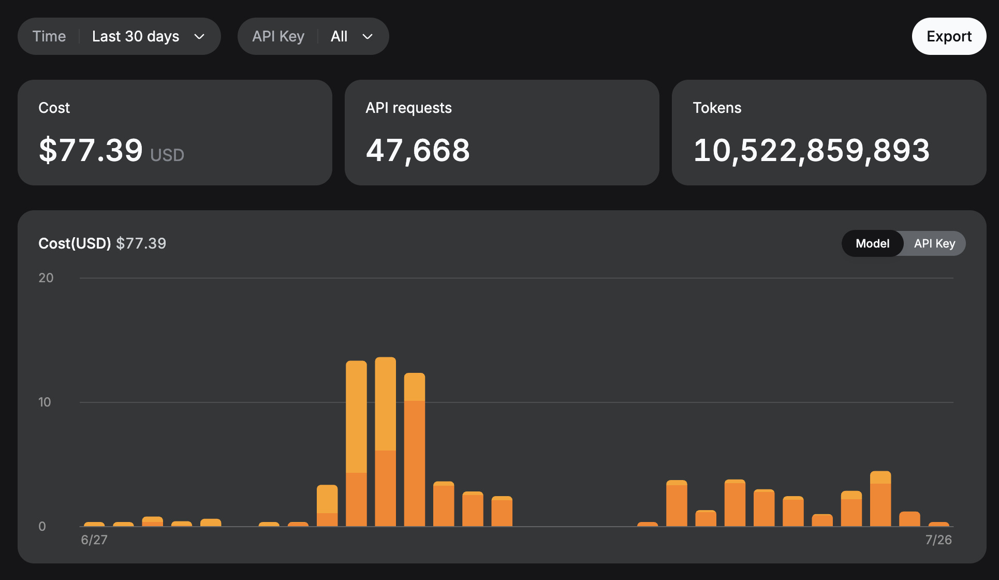
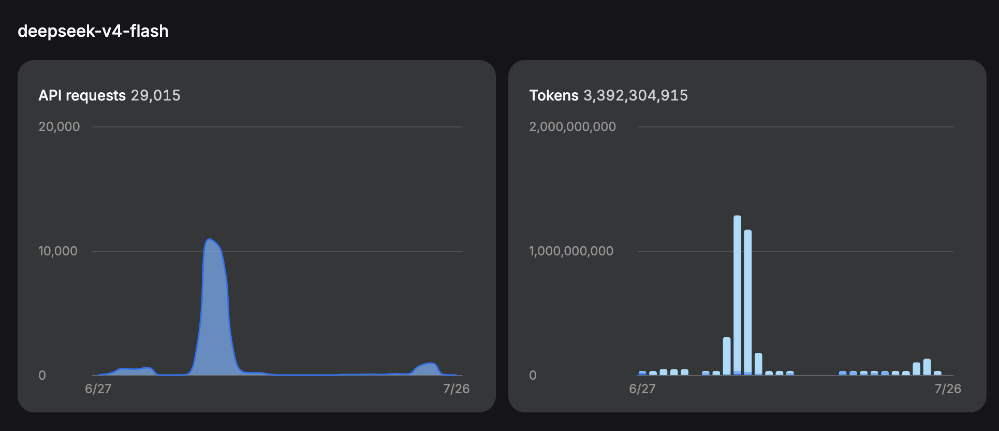
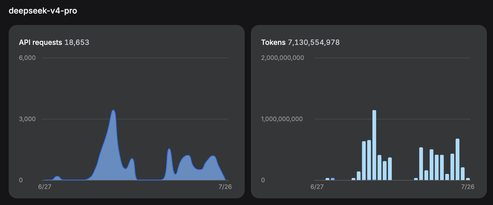

# Observed usage and actual spend

The most accurate data comes from `ccusage` (Claude Code + Codex agents only;
Hermes and OpenCode are automation agents and excluded here). Snapshot from
2026-08-07 (`ccusage` export since 2026-06-28). Note: this export was produced
by a newer `ccusage` version with a different rate table and session
attribution than the previous 2026-08-02 snapshot, so per-model figures differ
— the current snapshot is authoritative.

## ccusage API-level spend

| Model | Input | Output | Cache Create | Cache Read | Reasoning | Total Tokens | API Cost |
|---|---:|---:|---:|---:|---:|---:|---:|
| claude-fable-5 | 128,112 | 210,931 | 5,707,178 | 44,132,249 | — | 50,178,470 | $168.76 |
| claude-opus-4-8 | 153,359 | 505,224 | 3,840,858 | 93,893,329 | — | 98,392,770 | $86.22 |
| claude-opus-5 | 1,702 | 575,673 | 2,454,943 | 204,567,008 | — | 207,599,326 | $139.50 |
| claude-sonnet-4-6 | 3 | 654 | 22,730 | 14,116 | — | 37,503 | $0.15 |
| claude-sonnet-5 | 30,556 | 328,854 | 6,177,826 | 218,888,413 | — | 225,425,649 | $71.84 |
| deepseek-v4-flash | 52,791,367 | 15,125,986 | 0 | 2,734,161,536 | — | 2,802,078,889 | $19.28 |
| deepseek-v4-pro | 47,802,822 | 9,959,142 | 0 | 11,705,468,864 | — | 11,763,230,828 | $71.89 |
| glm-4.7 | 2,620,188 | 287,011 | 0 | 56,403,328 | — | 59,310,527 | $8.41 |
| glm-5.2 | 19,826,248 | 2,577,598 | 0 | 1,868,156,352 | — | 1,890,560,198 | $524.82 |
| gpt-5.5 | 1,781,759 | 117,119 | 0 | 18,613,504 | 31,270 | 20,543,652 | $21.73 |
| gpt-5.6-sol | 33,916,058 | 3,205,179 | 0 | 970,537,472 | 1,524,674 | 1,009,183,383 | $758.17 |
| **Total** | **159,052,174** | **32,893,371** | **18,203,535** | **17,914,836,171** | **1,555,944** | **18,126,541,195** | **$1,870.77** |

That's **18 billion tokens** and **$1,870.77** in API charges at
enterprise/pay-as-you-go rates. The earlier 14-billion-token estimate was
derived from provider dashboards and was an order-of-magnitude figure; the
ccusage data is a precise ledger-level reconciliation across Claude Code and
Codex sessions.

## Subscription spend

Separate from the API charges above, these subscription fees were paid:

| Provider | Spend | Notes |
|---|---:|---|
| GLM coding plan | $114 | Covers glm-4.7 and glm-5.2 API usage — the $533.23 in GLM API costs in the ccusage table is how the plan's included quota would be priced at PAYG rates |
| OpenAI subscription | $20 | |
| Claude subscription | $20 | |
| Grok subscription | $30 | Grok API usage is not tracked by ccusage |
| **Subscription total** | **$184** | |

## Total identified spend

| Category | Amount |
|---|---:|
| API charges (enterprise/PAYG rates, via ccusage) | $1,870.77 |
| Subscriptions | $184.00 |
| **Total identified** | **$2,054.77** |

The API charges are computed at published enterprise rates, not necessarily what
was actually billed (DeepSeek's actual bill was $77.39 for the project period;
GLM usage was covered by the $114 plan). The gap between the $1,870.77 computed
API cost and the ~$261 of actual out-of-pocket spend is the economic story of
this project: DeepSeek's cache-hit pricing made sustained agentic development
affordable.

The DeepSeek dashboard for the displayed 30-day window shows:

- **10,522,859,893 tokens**
- **47,668 API requests**
- **$77.39**

The model split shown by the dashboard was:

- DeepSeek V4 Flash: 3,392,304,915 tokens across 29,015 requests
- DeepSeek V4 Pro: 7,130,554,978 tokens across 18,653 requests

The mixture matters: the early UltraMode/subagent phase used V4 Flash through the
Sonnet-mapped model slot, while the later sequential phase stayed primarily on
V4 Pro. Treating all 10.5 billion DeepSeek tokens as Pro would therefore
overstate what I actually bought.

The [cumulative token usage table](cumulative-token-usage-since-2026-06-28.md#cumulative-token-usage-since-2026-06-28) at
the top of this page is the authoritative per-model breakdown. The dashboard
screenshots above are retained as the original historical evidence they were
captured from during development.
