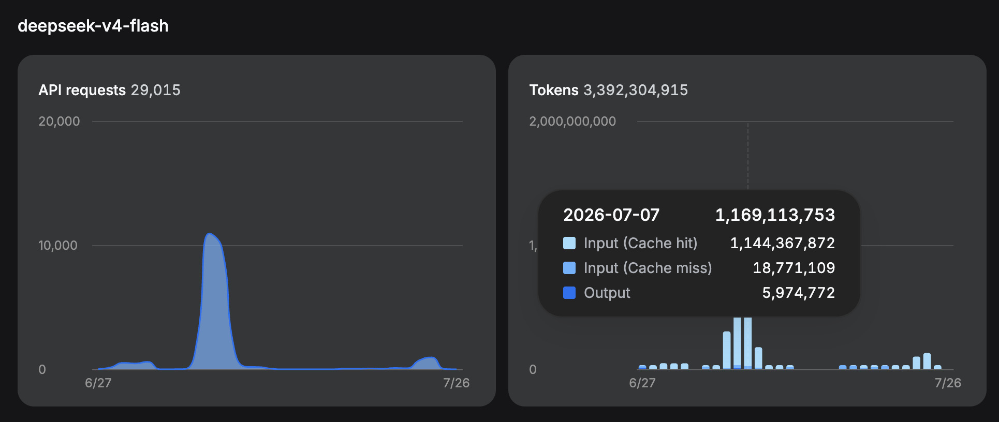
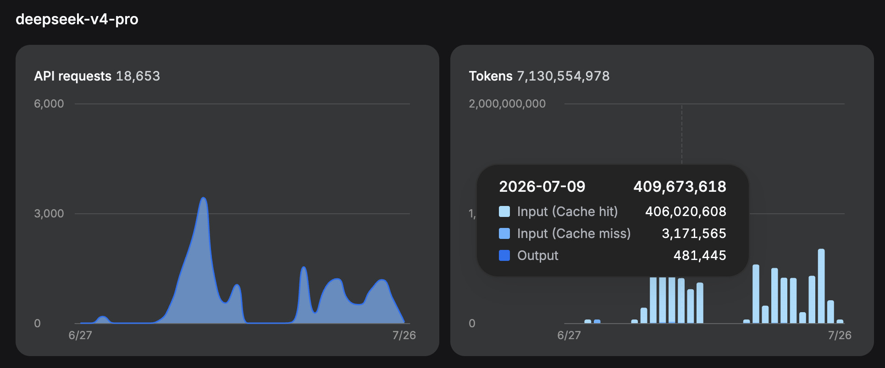
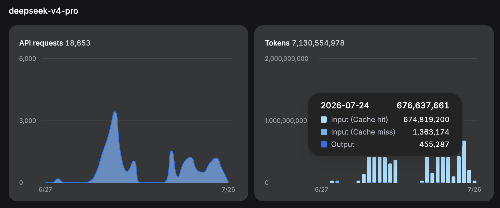

# The cache sample used for the cost comparison

The dashboard screenshots expose the input-cache-hit, input-cache-miss, and
output split for three selected days:







Combined, those samples contain:

| Token category | Sample tokens | Sample share |
|---|---:|---:|
| Input cache hits | 2,225,207,680 | 98.6602% |
| Input cache misses | 23,305,848 | 1.0333% |
| Output | 6,911,504 | 0.3064% |
| **Total** | **2,255,425,032** | **100%** |

Scaling that exact mix to 14 billion tokens gives:

| Token category | Normalised millions of tokens |
|---|---:|
| Input cache hits | 13,812.433168 MTok |
| Input cache misses / cache writes | 144.665359 MTok |
| Output | 42.901473 MTok |
| **Total** | **14,000 MTok** |

The cost formula is:

```text
cost =
    cache-hit MTok × cache-hit price
  + cache-miss MTok × miss/write price
  + output MTok × output price
```

This calculation includes all three categories. It does not price 14 billion
tokens as though they were all cheap cache hits.
