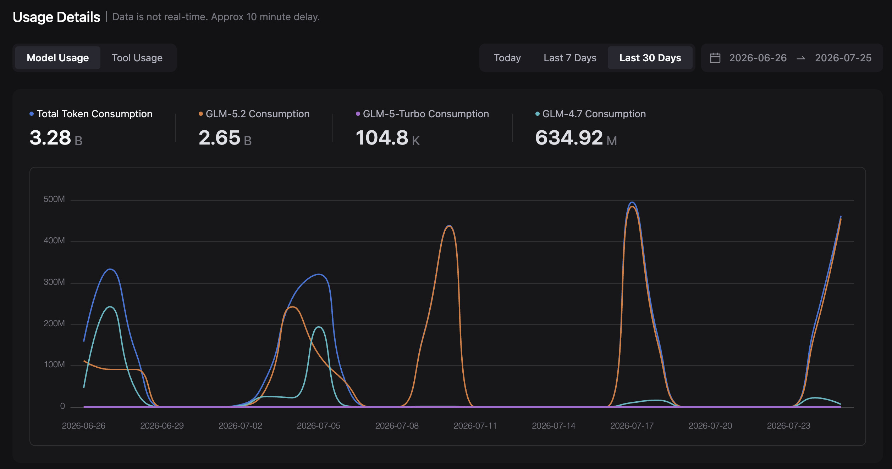

# Tools, models, and what each contributed

## Agent harness

The main harness was Claude Code CLI. This does not mean Claude wrote most of
the code. Claude Code was the interface; custom endpoints supplied other
models.

## DeepSeek

DeepSeek V4 Flash and V4 Pro performed most of the implementation work. I
had never planned to use DeepSeek for this project. My initial model choices
were elsewhere, but during the intensive development period I repeatedly hit
five-hour or weekly subscription and coding-plan limits. Waiting for a limit
to reset would have stopped the development flow, so I connected Claude Code
to DeepSeek's pay-as-you-go API and carried on working.

I initially regarded DeepSeek as temporary overflow capacity: something to use
until another plan reset. Only after using it for longer sessions did I realise
how capable it was for this particular workflow and, especially, how
cost-efficient its cache-hit pricing made sustained agentic development. What
began as an unplanned way to avoid an interruption became the project's main
implementation workhorse.

The model split also reflects the change in development style. Early in the
project I was using **UltraMode through Claude Code CLI**. UltraMode created
subagents and selected the model it considered appropriate for each task. In
my custom endpoint configuration, the model slot that UltraMode treated as
Sonnet was mapped to **DeepSeek V4 Flash**. Consequently, much of the early
parallel work ran on Flash without me manually choosing Flash for each
subagent.

Once the codebase became too coupled for parallel development, I moved to a
mostly sequential workflow and kept the main session on **DeepSeek V4 Pro**.
This explains why the dashboard contains substantial use of both models and
why the actual bill was lower than an all-Pro estimate. Flash handled a large
amount of the early, highly parallel token volume; Pro carried the longer
sequential implementation and refinement sessions.

There was no task where DeepSeek failed and I then had to escalate the same
problem to Opus, ChatGPT, or Grok to rescue the implementation. That surprised
me. It was possible because:

- I knew the domain;
- I normally knew what the correct result should look like;
- I could provide concrete API examples;
- the output was easy for me to inspect; and
- tests and benchmarks supplied tight feedback.

That is not evidence that DeepSeek is universally equivalent to a frontier
model. It is evidence that, for a tightly specified mechanical implementation
task under constant domain-expert supervision, a cheaper workhorse can be more
useful than buying maximum intelligence for every token.

My practical description is:

> DeepSeek V4 Pro delivered roughly Sonnet-class usefulness for this workflow.
> I would not treat that as proof that it replaces Opus for ambiguous,
> autonomous, long-horizon work where the developer does not know the answer.

DeepSeek's own model information is available from its
[official V4 documentation and reports](https://huggingface.co/deepseek-ai/DeepSeek-V4-Pro).
Cross-vendor benchmark numbers use different harnesses and should not be read
as controlled equivalence.

## GLM

I used GLM-5.2 and GLM-4.7 substantially, particularly early in the project.
The 30-day screenshot below records approximately 3.28 billion GLM tokens,
including 2.65 billion on GLM-5.2.

I bought the highest coding-plan tier I was using—about **$114**—and still hit
limits during the intensive development schedule.

## Claude, OpenAI, and Grok

I also paid for Claude, OpenAI, and Grok access. I used them mainly for
additional reviews and experiments, not as indispensable implementation
engines. Their reviews were sometimes a little stronger, but generally raised
the same categories of issue that DeepSeek reviews found. I cannot point to a
frontier-model finding without which this project could not have been
completed.

Cross-model review is useful, but agreement among models is not independent
proof. They can share training patterns and repeat the same plausible
misunderstanding. Official bytes and behavioural tests are stronger evidence.

