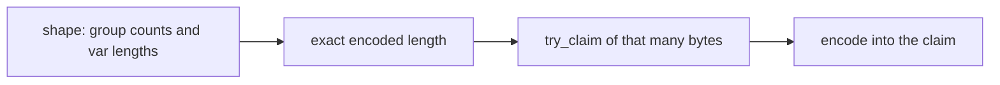

# Buffer Sizing

This page is the only copy of the sizing rule table. The
[samples guide](../../samples/buffer-sizing.md) links here.

Aeron `try_claim` (and similar slots) needs the encoded size before you
write. Guessing with `vec![0u8; 4096]` and copying later defeats that model.

Describe the shape (group counts, nested groups, var-data lengths) and get an
**exact** size from the generated API:

| Message shape | Generated sizing | Prefer |
|---------------|------------------|--------|
| Fixed only | `{Msg}Encoder::compute_length_with_header()` (const) | stack / claim of that length |
| Groups / nested / ragged | `{Msg}EncodedLength` staged builder | `len` then encode into a claim/slot of `len` |

`MAX_ENCODED_LENGTH` counts one entry per group and only var-data that
declares `maxLength`, so it is an upper bound only for a message with no
groups whose var-data all declare `maxLength`. After writing, assert that the
computed length equals the encoded length.



```rust,no_run
{{#include ../../../../samples/sbe-feature-tour/src/lib.rs:demo_car_size_and_encode}}
```
*(From `sbe-feature-tour`: EncodedLength + exact buffer encode, tested in CI.)*

Nested books:
[`book_encoded_length`](https://github.com/mimran1980/ergon/blob/main/samples/l3-book/src/lib.rs).
API matrix:
[`encoded_length_api_test`](https://github.com/mimran1980/ergon/blob/main/sbe/tests/encoded_length_api_test.rs).
