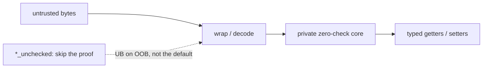

# Trust boundary

Every SBE buffer crossing a process boundary must be validated. This page
is the only full statement of the three constructor tiers. The
[feature tour](../feature-tour/trust-boundaries.md) shows the calls on a
buffer and does not repeat these tables.

| Tier | Prefix | Behaviour on bad buffer | Use case |
|------|--------|------------------------|----------|
| **Checked** | `try_{wrap,decode,…}` | Returns `Result::Err` | Untrusted input, process boundaries |
| **Trusted** | bare name (`wrap`, `decode`, …) | Panics after the same extent proof. Bare `decode` still returns `Err` on a wrong template or schema | Known-good buffers |
| **Unchecked** | `unsafe fn *_unchecked` | UB (raw pointer ops). `decode_unchecked` still returns `Err` on a wrong template or schema | Proven-tight hot loops |

The ladder, from untrusted bytes to typed fields:

`try_*` returns `Result::Err`; bare names panic after the same extent
proof; `decode` is the hybrid above. `*_unchecked` is not shipped as a
default path; use it only after an independent extent proof.

Wire layout follows official SBE offsets and order for the shapes under
test ([compatibility profile](https://github.com/mimran1980/ergon/blob/main/docs/SBE_COMPATIBILITY.md));
official SBE wire compatibility outranks API convenience.

**The trusted tier is safe Rust.** Bare constructors run the same header +
fixed-body extent proof as `try_*`, then panic on failure. After that proof,
field accessors/setters use unchecked loads/stores (justified by the
constructor). Dynamic tails still check on consume.

`try_decode` does not first traverse all dynamic tails. A staged walk validates
them as it advances, so checked construction is compatible with a single-pass
decoder. A separate `verify()` before that walk adds another structural pass.
Checks for text encoding happen when text accessors are used.

The `unsafe fn *_unchecked` variants skip the extent proof entirely, only for
the case where panic machinery is measurable and the caller has proven the
layout independently.

## Fixed extent across schema versions

The header's **acting version** tells the decoder which fields the sender
knows. Its **acting block length** tells it how many fixed-body bytes precede
the first tail. The local `BLOCK_LENGTH` describes the generated schema, so
it cannot replace the sender's length when locating a tail.

Checked construction requires the body to hold
`max(acting_block_length, min_readable_fixed_extent(acting_version))` bytes.
An older frame can therefore have a shorter fixed block than the local
schema. A compatible newer frame can have an unknown fixed suffix, which the
decoder skips before reaching the existing tails. This does not make arbitrary
schema edits compatible: keep the official SBE evolution rules and the
[published compatibility profile](https://github.com/mimran1980/ergon/blob/main/docs/SBE_COMPATIBILITY.md).

*In words:* an illustrative v2 decoder knows an 8-byte v1 fixed block and a
4-byte optional field added in v2. With an 8-byte header, a v1 frame's first
tail starts at byte 16 and the absent v2 field returns `None`. A v2 frame's
tail starts at byte 20. A compatible v3 frame adds an unknown 4-byte fixed
suffix: the decoder proves all 16 declared body bytes fit, reads its known
fields and starts the tail at byte 24. A frame claiming 12 body bytes but
containing only 8 is rejected by `try_decode` before any decoder is returned.
These are illustrative append-only layouts, not a feature-tour wire fixture.
Successful construction still leaves dynamic-tail and value checks to their
respective walks.

## Dynamic tails are checked as reached

*Animation, in words:* an illustrative 79-byte frame (8-byte header, 16-byte
fixed block, a fixed-stride group of 17-byte entries) has a group header that
claims `numInGroup` 1000 but holds bytes for 3 entries. `try_decode`, `decode`
and `decode_unchecked` differ only at the message's own header and fixed-body
proof (`Err`, panic, or UB if short); here that body is real, so all three
succeed. Reaching the group runs the same checks in every tier: the 4-byte
group header fits, `numInGroup` ≤ `u32::MAX`, the short-block rule
(a positive count needs `blockLength` ≥ the 17 bytes its getters read), then
1000 × 17 = 17000 bytes needed against 51 left: `Err(BufferTooShort)` before
any entry decoder exists, after reading 4 bytes and one multiply. A
`blockLength` of 0 with a positive count passes the product (1000 × 0 = 0) but
fails the short-block rule. `verify` and `skip_<group>` use the same product;
random access to a later tail walks the group entry by entry and fails at the
fourth. A group with nested groups or var-data has no fixed stride, so each
entry is proven as it is reached and the first three are yielded before the
error. No timing is recorded for these checks.

A var-data length above its length type's `maxValue` is malformed even when
the buffer holds every byte. Reading the field rejects it with
`InvalidVarDataLength` on every lane, and so do the paths that prove a whole
message or entry: `verify`, `encoded_length`, `as_body_bytes`, a staged read
or `skip_<group>`, `skip_n`, `ordered()` and the memoized lane. On those the
maximum is checked before the buffer length, so a huge length in a short
buffer reports `InvalidVarDataLength`, not `BufferTooShort`. A random-access
read that only passes over an earlier field to reach a later one, group
iteration and `scan_entry_at` check bounds only: the later read succeeds, and
the over-max field is rejected when it is read. The memoized lane is the
exception: it proves every boundary it caches, so its getter for a later
field also rejects an earlier over-max one.

## Value validation (opt-in)

The tiers above prove bounds, not values. A frame from an older or foreign
producer can be in bounds and still carry a value the schema does not allow.
Generate with `GenerationConfig::with_validate(true)` to get `validate()` on
every message decoder, group entry decoder and `AnyMessage`. Call it after
`try_decode`, which still checks bounds only:
`NewOrderDecoder::try_decode(buf, 0)?.validate()?` returns the first
`sbe_rt::ValidateError`.

| Wire value | `ValidateError` |
|---|---|
| integer or `char` scalar, or integer array element, outside a declared `minValue` / `maxValue` | `ValueOutOfRange` |
| enum discriminant that is neither a `validValue` nor the enum's null | `UnknownEnum` |
| set bit that no `choice` declares | `UnknownSetBits` |
| `AnyMessage::Unknown` | `UnknownTemplate` |
| malformed group or var-data tail | `Decode` |

`validate()` reads every field and every group entry, so keep it off the hot
path (archive replay, ingest from another team's producer). It does not
allocate. Not checked: bounds the schema does not declare, floats, fixed
`char` arrays (NUL padding is valid SBE) and var-data contents. An optional
field's null value passes. `DecodeError` is unchanged.

## Encoder entry points

| Entry | Return | Behaviour |
|-------|--------|-----------|
| `Encoder::try_wrap(buf, offset)` | `Result<Encoder, EncodeError>` | Validates capacity, returns `Err` |
| `Encoder::wrap(buf, offset)` | `Encoder` (body-only) | Panics if header+fixed body do not fit |
| `Encoder::try_wrap_and_apply_header(buf, pos)` | `Result<Encoder, EncodeError>` | Validates capacity + writes header, returns `Err` |
| `Encoder::wrap_and_apply_header(buf, pos)` | `Encoder` (header written) | Panics if header+fixed body do not fit |
| `unsafe fn Encoder::wrap_unchecked(buf, offset)` | `Encoder` (body-only) | UB on OOB (raw pointer setters) |
| `unsafe fn Encoder::wrap_and_apply_header_unchecked(buf, pos)` | `Encoder` (header written) | UB on OOB (`copy_nonoverlapping` header) |

## Decoder entry points

| Entry | Return | Behaviour |
|-------|--------|-----------|
| `Decoder::try_wrap(buf, offset, bl, ver)` | `Result<Decoder, DecodeError>` | Validates body extent, returns `Err` |
| `Decoder::try_decode(buf, pos)` | `Result<Decoder, DecodeError>` | Header + template/schema + version-aware fixed extent (all failures are `Err`) |
| `Decoder::wrap(buf, offset, bl, ver)` | `Decoder` | Panics if version-aware fixed body does not fit |
| `Decoder::decode(buf, pos)` | `Result<Decoder, DecodeError>` | Hybrid: panics if short; `Err` on wrong template/schema only |
| `unsafe fn Decoder::wrap_unchecked(buf, offset, bl, ver)` | `Decoder` | UB on OOB (raw pointer accessors) |
| `unsafe fn Decoder::decode_unchecked(buf, pos)` | `Result<Decoder, DecodeError>` | Unchecked extent (UB on OOB) + checked identity (`Err` on wrong template/schema) |

### Why `decode` returns `Result` but still panics

Bare `decode` keeps a freeze-friendly hybrid so feed handlers can `?` on
`WrongTemplate` / `WrongSchema` after demux, while short buffers remain a
trusted-tier panic (same extent proof as `wrap`). Prefer `try_decode` when
every failure, including short buffers, must be a `Result`.

See [Trust boundaries (feature tour)](../feature-tour/trust-boundaries.md) for
worked examples.
