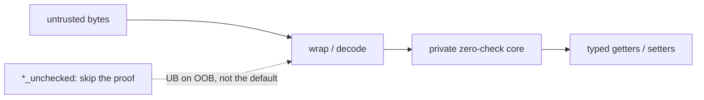

# Trust Boundary

Every SBE buffer crossing a process boundary must be validated. ergo-sbe
provides a **three-tier** constructor API with different failure contracts:

| Tier | Prefix | Behaviour on bad buffer | Use case |
|------|--------|------------------------|----------|
| **Checked** | `try_{wrap,decode,…}` | Returns `Result::Err` | Untrusted input, process boundaries |
| **Trusted** | bare name (`wrap`, `decode`, …) | **Panics** after the same extent proof | Known-good buffers |
| **Unchecked** | `unsafe fn *_unchecked` | **UB** (raw pointer ops) | Proven-tight hot loops |

The ladder, from untrusted bytes to typed fields:

`try_*` returns `Result::Err`; bare names panic after the same extent
proof; `decode` is the hybrid above. `*_unchecked` is not shipped as a
default path — only after an independent extent proof.

Wire layout follows official SBE offsets and order for the shapes under
test ([compatibility profile](https://github.com/mimran1980/ergon/blob/main/docs/SBE_COMPATIBILITY.md));
official SBE wire compatibility outranks API convenience.

**The trusted tier is safe Rust.** Bare constructors run the same header +
fixed-body extent proof as `try_*`, then **panic** on failure. After that proof,
field accessors/setters use unchecked loads/stores (justified by the
constructor). Dynamic tails still check on consume.

`try_decode` does not first traverse all dynamic tails. A staged walk validates
them as it advances, so checked construction is compatible with a single-pass
decoder. A separate `verify()` before that walk adds another structural pass.
Checks for text encoding happen when text accessors are used.

The `unsafe fn *_unchecked` variants skip the extent proof entirely — only for
the case where panic machinery is measurable and the caller has proven the
layout independently.

## Value validation (opt-in)

The tiers above prove bounds, not values. A frame from an older or foreign
producer can be in bounds and still carry a value the schema does not allow.
Generate with `GenerationConfig::with_validate(true)` to get `validate()` on
every message decoder, group entry decoder and `AnyMessage`. Call it after
`try_decode`, which still checks bounds only:
`NewOrderDecoder::try_decode(buf, 0)?.validate()?` returns the first
`sbe_rt::ValidateError`.

| Wire value | `ValidateError` |
|---|---|
| integer or `char` scalar, or integer array element, outside a declared `minValue` / `maxValue` | `ValueOutOfRange` |
| enum discriminant that is neither a `validValue` nor the enum's null | `UnknownEnum` |
| set bit that no `choice` declares | `UnknownSetBits` |
| `AnyMessage::Unknown` | `UnknownTemplate` |
| malformed group or var-data tail | `Decode` |

`validate()` reads every field and every group entry, so keep it off the hot
path (archive replay, ingest from another team's producer). It does not
allocate. Not checked: bounds the schema does not declare, floats, fixed
`char` arrays (NUL padding is valid SBE) and var-data contents. An optional
field's null value passes. `DecodeError` is unchanged.

## Encoder entry points

| Entry | Return | Behaviour |
|-------|--------|-----------|
| `Encoder::try_wrap(buf, offset)` | `Result<Encoder, EncodeError>` | Validates capacity, returns `Err` |
| `Encoder::wrap(buf, offset)` | `Encoder` (body-only) | Panics if header+fixed body do not fit |
| `Encoder::try_wrap_and_apply_header(buf, pos)` | `Result<Encoder, EncodeError>` | Validates capacity + writes header, returns `Err` |
| `Encoder::wrap_and_apply_header(buf, pos)` | `Encoder` (header written) | Panics if header+fixed body do not fit |
| `unsafe fn Encoder::wrap_unchecked(buf, offset)` | `Encoder` (body-only) | UB on OOB — raw pointer setters |
| `unsafe fn Encoder::wrap_and_apply_header_unchecked(buf, pos)` | `Encoder` (header written) | UB on OOB — `copy_nonoverlapping` header |

## Decoder entry points

| Entry | Return | Behaviour |
|-------|--------|-----------|
| `Decoder::try_wrap(buf, offset, bl, ver)` | `Result<Decoder, DecodeError>` | Validates body extent, returns `Err` |
| `Decoder::try_decode(buf, pos)` | `Result<Decoder, DecodeError>` | Header + template/schema + version-aware fixed extent (all failures are `Err`) |
| `Decoder::wrap(buf, offset, bl, ver)` | `Decoder` | Panics if version-aware fixed body does not fit |
| `Decoder::decode(buf, pos)` | `Result<Decoder, DecodeError>` | **Hybrid:** panics if short; `Err` on wrong template/schema only |
| `unsafe fn Decoder::wrap_unchecked(buf, offset, bl, ver)` | `Decoder` | UB on OOB — raw pointer accessors |
| `unsafe fn Decoder::decode_unchecked(buf, pos)` | `Result<Decoder, DecodeError>` | **Unchecked extent** (UB on OOB) + **checked identity** (`Err` on wrong template/schema) |

### Why `decode` returns `Result` but still panics

Bare `decode` keeps a freeze-friendly hybrid so feed handlers can `?` on
`WrongTemplate` / `WrongSchema` after demux, while short buffers remain a
trusted-tier panic (same extent proof as `wrap`). Prefer `try_decode` when
**every** failure — including short buffers — must be a `Result`.

See [Trust boundaries (feature tour)](../feature-tour/trust-boundaries.md) for
worked examples.
