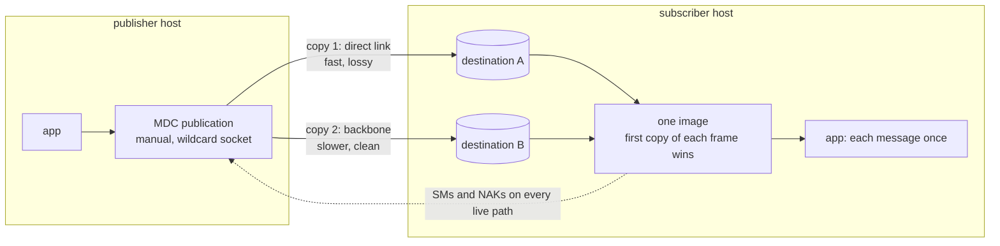
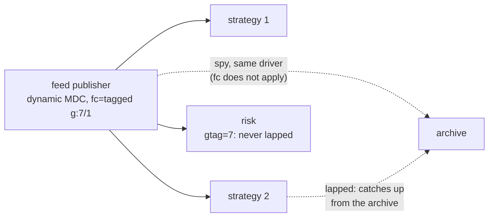

<!-- Generated page: edits here are overwritten by the next export. sha256:0f6adbc1e98115cb9a9bf53022021763bb0d931fc271c6c72d6de07605a14e15 -->
# MDC and MDS

Aeron's two multi-destination features, read from the Aeron 1.54.0 C
driver and tested here:

- **MDC** (multi-destination-cast): one publication sends every frame to
  several destinations. Dynamic MDC (`control-mode=dynamic`) adds a
  destination for each subscriber that sends it status messages. Manual MDC
  (`control-mode=manual`) adds the ones it is told.
- **MDS** (multi-destination subscription): one subscription
  (`control-mode=manual`) listens on several destinations and puts every
  copy of one session into one image.

## Recommendation

1. **Two paths for one stream: one MDC publication, one MDS subscription,
   reliable.** The publication sends each frame down both paths. The
   subscriber's driver keeps the first copy of each frame and drops the
   rest, so the application reads each message once and needs no merge
   code. A frame lost on the fast path is filled by the slow path's copy; a
   frame lost on both is NAKed and repaired a round trip later. Measured
   between regions with loss: every message delivered, p99.99 one round
   trip past the delay at worst (242 to 257 ms at 75 ms one way), where
   Aeron on the backbone alone, at the same 2 MiB window, reached 0.9 to
   1.1 s (1.5 to 1.9 s at the 8 MiB window). `nak-delay` above the skew
   made no measurable difference: leave the default.
   - **The trade: in order and complete, not first copy.** The image is read
     in order, so every message behind a frame lost on the fast path waits
     for the slow path's copy. The share of time a stream is held is about
     `1 − exp(−loss × datagrams/s × skew)`: at 1 % loss, 50,000 datagrams/s
     and a 13 ms skew that is all the time, so the median moves to the slow
     path's delay (measured: p50 86.6 ms with paths of 75 and 88 ms). An
     application merge that keeps the first copy of each
     message per key holds only the key that lost a message.
   - So: MDS when the loss rate × rate × skew is well under 1 (the paths are
     close, or loss is rare), or when the consumer needs the whole stream in
     order anyway. A keyed first-copy merge when many independent keys share
     a stream across a lossy, skewed pair of paths.
2. **Not unreliable.** With `reliable=false` the driver pads a gap as soon
   as it sees it and ignores `nak-delay`. The slower path's copy then arrives
   too late and is dropped. Unreliable MDS repairs a loss only when the
   paths are within about one message interval of each other. Measured with
   a 13 ms skew: it delivered what the fast path alone delivered (99.014 %
   against 99.009 % at 1 % loss).
3. **MDS merges copies of one log, not two sources.** Two copies merge
   only when they are the same bytes at the same positions: one publication
   sent twice, or relays that reproduce one origin's session, term ids, term
   length, MTU and framing. Two handlers that each publish the same upstream
   data are two sessions: two images, nothing merged. Keep merging those in
   the application.
4. **Fan-out: one MDC publication per stream and latency class, `fc=max`.**
   The fastest subscriber sets the pace, and a slow one is lapped instead of
   holding the others. A remote subscriber that must never be lapped (risk,
   an audit reader) goes in a tagged group: `fc=tagged,g:<tag>/<n>,t:<timeout>`.
   An archive on the publisher's node records through a spy, which `fc`
   does not govern. Never use `fc=min` on a shared hot stream: one stalled
   subscriber holds every other one for the timeout, 5 s by default. (From
   the source, not measured here: see [Not measured](#not-measured).)
5. **Size the window for the round trip.** The receiver window is
   `min(rcv-wnd, term-length / 2)`, 128 KiB by default, and a reliable
   publisher can have at most one window in flight to its fastest receiver.
   So a stream carries at most `window / RTT`: 128 KiB over 176 ms is
   0.74 MB/s, about 7,700 messages/s of 96-byte frames. Past that the
   publisher is back-pressured. Set `rcv-wnd` to at least the
   bandwidth-delay product, `term-length` to at least twice that, and keep
   the window inside the socket buffer the kernel really keeps. (From the
   source, not measured.)
6. **Watch each path.** `aeron_image_active_transport_count` (rusteron
   `AeronImage::active_transport_count`) counts the destinations that
   delivered within the image liveness timeout. Lower that timeout (default
   10 s) to see a dead path in seconds.
7. **Same host: IPC or a spy, never in the MDS set.** An IPC or spy
   destination on an MDS subscription is a second image beside the network
   one, so the application gets every message twice.

## Topology by use case

| use case | publisher | subscriber | flow control | reliable | notes |
|---|---|---|---|---|---|
| market data, one region, many hosts | dynamic MDC, one publication per stream and latency class | plain subscription | `max` | yes for books and trades, no for latest-value streams | a lapped subscriber catches up from the archive |
| market data that a remote reader (risk, audit) must see whole | as above | as above, that reader with `gtag=<tag>` | `tagged,g:<tag>/1,t:<short>` | yes | untagged subscribers never hold the publisher; the node's archive records through a spy either way |
| one stream over two paths (two ENIs, two links) | manual MDC, no `control` (the socket binds the wildcard, so each copy leaves on the route to its destination), one destination per path | MDS, one destination per path | `max` | yes, `nak-delay` above the skew | the subscriber's driver merges; the application sees one image |
| between regions, a direct link and a backbone | as above, `rcv-wnd` and `term-length` sized for the slower round trip | as above | `max` | yes | in order and complete; at high loss the median moves to the backbone's delay (above) |
| relays of one origin over two paths | each relay reproduces the origin's log | MDS, one destination per relay | each relay's own | yes | identical framing is the precondition: a relay checks its position after every offer |
| orders, one sender, one gateway | unicast, or manual MDC to two gateway paths | plain, or MDS | unicast / `max` | yes | the gateway still deduplicates by order id: a restarted sender is a new session |
| request/response | see [Request/response](../io/request-response.md) | | | | per-client MDC needs a control port per client |
| same host | IPC, or a spy on the UDP publication | IPC or spy | | | never an IPC or spy destination in the MDS set |

## How Aeron does it

All from the Aeron 1.54.0 C driver (`aeron-driver/src/main/c`).

### MDS: one image from several destinations

| rule | where |
|---|---|
| A receive channel endpoint keeps one image per (session id, stream id). Every destination's frames for that session go into that image's term buffers. | `aeron_publication_image_insert_packet` |
| A frame is copied only if its slot is still empty (frame length 0). A later copy costs a 4-byte read and nothing else. | `aeron_term_rebuilder_insert` |
| A copy behind the last status-message position is dropped before that, counted as a flow-control under-run. | `aeron_publication_image_is_flow_control_under_run` |
| The image is read in order. Frames after a gap wait until the gap is filled, by any destination. | the image's rebuild position |
| Status messages and NAKs go to every connection that was active in the last 5 s. | `aeron_publication_image_send_pending_status_message`, `..._send_pending_loss`, `AERON_RECEIVE_DESTINATION_TIMEOUT_NS` |
| Reliable: the first NAK waits `nak-delay` (a subscription URI parameter; the unicast default is 1 µs); a retry waits `nak-delay × AERON_NAK_UNICAST_RETRY_DELAY_RATIO` (100). | `aeron_publication_image_acquire_delay_generator_state` |
| Unreliable: the delay is 0 and `nak-delay` is ignored. A gap is padded as soon as the conductor's loss scan sees it. | same function; `aeron_publication_image_send_pending_loss` |
| A destination counts in the active transport count while it delivered a frame within the image liveness timeout. The count is refreshed when a status message is sent (every 200 ms by default). | `aeron_update_active_transport_count` |
| Destinations may not set `mtu`, `rcv-wnd`, `so-rcvbuf`, `so-sndbuf`, `so-tos`, `response-correlation-id` or `control-mode=response`. | `aeron_driver_conductor_validate_destination_uri_params` |
| An `aeron:ipc` or `aeron-spy:` destination becomes a separate subscription link with its own images, not part of the network image. | `aeron_driver_conductor_on_add_receive_ipc_destination`, `..._spy_destination` |
| Both paths' status messages carry the same receiver id, so `min` and `tagged` flow control count one receiver, not two. | `aeron_min_flow_control_strategy_on_sm`; the id is the receive channel endpoint's |
| A manual MDC publication with neither `control` nor `interface` binds 0.0.0.0, so the kernel picks each copy's route and source address by its destination. | `aeron_udp_channel_finish_parse` (`aeron_find_unicast_interface` with no interface) |

**What a loss on one path costs.** Say path A is faster than path B by the
skew `s`, and A loses a frame:

| subscription | what happens | the lost frame and those behind it arrive |
|---|---|---|
| reliable, `nak-delay` < `s` | by the code, a NAK can go out on both paths before B's copy lands, and the publisher resends to every destination; B's copy usually fills the gap first. Measured, NAKs stayed near 2,500 a rep against 17,500 fast-path losses | at B's delay |
| reliable, `nak-delay` > `s` | B's copy fills the gap before any NAK; a frame lost on both paths is repaired `nak-delay` plus a round trip later. Measured: no difference from the default | at B's delay |
| unreliable | the gap is padded at once. B's copy lands on a filled slot and is dropped. | never: the message is lost |

**First arrival.** The receiver thread polls every destination's socket.
A frame is readable as soon as its first copy lands, unless an earlier
frame is still missing.

**Driver CPU.** The receiver handles every copy: one more datagram read
and header check per frame for each extra path. The sender sends every
frame once per destination, one `sendmsg` after another, starting at a
rotating destination so none is always first
(`aeron_udp_destination_tracker_send`). A 2-path MDC costs the sender
about two sends per frame; a 50-destination fan-out costs 50.

### MDC: fan-out and flow control

| strategy | the publisher's limit | a slow or stalled subscriber | use it for |
|---|---|---|---|
| `max` (MDC's default) | the furthest subscriber's position plus its window | is lapped; it cannot be repaired from the publisher once more than half a term behind (`aeron_network_publication_resend`) | every shared hot stream |
| `min` | the slowest subscriber heard from in the last `t` (default 5 s) | holds every subscriber for up to `t` | small groups where all must keep up, with a short `t` |
| `tagged,g:<tag>/<n>,t:<timeout>` | the slowest subscriber whose channel has `gtag=<tag>`; others do not count. The publication is not connected until `n` tagged subscribers are | a tagged one holds the publisher for up to `t`; an untagged one is lapped | a remote risk or audit reader that must see everything |

There is no other strategy in the 1.54 C driver
(`aeron_flow_control_strategy_table`: unicast max, multicast max, min,
tagged).

**Spies ignore `fc`.** Every spy bounds the publication. An untethered spy
(`tether=false`) is dropped once it is more than three quarters of the term
window behind the sender for `untethered-window-limit-timeout` (default
5 s), lingers for `untethered-linger-timeout`, and rests for
`untethered-resting-timeout` (default 10 s) before it may rejoin
(`aeron_network_publication_check_untethered_subscriptions`). While it is
behind, it holds every subscriber of that publication. That is the
stalled-spy hazard measured in
[Request/response](../io/request-response.md): a stalled untethered
spy on a shared publication silenced the healthy reader for 300 ms.

**Priority classes.** Separate MDC publications give a fast stream its own
flow control and its own terms, so a burst on a bulk stream never queues
in front of it. They do not give priority: one sender thread walks every
publication, starting at a rotating index. For real priority, give the
fast streams their own driver (and its sender CPU), and keep each driver
to 8 streams or fewer ([many streams](aeron-many-streams.md)).

**Dynamic destinations time out.** A dynamic MDC destination that sends
no status message for 5 s is removed
(`AERON_UDP_DESTINATION_TRACKER_DESTINATION_TIMEOUT_NS`). Manual
destinations stay until removed.

## Measured

### One image from two paths and from two writers (functional)

Each on a media driver the test embeds, kernel UDP on 127.0.0.1:

| test | result |
|---|---|
| one manual-MDC publication to two destinations, one MDS subscription | every message once, in order, no loss; the driver received 2.0 × the bytes of a single path (576,400 against 288,200 B for 3,000 messages); 2 active transports |
| two exclusive publications writing one log (same session id, initial term id, term length and MTU, the same 2,000 messages) to two destinations, one MDS subscription | one image, every message once, in order; both publications at the same position after every offer |
| one MDC publication to both destinations, then one destination removed (that path's packets stop at once), image liveness timeout 2 s | the active transport count fell from 2 to 1 after 1.98 to 2.09 s over 5 runs: the liveness timeout plus up to one status-message interval |
| the two writers of one log instead, one of them closed (`linger=0`) | 2.97 to 3.46 s over 7 runs: about 1 s more, while the closing publication's driver drained it and still sent heartbeats |

### Two links between regions

One box, one clock, `tc netem` in a rootless network namespace, as the
[comparison's long-distance section](comparison.md#long-distance-with-loss-one-box-netem)
runs it. Link A is the direct link: faster, lossier, capped at
100 Mbit/s. Link B is the backbone: slower, nearly lossless. One stream
of 64-byte messages, one way. A desktop x86 box (6 cores, nothing
isolated), so the millisecond effects are the finding, not the
microseconds.

| arm | what |
|---|---|
| `aeron-mds` | one manual-MDC publication to a destination on each link, one MDS subscription with both; reliable, default `nak-delay` |
| `aeron-mds-nd` | the same, `nak-delay` 20 ms (above both presets' skew), NAK retry ratio 10 |
| `aeron-mds-u` | the same, unreliable |
| `aeron-rel-b` | Aeron reliable on link B alone (8 MiB receiver window: the earlier matrix's setting, above the 4 MiB socket buffer the kernel keeps) |
| `aeron-win2m-b` | the same at the MDS arms' 2 MiB window: the like-for-like control ([below](#backbone-control-at-the-mds-window)) |
| `mio-udp-a` | plain UDP on link A alone: the floor, and what A loses |

All Aeron arms: 16 MiB terms, MTU 1408, `SHARED` threading with a
busy-spinning agent; the MDS arms' receiver window is 2 MiB. 3 reps pooled
per arm, 25 s measured each after 10 s of warm-up. Latency in ms; the
max cause is labelled demonstrated, correlated or unexplained.

**T2: A 75 ms one way, B 88 ms (skew 13 ms); 50,000 msg/s**

| cell (loss A / B) | arm | n | min | p50 | p99 | p99.99 | max | delivered | max cause |
|---|---|---|---|---|---|---|---|---|---|
| 0.1 % / 0.01 % | `aeron-mds` | 3,750,000 | 75.02 | 75.63 | 87.88 | 89.92 | 92.59 | 100 % | unexplained: 4.6 ms past B's delay |
| | `aeron-mds-nd` | 3,750,000 | 75.02 | 75.69 | 87.95 | 102.50 | 106.67 | 100 % | unexplained: 18.7 ms past B's delay |
| | `aeron-mds-u` | 3,746,155 | 75.02 | 75.04 | 75.96 | 84.02 | 85.90 | 99.900 % | unexplained: 10.9 ms past A's delay |
| | `aeron-rel-b` | 3,750,000 | 88.00 | 319.29 | 1,508.90 | 1,853.88 | 1,860.93 | 100 % | correlated: NAK repair backlog, 10.1 RTT (NAKs 288,627, retransmits 3,137 in that rep) |
| | `mio-udp-a` | 3,746,076 | 75.01 | 75.04 | 75.04 | 80.74 | 84.77 | 99.899 % | unexplained: 9.8 ms past A's delay |
| 1 % / 0.01 % | `aeron-mds` | 3,750,000 | 75.02 | 86.64 | 88.54 | 242.09 | 246.15 | 100 % | correlated: a frame lost on both links, repaired 1.1 RTT later (NAKs 2,530, retransmits 2,277) |
| | `aeron-mds-nd` | 3,750,000 | 75.02 | 86.64 | 88.54 | 239.99 | 245.84 | 100 % | correlated: as above (NAKs 2,496, retransmits 2,256) |
| | `aeron-mds-u` | 3,712,925 | 75.02 | 75.04 | 75.96 | 93.26 | 96.17 | 99.014 % | unexplained: 21.2 ms past A's delay |
| | `aeron-rel-b` | 3,750,000 | 88.00 | 259.65 | 1,308.62 | 1,645.22 | 1,652.45 | 100 % | correlated: NAK repair backlog, 8.9 RTT |
| | `mio-udp-a` | 3,712,698 | 75.01 | 75.04 | 75.04 | 79.63 | 80.94 | 99.009 % | unexplained: 5.9 ms past A's delay |
| bursts of 10, about 1 % / 0.01 % | `aeron-mds` | 3,750,000 | 75.02 | 75.63 | 88.15 | 257.29 | 264.68 | 100 % | correlated: repair, 1.3 RTT |
| | `aeron-mds-nd` | 3,750,000 | 75.02 | 75.63 | 88.08 | 243.27 | 247.08 | 100 % | correlated: repair, 1.1 RTT |
| | `aeron-mds-u` | 3,712,284 | 75.02 | 75.04 | 76.09 | 80.81 | 82.59 | 99.017 % | unexplained: 7.6 ms past A's delay |
| | `aeron-rel-b` | 3,750,000 | 88.00 | 253.49 | 1,287.65 | 1,527.78 | 1,534.56 | 100 % | correlated: NAK repair backlog, 8.2 RTT |
| | `mio-udp-a` | 3,712,641 | 75.01 | 75.04 | 75.04 | 78.91 | 79.97 | 99.015 % | unexplained: 5.0 ms past A's delay |

**T2 at 10,000 msg/s, 1 % on A, B lossless**

| arm | n | min | p50 | p99 | p99.99 | max | delivered | max cause |
|---|---|---|---|---|---|---|---|---|
| `aeron-mds` | 750,000 | 75.02 | 81.13 | 88.01 | 89.52 | 92.10 | 100 % | unexplained: 4.1 ms past B's delay |
| `aeron-mds-nd` | 750,000 | 75.02 | 81.13 | 88.01 | 89.98 | 92.06 | 100 % | unexplained: 4.1 ms past B's delay |
| `aeron-mds-u` | 742,326 | 75.02 | 75.04 | 75.69 | 79.43 | 88.01 | 98.991 % | correlated: exactly B's delay, a gap B's copy filled before the loss scan padded it |
| `aeron-rel-b` | 750,000 | 88.00 | 88.01 | 88.67 | 95.09 | 98.65 | 100 % | unexplained: 10.7 ms past B's delay |
| `mio-udp-a` | 742,281 | 75.01 | 75.04 | 75.04 | 78.84 | 79.82 | 98.985 % | unexplained: 4.8 ms past A's delay |

**L2: A 40 ms one way, B 47 ms (skew 7 ms); 1 % / 0.01 %, 50,000 msg/s**

| arm | n | min | p50 | p99 | p99.99 | max | delivered | max cause |
|---|---|---|---|---|---|---|---|---|
| `aeron-mds` | 3,750,000 | 40.02 | 45.61 | 47.71 | 132.19 | 135.10 | 100 % | correlated: repair, 1.2 RTT |
| `aeron-mds-nd` | 3,750,000 | 40.02 | 45.61 | 47.74 | 132.12 | 134.99 | 100 % | correlated: repair, 1.2 RTT |
| `aeron-mds-u` | 3,712,612 | 40.02 | 40.04 | 40.99 | 48.20 | 50.54 | 99.000 % | unexplained: 10.5 ms past A's delay |
| `aeron-rel-b` | 3,750,000 | 47.00 | 47.71 | 389.28 | 770.18 | 777.18 | 100 % | correlated: NAK repair backlog, 7.8 RTT |
| `mio-udp-a` | 3,712,816 | 40.01 | 40.04 | 40.04 | 59.11 | 63.44 | 99.001 % | unexplained: 23.4 ms past A's delay |

#### Backbone control at the MDS window

Aeron on link B alone at the MDS arms' 2 MiB window (`aeron-win2m-b`), same
code, cells and settings, run later the same day as its own supplement
(3 reps pooled, 25 s measured after 10 s of warm-up; busy CPUs before each
point 0.01 to 0.14). Beside it, the `aeron-mds` row of the same cell.

| cell (A / B loss, rate) | arm | n | min | p50 | p99 | p99.99 | max | delivered | max cause |
|---|---|---|---|---|---|---|---|---|---|
| T2, 0.1 % / 0.01 %, 50,000 | `aeron-win2m-b` | 3,750,000 | 88.00 | 204.73 | 705.17 | 871.37 | 878.84 | 100 % | correlated: NAK repair backlog, 4.5 RTT (NAKs 202,923, retransmits 2,189 in that rep) |
| | `aeron-mds` | 3,750,000 | 75.02 | 75.63 | 87.88 | 89.92 | 92.59 | 100 % | unexplained: 4.6 ms past B's delay |
| T2, 1 % / 0.01 %, 50,000 | `aeron-win2m-b` | 3,750,000 | 88.00 | 171.97 | 700.97 | 884.47 | 890.85 | 100 % | correlated: NAK repair backlog, 4.6 RTT (NAKs 194,025, retransmits 2,104) |
| | `aeron-mds` | 3,750,000 | 75.02 | 86.64 | 88.54 | 242.09 | 246.15 | 100 % | correlated: a frame lost on both links, repaired 1.1 RTT later |
| T2, bursts / 0.01 %, 50,000 | `aeron-win2m-b` | 3,750,000 | 88.00 | 195.69 | 854.07 | 1,059.06 | 1,066.26 | 100 % | correlated: NAK repair backlog, 5.6 RTT (NAKs 215,121, retransmits 2,314) |
| | `aeron-mds` | 3,750,000 | 75.02 | 75.63 | 88.15 | 257.29 | 264.68 | 100 % | correlated: repair, 1.3 RTT |
| T2, 1 % / lossless, 10,000 | `aeron-win2m-b` | 750,000 | 88.00 | 88.01 | 88.67 | 93.19 | 95.77 | 100 % | unexplained: 7.8 ms past B's delay |
| | `aeron-mds` | 750,000 | 75.02 | 81.13 | 88.01 | 89.52 | 92.10 | 100 % | unexplained: 4.1 ms past B's delay |
| L2, 1 % / 0.01 %, 50,000 | `aeron-win2m-b` | 3,750,000 | 47.00 | 47.74 | 409.99 | 769.13 | 776.47 | 100 % | correlated: NAK repair backlog, 7.8 RTT (NAKs 158,517, retransmits 1,789) |
| | `aeron-mds` | 3,750,000 | 40.02 | 45.61 | 47.71 | 132.19 | 135.10 | 100 % | correlated: repair, 1.2 RTT |

The 2 MiB window helps the backbone alone (p50 172 to 205 ms against 253
to 319 ms at the 8 MiB window) but does not fix it: NAKs run at
160,000 to 215,000 a rep for 1,800 to 2,300 retransmits, and the delay is the repair
limit, one gap a round trip. At 10,000 msg/s the backbone alone holds its
delay and MDS gains 6.9 ms at p50 and 3.7 ms at p99.99. The report flags no point.

What it shows:

- **Reliable MDS delivered every message in every cell**, with p99.99
  under 260 ms at T2 and 133 ms at L2: one round trip past the delay at
  worst, for the rare frame lost on both links.
- **Head-of-line, as predicted.** The p50 sits between A's and B's delay
  by the share of time a fast-path loss holds the stream: 75.6 ms at
  0.1 % (about half the time held), 81.1 ms at 1 % and 10,000 msg/s,
  86.6 ms at 1 % and 50,000 msg/s (held nearly all the time), 45.6 ms at
  L2.
- **Unreliable MDS repairs nothing across a skew.** `aeron-mds-u`
  delivered what link A alone delivered (99.014 % against 99.009 % at
  1 %; 99.900 % against 99.899 % at 0.1 %): the gap is padded before the
  backbone's copy arrives.
- **`nak-delay` above the skew changed nothing measurable**: the same p50
  and p99, p99.99 within 2 % at 1 %, and about the same NAK counts (2,496
  against 2,530 a rep at T2 1 %). Leave it at the default. Why the
  default does not NAK every fast-path gap (17,500 a rep at 1 %) was not
  established.
- **Against Aeron on the backbone alone at the same 2 MiB window**, MDS
  cuts p50 by 85 to 129 ms and p99.99 by 642 to 802 ms at T2 and 50,000
  msg/s (at L2: p50 2.1 ms, p99.99 637 ms): B alone repairs its own losses
  at one gap a round trip, while MDS has A's copy of almost every frame B
  loses. Against the 8 MiB window of the earlier matrix (`aeron-rel-b`)
  the gap is larger (p50 173 to 244 ms, p99.99 1.27 to 1.76 s), but the
  window is not the cause: the control at 2 MiB is still 0.9 to 1.1 s at
  p99.99, and the report lists no kernel socket drops for either. Its
  delay is the repair limit (0.01 % × 50,000 datagrams/s × 176 ms is
  about 0.9 gaps a round trip, one repaired per round trip).
- **Unexplained maxima** of 4 to 23 ms past a link's delay appear on every
  arm, the floor included, as in the earlier matrix on this box: host or
  netem timer noise, not separated here.
- Realised loss per link matched the asked loss (link A 0.990 to 1.013 %
  at 1 %, 0.101 % at 0.1 %; link B 0.009 to 0.011 %); no point was flagged
  for foreign load (busy CPUs before each point 0.02 to 0.17; load
  average 1.94 to 3.61).

## Kubernetes and AWS

- **No multicast in a VPC.** MDC replaces it. Its cost is one `sendmsg`
  per destination per frame on the publisher's sender thread. Past a few
  dozen destinations on one stream, fan out through relays (a tree) instead
  of growing one publisher's destination list.
- **Two paths need two ENIs on two subnets, seen by the pod.** With the VPC
  CNI a pod gets addresses from the node's ENIs but cannot pick an ENI. Use
  `hostNetwork: true` on nodes with one ENI per subnet, or a second
  interface per pod (Multus with `ipvlan` or `host-device`). An MDC
  publication with no `control` binds the wildcard address, and the kernel
  routes each copy by its destination. The connected route sends a copy
  out of the matching ENI only when the far end is in that ENI's subnet.
  For any other destination (another subnet, zone or region) both copies
  take the default route out of the first ENI, unless the node has a route
  per destination prefix or source-based policy routing: check with
  `ip route get <destination>` for each path, or path diversity is
  silently one path.
- **Two ENIs share one network card** on most instance sizes: its queues,
  its packets-per-second allowance and its failure. They protect against a
  path or ENI fault, not a host fault. Independent paths need a second
  network card (the largest sizes only) or a second host.
- **Driver in the pod.** Run the media driver as a container in the same
  pod, sharing an `emptyDir` with `medium: Memory` for its directory,
  sized for every log: 3 terms per publication and per image, and an MDS
  image is one log however many paths feed it.
- **CPUs.** A Guaranteed pod with integer CPUs and the static CPU manager.
  `DEDICATED` threading: the sender and the receiver each on an exclusive
  CPU of the pod's cpuset, the conductor on a shared one. MDC with N paths
  multiplies the sender's sends by N; MDS adds one datagram read per extra
  path on the receiver. Neither needs another thread.
- **Node settings.** Socket buffer limits (`net.core.rmem_max`,
  `wmem_max`) are the node's. The receiver window must fit inside what the
  kernel keeps (twice `rmem_max` at most).

## Not measured

From the Aeron source only, each with the test that would settle it:

| claim | test |
|---|---|
| `fc=min` holds every subscriber for up to `t` when one stalls | one publisher, three subscribers, one stalled for 5 s: p50 and max of the healthy two under `max`, `tagged` and `min` |
| a tagged group keeps its readers from being lapped while untagged ones are | the same, with the stalled reader untagged and a slow reader tagged |
| a reliable stream between regions is capped at `window / RTT` (about 7,700 messages/s of 96-byte frames at 128 KiB and 176 ms) | one link at 88 ms, no loss, 20,000 messages/s, default window against a sized one: back pressure on the first only |
| MDS costs one datagram read per extra path on the receiver and one send per destination on the sender; the first copy is readable at once | two hosts, one and two paths, p50 to max and the driver threads' CPU |
| dynamic MDC with a wildcard control address works across two paths | two subscriber destinations, each joining at the publisher's address on its own path |

- **Latency verdict:** two hosts with two ENIs each (on AWS). The numbers
  here come from one desktop box with `netem`.
- **Why the default `nak-delay` sent about 2,500 NAKs a rep, not one per
  fast-path loss:** not established.

